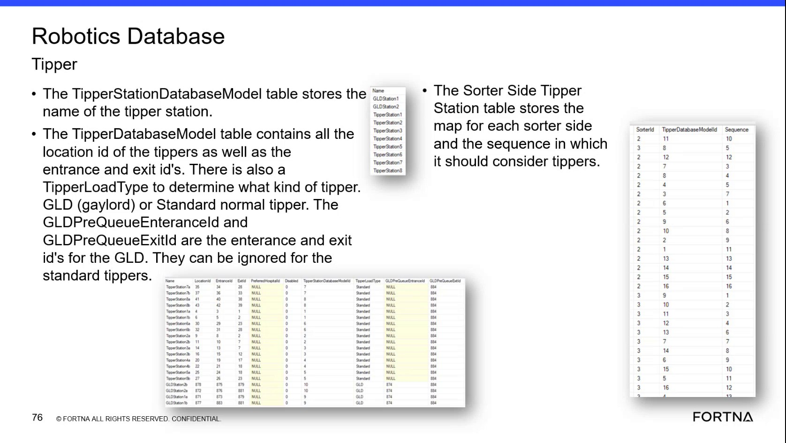

# Check Charger and Tote-Stand Mapping in SSMS / Helix DB

## Runbook Header

| Field | Value |
| --- | --- |
| Procedure ID | `proc_check_charger_and_tote_stand_mapping_in_ssms_helix_db_v1` |
| Title | Check Charger and Tote-Stand Mapping in SSMS / Helix DB |
| Procedure Type | `diagnostic` |
| Primary Role | `L2_support` |
| Supporting Roles | None |
| Support Safe | Yes |
| Capability Tags | `agv_charging_state` |
| Access Surface | `wcs_sql` |
| Audience Roles | `L2_support` |
| Failure Pattern Tags | `mapping_abnormal` |
| Validation Status | `needs_sme_review` |
| Merge Status | `source_finalized` |

## Summary

Use the WCS / Helix DB (SSMS) to inspect a charging-location record and verify that the individual charger is mapped to the expected station, tote stand, and charging area, with the disabled status appropriate for operation.

## When To Use

Use this WCS / Helix DB (SSMS) diagnostic when investigating whether a charger is correctly configured for its station, tote stand, and charging area, or whether its disabled status explains an observed charging or mapping issue.

## Do Not Use For

* Do not use this read-only diagnostic to edit charger mappings or change the disabled status.
* Do not use this procedure to reassign a charger or perform charger recovery actions.

## Safety And Operational Notes

* This procedure is a read-only inspection in the WCS / Helix DB (SSMS). Do not edit charger mappings or disabled status as part of this procedure.

## Access Or Tools Needed

* WCS / Helix DB (SSMS)
* Charging location database model table

## Related Operational Context

* ctx_training_video_charging_database_models_v1
* ctx_training_video_charging_location_mapping_v1

## Visual References

*Charging database model reference showing charging areas, individual chargers, stations, tote stands, and disabled status.*

## Procedure Steps

### Step 1 — Open the charging-location model in WCS / Helix DB (SSMS)

**Responsible role:** L2_support

**Instruction:**
Open the WCS / Helix DB (SSMS) and locate the charging location database model table. Use the charging-location model rather than the separate charging-area or charging-threshold model when inspecting an individual charger.

**Expected result:**
The charging-location database model is available for inspection and provides the record set used to identify individual chargers and their associated station, tote stand, charging area, and disabled status.

**Stop or Escalate If:**

* Escalate if the charging-location database model cannot be located or accessed.

---

### Step 2 — Inspect the charger mapping record in WCS / Helix DB (SSMS)

**Responsible role:** L2_support

**Instruction:**
In the WCS / Helix DB (SSMS) charging-location model, find the record for the charger being investigated. Inspect the charger or station identifier, associated tote stand, charging-area association, and disabled field.

**Expected result:**
The investigated charger has a present record with an identifiable charger or station value, an associated tote stand, a charging-area association, and a visible disabled status.

**Stop or Escalate If:**

* Escalate if the charger row is missing.
* Escalate if a station, tote stand, or charging-area association is absent or incorrect.
* Escalate if the disabled field is unexpectedly set.

---

### Step 3 — Confirm the charger mapping is complete and enabled in WCS / Helix DB (SSMS)

**Responsible role:** L2_support

**Instruction:**
In the WCS / Helix DB (SSMS) record, confirm that the charger has a station and tote-stand mapping, belongs to a charging area, and is not unexpectedly disabled.

**Expected result:**
The relevant charging-location row is present with an individual charger, station, tote-stand association, charging-area association, and disabled status. The charger expected to serve the area is mapped completely and is enabled.

**Stop or Escalate If:**

* Stop the diagnostic and escalate to engineering if the mapping is incomplete or incorrect.
* Stop the diagnostic and escalate if the charger is unexpectedly disabled.
* Do not edit the mapping or disabled status from this procedure.

---

## Success Criteria

* The investigated charger has a present charging-location record in the WCS / Helix DB (SSMS).
* The record identifies the expected station, associated tote stand, and charging area.
* The charger is not unexpectedly disabled.
* No database mapping or disabled-status changes are made during the diagnostic.

## Failure Conditions

* The charger row is missing.
* The station mapping is absent or incorrect.
* The tote-stand association is absent or incorrect.
* The charging-area association is absent or incorrect.
* The charger is unexpectedly disabled.
* The charging-location model cannot be located or accessed in the WCS / Helix DB (SSMS).

## Escalation Guidance

* Escalate to engineering when the charger row is missing or when the station, tote stand, or charging-area association is absent or incorrect.
* Escalate when the charger is unexpectedly disabled.
* Do not change charger mappings or disabled status as part of this read-only diagnostic.

## Missing Details / Known Gaps

* The source does not provide the exact database schema, database name, table name, or column names for the charging-location model.
* The source does not provide a site-specific expected station, tote stand, charging area, or disabled-status value for a particular charger.
* The source does not define the exact SSMS navigation or query used to locate a charger record.
* The source describes charging-area and charging-location relationships but does not provide a recovery or correction procedure for incorrect mappings.

## Source Lineage

- Candidate IDs: candidate_training_video_charging_location_mapping_check
- Source ID: `training_video_day2`
- Source Type: `training_video`
