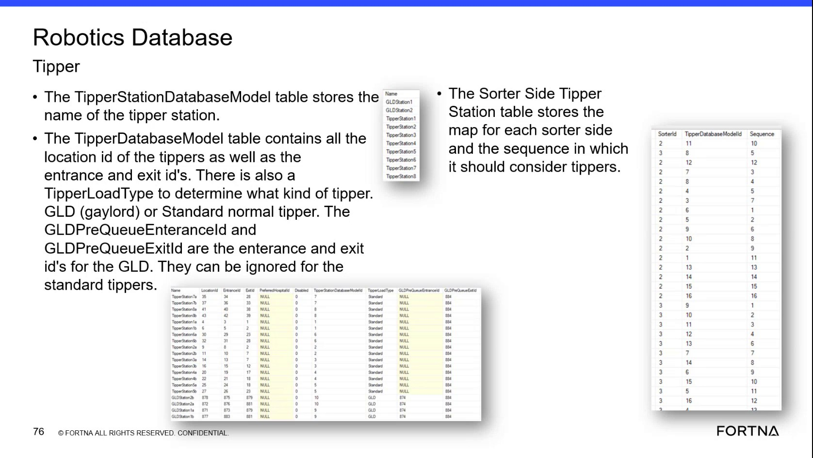

# Inspect Charging Threshold Values in SSMS / Helix DB

## Runbook Header

| Field | Value |
| --- | --- |
| Procedure ID | `proc_inspect_charging_threshold_values_in_ssms_helix_db_v1` |
| Title | Inspect Charging Threshold Values in SSMS / Helix DB |
| Procedure Type | `diagnostic` |
| Primary Role | `L2_support` |
| Supporting Roles | `L3_support` |
| Support Safe | Yes |
| Capability Tags | `agv_charging_state` |
| Access Surface | `wcs_sql` |
| Audience Roles | `L2_support`, `L3_support` |
| Failure Pattern Tags | `charging_abnormal` |
| Validation Status | `needs_sme_review` |
| Merge Status | `source_finalized` |

## Summary

Use the WCS / Helix DB (SSMS) to inspect the charging threshold database model and relate its configured values to the AGV charging state under investigation. The model stores values used by OptiSweep to determine whether an AGV needs charge, can be released from a charger, or needs emergency charge.

## When To Use

Use this WCS / Helix DB (SSMS) diagnostic when investigating an AGV charging state and determining whether the configured charging threshold records support the observed charge-required, charger-release, or emergency-charge behavior.

## Do Not Use For

* Do not use this read-only diagnostic to modify charging threshold values.
* Do not use this procedure to validate numeric healthy ranges; the source does not provide exact column names or numeric ranges.

## Safety And Operational Notes

* This is a read-only diagnostic. Do not alter charging threshold values.
* Escalate rather than changing configuration when records are missing, null, unreadable, or inconsistent with observed charging behavior.

## Access Or Tools Needed

* WCS / Helix DB (SSMS)
* Charging threshold database model table

## Related Operational Context

* ctx_training_video_charging_database_models_v1
* ctx_training_video_charging_threshold_reference_v1

## Visual References

*Robotics database frame describing the charging database model, charging location model, and charging threshold database model. Use it to identify the charging threshold model's purpose and its relationship to charging areas and chargers.*

## Procedure Steps

### Step 1 — Open the charging threshold model in WCS / Helix DB (SSMS)

**Responsible role:** L2_support

**Instruction:**
Open the WCS / Helix DB in SSMS and locate the charging threshold database model table. Distinguish it from the separate charging database model tables for charging areas and individual charging locations.

**Expected result:**
The charging threshold database model table is located in the WCS / Helix DB and is identifiable as the model containing charging decision variables.

**Stop or Escalate If:**

* Escalate to L3 support if the charging threshold model is missing or inaccessible in the WCS / Helix DB.

---

### Step 2 — Inspect the charging decision records

**Responsible role:** L2_support

**Instruction:**
Inspect the threshold records in the WCS / Helix DB (SSMS) and record the configured values associated with charge required, charger release, and emergency charge decisions. Do not edit the records.

**Expected result:**
The charging threshold records are present, readable, and contain values associated with charge-required, charger-release, and emergency-charge decisions.

**Stop or Escalate If:**

* Do not modify the threshold records.
* Escalate to L3 support or engineering if threshold records are missing, null, or unreadable.

---

### Step 3 — Compare threshold records with the AGV charging state

**Responsible role:** L2_support

**Instruction:**
Compare the relevant values in the WCS / Helix DB (SSMS) with the AGV charging state under investigation. Verify that the records are present and interpretable for the observed charge-required, charger-release, or emergency-charge behavior.

**Expected result:**
The threshold records can be related to the observed AGV charging state, or a specific missing, null, unreadable, or inconsistent record is identified for escalation.

**Stop or Escalate If:**

* Escalate to L2 support or engineering if the threshold values are inconsistent with the charging behavior being investigated.
* Escalate if the available records do not support interpretation of the observed charging state.

---

## Success Criteria

* The charging threshold database model is located in the WCS / Helix DB (SSMS).
* Records associated with charge required, charger release, and emergency charge are present and readable.
* The records provide an interpretable basis for the AGV charging state under investigation, or any inconsistency is clearly identified for escalation.
* No threshold values are modified.

## Failure Conditions

* The charging threshold model is missing or inaccessible.
* Threshold records are missing, null, unreadable, or otherwise uninterpretable.
* The available threshold values are inconsistent with the AGV charging behavior being investigated.
* The source does not provide exact column names or numeric healthy ranges, so numeric validation cannot be completed from this procedure alone.

## Escalation Guidance

* Escalate to L3 support or engineering when threshold records are missing, null, unreadable, or inconsistent with the observed charging behavior.
* Do not change threshold values as part of this diagnostic.

## Missing Details / Known Gaps

* The source does not provide exact charging threshold column names.
* The source does not provide numeric threshold values or healthy ranges.
* The packet does not identify a specific live AGV charging-state field or surface for the comparison; the observed state must be supplied by the investigation context.
* The source describes the charging threshold model but does not provide a complete SSMS navigation path or query.

## Source Lineage

- Candidate IDs: candidate_training_video_charging_threshold_db_check
- Source ID: `training_video_day2`
- Source Type: `training_video`
