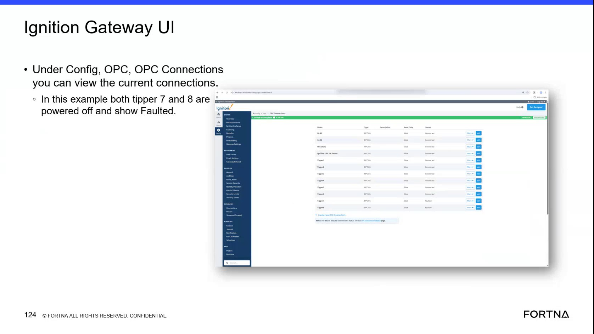

# Check Ignition Gateway OPC Connection Status

## Runbook Header

| Field | Value |
| --- | --- |
| Procedure ID | `proc_check_ignition_gateway_opc_connection_status_v1` |
| Title | Check Ignition Gateway OPC Connection Status |
| Procedure Type | `diagnostic` |
| Primary Role | `L2_support` |
| Supporting Roles | None |
| Support Safe | Yes |
| Capability Tags | `opc_connection_or_tipper_heartbeat`, `gateway_health` |
| Access Surface | `ignition_gateway` |
| Audience Roles | `L2_support`, `L3_support` |
| Failure Pattern Tags | `opc_connection_faulted`, `gateway_unhealthy` |
| Validation Status | `needs_sme_review` |
| Merge Status | `source_finalized` |

## Summary

Use the Ignition gateway web UI to inspect live OPC connection states for tipper tags and compare each displayed status with the associated tipper equipment state.

## When To Use

Use this diagnostic when support needs to verify live OPC connection states serving tipper tags in the Ignition Gateway web UI, especially when a tipper state or tag connection is suspected to be unavailable.

## Do Not Use For

* Do not use this procedure to restart, repair, or recover an OPC connection; the source provides inspection only.
* Do not treat a Faulted status as unexpected when the associated tipper is confirmed powered off.

## Safety And Operational Notes

* This is a read-only diagnostic procedure based on the displayed Ignition Gateway OPC connection state.
* Do not infer that a Faulted connection requires recovery until the associated tipper power state has been confirmed.

## Access Or Tools Needed

* Ignition gateway
* Ignition Gateway web view
* Ignition Gateway Config > OPC > OPC Connections

## Related Operational Context

* ctx_training_video_ignition_gateway_opc_connections_v1
* ctx_training_video_tipper_opc_faulted_example_v1

## Visual References

*Ignition Gateway Config > OPC > OPC Connections view showing current connection entries and displayed statuses; the example includes Tipper 7 and Tipper 8 as powered off and Faulted.*

## Procedure Steps

### Step 1 — Open the Ignition Gateway OPC Connections page

**Responsible role:** L2_support

**Instruction:**
In the Ignition Gateway web view, navigate to Config > OPC > OPC Connections.

**Expected result:**
The Ignition Gateway OPC Connections page displays the current OPC connection list and status values.

**Stop or Escalate If:**

* Escalate if the Ignition Gateway OPC Connections page cannot be accessed or does not show current connection states.

---

### Step 2 — Inspect the relevant tipper connection statuses

**Responsible role:** L2_support

**Instruction:**
On the Ignition Gateway Config > OPC > OPC Connections page, locate the relevant tipper OPC connection entries and observe the displayed status for each entry, such as Connected or Faulted.

**Expected result:**
The relevant tipper connection entries are visible and each has a displayed current status.

**Stop or Escalate If:**

* Escalate when a relevant tipper connection remains Faulted while the associated tipper should be powered and available.

---

### Step 3 — Compare the OPC status with the tipper equipment state

**Responsible role:** L2_support

**Instruction:**
Compare each live status shown in Ignition Gateway Config > OPC > OPC Connections with the associated tipper equipment state. Treat a Faulted status as consistent with the documented example when the corresponding tipper is confirmed powered off.

**Expected result:**
The displayed OPC status is interpreted together with the associated tipper state: Connected is shown for an available connection, while Faulted may be expected when the associated tipper is powered off.

**Stop or Escalate If:**

* Do not escalate solely because a tipper connection is Faulted when the corresponding tipper is confirmed powered off.
* Escalate when a relevant tipper connection remains Faulted while the associated tipper should be powered and available.

---

## Success Criteria

* The Ignition Gateway Config > OPC > OPC Connections page is opened successfully.
* The relevant tipper OPC connection entries and their displayed statuses are identified.
* The displayed connection statuses are compared with the associated tipper equipment states.
* Any Faulted status is classified as expected for a powered-off tipper or escalated when the tipper should be powered and available.

## Failure Conditions

* The Ignition Gateway OPC Connections page cannot be accessed or does not show current connection states.
* A relevant tipper OPC connection displays Faulted while the associated tipper should be powered and available.

## Escalation Guidance

* Escalate to L3 support when a relevant tipper OPC connection remains Faulted while the associated tipper should be powered and available.
* Do not escalate the Faulted display solely on the basis of the status when the corresponding tipper is confirmed powered off.
* This runbook does not define OPC connection restart or recovery actions.

## Missing Details / Known Gaps

* The source does not provide the Ignition Gateway URL or authentication procedure.
* The source does not define the exact naming convention for the relevant tipper OPC connection entries.
* The source does not provide OPC connection restart, repair, or recovery instructions.
* The source does not define a further escalation destination beyond escalation when a relevant connection remains Faulted while the tipper should be powered and available.

## Source Lineage

- Candidate IDs: candidate_training_video_check_ignition_opc_connection_status
- Source ID: `training_video_day2`
- Source Type: `training_video`
