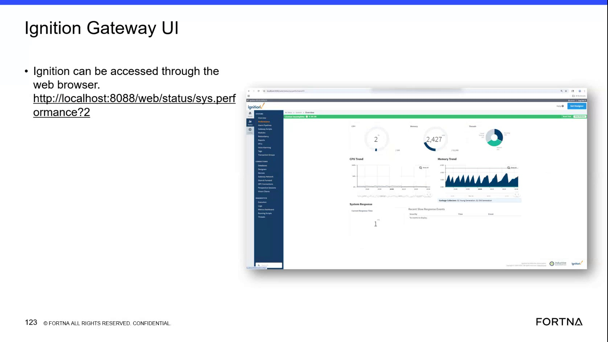

# Check Ignition Gateway system performance status via Ignition Gateway UI

## Runbook Header

| Field | Value |
| --- | --- |
| Procedure ID | `proc_check_ignition_gateway_sys_perf_v1` |
| Title | Check Ignition Gateway system performance status via Ignition Gateway UI |
| Procedure Type | `diagnostic` |
| Primary Role | `L1_support` |
| Supporting Roles | None |
| Support Safe | Yes |
| Capability Tags | `gateway_health` |
| Access Surface | `ignition_gateway` |
| Audience Roles | `L1_support` |
| Failure Pattern Tags | `gateway_unhealthy` |
| Validation Status | `needs_sme_review` |
| Merge Status | `source_finalized` |

## Summary

Use the Ignition Gateway web UI to open the system performance status page for sys.perf and confirm the page loads and displays system performance status content.

## When To Use

When you need to verify that the Ignition Gateway system performance status page is reachable and that it shows sys.perf system performance status content.

## Access Or Tools Needed

* Web browser access to the Ignition Gateway host
* Ignition Gateway UI (ignition_gateway)

## Related Operational Context

* ctx_training_video_ignition_gateway_ui_v1
* ctx_training_video_sys_perf_status_url_v1

## Visual References

*Ignition Gateway UI frame showing the sys.perf status URL path: http://localhost:8088/web/status/sys.perf*

## Procedure Steps

### Step 1 — Open the Ignition Gateway sys.perf system performance status page

**Responsible role:** L1_support

**Instruction:**
Using a web browser, navigate to http://localhost:8088/web/status/sys.perf.

**Expected result:**
The browser loads the Ignition Gateway sys.perf status page (i.e., not a browser error page).

**Stop or Escalate If:**

* The sys.perf page is unreachable or fails to load (e.g., connection refused/timeout).

---

### Step 2 — Confirm the loaded page corresponds to sys.perf and is not blank

**Responsible role:** L1_support

**Instruction:**
After the page loads, confirm the content corresponds to the sys.perf system performance status page and that the page shows system performance status information (not blank/failed content).

**Expected result:**
The sys.perf page displays system performance status information (visible performance/status content).

**Stop or Escalate If:**

* The sys.perf page loads but shows no system performance/status content.

---

## Success Criteria

* http://localhost:8088/web/status/sys.perf loads successfully in the browser
* The sys.perf page displays system performance status information (not blank/failed content)

## Failure Conditions

* sys.perf page is unreachable or fails to load (connection refused/timeout)
* sys.perf page loads but system performance/status content is missing/blank

## Escalation Guidance

* If the sys.perf page is unreachable or fails to load, stop and escalate for Ignition gateway health investigation.
* If the sys.perf page loads but shows no system performance/status content, stop and escalate.

## Missing Details / Known Gaps

* The source does not provide specific field names/values or exact visual indicators on the sys.perf page beyond that it is a system performance status/performance page; success is therefore limited to page load and presence of visible performance/status content.

## Source Lineage

- Candidate IDs: candidate_training_video_d2_ignition_gateway_sys_perf_check
- Source ID: `training_video_day2`
- Source Type: `training_video`
