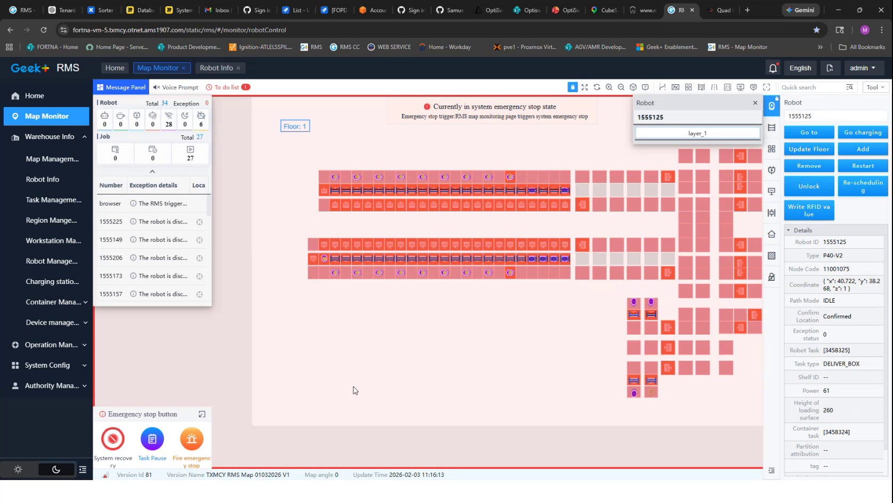

# Check RMS Map Monitor Emergency Stop Trigger and Emergency Stop Button State

## Runbook Header

| Field | Value |
| --- | --- |
| Procedure ID | `proc_check_rms_map_monitor_emergency_stop_trigger_button_state_v1` |
| Title | Check RMS Map Monitor Emergency Stop Trigger and Emergency Stop Button State |
| Procedure Type | `diagnostic` |
| Primary Role | `L1_support` |
| Supporting Roles | None |
| Support Safe | Yes |
| Capability Tags | `e_stop_or_safety_stop` |
| Access Surface | `rms_ui` |
| Audience Roles | `L1_support` |
| Failure Pattern Tags | None |
| Validation Status | `needs_sme_review` |
| Merge Status | `source_finalized` |

## Summary

Use the RMS / fleet status UI Map Monitor (robotControl) view to confirm whether the UI shows the 'Emergency stop trigger' section and the 'Emergency stop button' control for the current robot/fleet view.

## When To Use

When support needs to verify whether the RMS Map Monitor (robotControl) page is presenting the emergency-stop-trigger-related UI elements ('Emergency stop trigger' and 'Emergency stop button') for the current view.

## Safety And Operational Notes

* Do not perform physical E-stop actions from this procedure; this runbook only verifies UI element presence/visibility on RMS.

## Access Or Tools Needed

* RMS / fleet status UI (rms_ui) web access

## Related Operational Context

* ctx_training_video_rms_map_emergency_stop_trigger_v1

## Visual References

*RMS Map Monitor (robotControl) frame showing the 'Emergency stop trigger' text/section and the 'Emergency stop button' control.*

## Procedure Steps

### Step 1 — Open RMS Map Monitor (robotControl) view

**Responsible role:** L1_support

**Instruction:**
In the RMS / fleet status UI (rms_ui), navigate to the Map Monitor / robotControl view. The captured frame indicates the URL pattern: /static/rms/#/monitor/robotControl.

**Expected result:**
The RMS Map Monitor / robotControl page loads and displays the Map Monitor UI.

**Stop or Escalate If:**

* If the RMS Map Monitor page does not load, escalate to deeper RMS/WCS/API checks (or site support) to determine whether the UI is unreachable or the system is not publishing the expected state.

---

### Step 2 — Verify 'Emergency stop trigger' section is present and what it shows

**Responsible role:** L1_support

**Instruction:**
On the RMS Map Monitor / robotControl page, locate the UI section labeled 'Emergency stop trigger' and confirm what is currently displayed (present/active vs missing/unreadable).

**Expected result:**
The RMS Map Monitor / robotControl page displays the 'Emergency stop trigger' section.

**Stop or Escalate If:**

* If the emergency stop trigger element is missing/unreadable, escalate to deeper RMS/WCS/API checks (or site support) to determine whether the UI is unreachable or the system is not publishing the expected state.

---

### Step 3 — Verify 'Emergency stop button' control state/visibility

**Responsible role:** L1_support

**Instruction:**
On the RMS Map Monitor / robotControl page, locate the 'Emergency stop button' control and confirm its current state/visibility (e.g., whether the button is shown/enabled as displayed on the page).

**Expected result:**
The RMS Map Monitor / robotControl page displays the 'Emergency stop button' control.

**Stop or Escalate If:**

* If the emergency stop button element is missing/unreadable, escalate to deeper RMS/WCS/API checks (or site support) to determine whether the UI is unreachable or the system is not publishing the expected state.

---

### Step 4 — Record observed UI state for escalation/next diagnostics

**Responsible role:** L1_support

**Instruction:**
If the RMS page shows both the 'Emergency stop trigger' section and the 'Emergency stop button' area, record the observed UI state (presence/visibility and what is displayed) for escalation/next diagnostics.

**Expected result:**
You have a recorded observation that both emergency-stop-related UI elements are present/visible (or you have recorded that one/both are missing/unreadable).

**Stop or Escalate If:**

* If the RMS page does not load or the emergency stop trigger/button elements are missing/unreadable, escalate to deeper RMS/WCS/API checks (or site support) to determine whether the UI is unreachable or the system is not publishing the expected state.

---

## Success Criteria

* RMS Map Monitor / robotControl page displays the 'Emergency stop trigger' section.
* RMS Map Monitor / robotControl page displays the 'Emergency stop button' control.

## Failure Conditions

* RMS Map Monitor / robotControl page does not load.
* The 'Emergency stop trigger' section is missing or unreadable.
* The 'Emergency stop button' control is missing or unreadable.

## Escalation Guidance

* If the RMS Map Monitor page does not load or the emergency stop trigger/button elements are missing/unreadable, escalate to deeper RMS/WCS/API checks (or site support) to determine whether the UI is unreachable or the system is not publishing the expected state.

## Missing Details / Known Gaps

* The candidate does not provide explicit instructions for how to select a specific robot/fleet view within RMS before checking the emergency stop trigger/button state; it only provides the robotControl Map Monitor URL pattern and the presence of the UI elements in the captured frame.

## Source Lineage

- Candidate IDs: candidate_training_video_d2_rms_map_emergency_stop_trigger_check
- Source ID: `training_video_day2`
- Source Type: `training_video`
