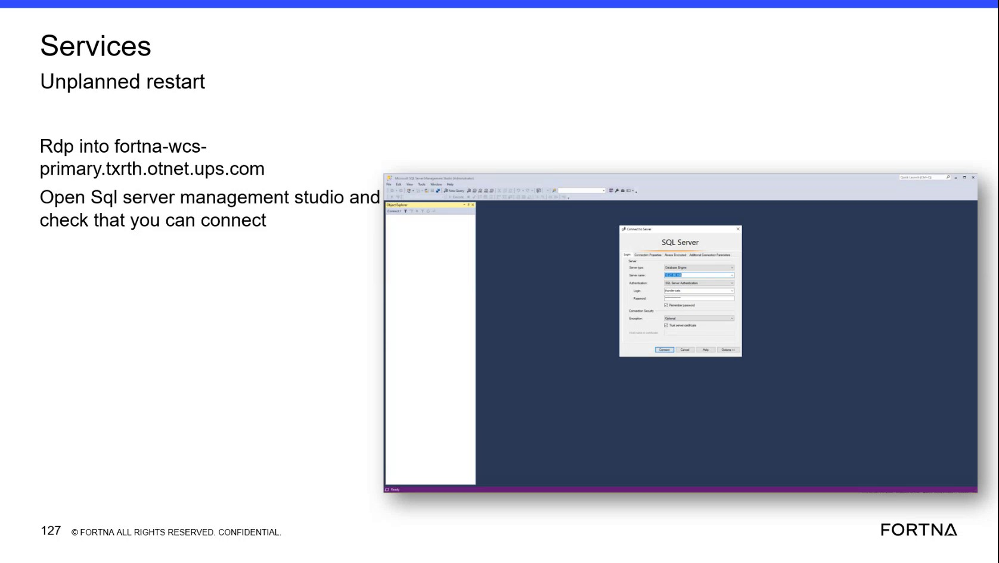

# Verify SQL Server Management Studio connectivity after an unplanned restart on the FORTNA WCS primary host

## Runbook Header

| Field | Value |
| --- | --- |
| Procedure ID | `proc_verify_ssms_connectivity_after_unplanned_restart_fortna_wcs_primary_v1` |
| Title | Verify SQL Server Management Studio connectivity after an unplanned restart on the FORTNA WCS primary host |
| Procedure Type | `diagnostic` |
| Primary Role | `L2_support` |
| Supporting Roles | None |
| Support Safe | Yes |
| Capability Tags | `wcs_service_health` |
| Access Surface | `wcs_sql` |
| Audience Roles | `L2_support` |
| Failure Pattern Tags | `api_unresponsive` |
| Validation Status | `needs_sme_review` |
| Merge Status | `source_finalized` |

## Summary

After an unplanned restart on the FORTNA WCS primary host, use RDP to open SQL Server Management Studio (SSMS) and confirm that you can successfully connect to the SQL Server on the host named fortna-wcs-primary.txrth.otnet.ups.com.

## When To Use

Use this as a basic validation step after an unplanned restart on the FORTNA WCS primary host to confirm SSMS connectivity before deeper service/DB connectivity troubleshooting.

## Access Or Tools Needed

* RDP access to fortna-wcs-primary.txrth.otnet.ups.com
* SQL Server Management Studio (SSMS)

## Related Operational Context

* ctx_training_video_services_unplanned_restart_reference_v1
* ctx_training_video_fortna_wcs_primary_host_reference_v1
* ctx_training_video_sql_server_management_studio_connectivity_check_v1

## Visual References

*Frame showing: 'Rdp into fortna-wcs-primary.txrth.otnet.ups.com', 'Open Sql server management studio', and 'check that you can connect'.*

## Procedure Steps

### Step 1 — RDP to the FORTNA WCS primary host named in the check

**Responsible role:** L2_support

**Instruction:**
Use RDP to connect to the host named fortna-wcs-primary.txrth.otnet.ups.com.

**Expected result:**
You are connected to the host fortna-wcs-primary.txrth.otnet.ups.com and can launch applications on it.

**Stop or Escalate If:**

* If you cannot reach the host via RDP, stop and escalate for host/network access troubleshooting.

---

### Step 2 — Open SQL Server Management Studio (SSMS) on the connected host

**Responsible role:** L2_support

**Instruction:**
On the connected host, open SQL Server Management Studio (SSMS).

**Expected result:**
SSMS launches successfully and is ready for a connection attempt.

**Stop or Escalate If:**

* If SSMS cannot be opened, stop and escalate for application/host troubleshooting.

---

### Step 3 — Attempt the SSMS connectivity check and confirm success

**Responsible role:** L2_support

**Instruction:**
In SSMS, perform the connectivity check by verifying that you can connect (the connection attempt succeeds rather than failing).

**Expected result:**
The SSMS connection attempt succeeds (i.e., you are able to establish a connection rather than receiving a connection failure).

**Stop or Escalate If:**

* If the connection cannot be established, stop and escalate for further service/DB connectivity troubleshooting (do not proceed with dependent checks).

---

### Step 4 — Stop and escalate if SSMS connectivity fails

**Responsible role:** L2_support

**Instruction:**
If SSMS cannot connect, stop and escalate for further service/DB connectivity troubleshooting; do not proceed with dependent checks.

**Expected result:**
A failure outcome is recognized and escalation is initiated rather than continuing with downstream validation steps.

**Stop or Escalate If:**

* SSMS connection attempt fails.

---

## Success Criteria

* SSMS connectivity check succeeds: the SSMS connection attempt to the SQL Server on fortna-wcs-primary.txrth.otnet.ups.com succeeds.

## Failure Conditions

* SSMS connection attempt fails (cannot establish a connection).

## Escalation Guidance

* If SSMS cannot connect, stop and escalate for further service/DB connectivity troubleshooting (do not proceed with dependent checks).

## Missing Details / Known Gaps

* The packet does not specify the SSMS server/instance name, authentication method, or exact UI fields to use for the connection attempt; the procedure only requires confirming that the connection attempt succeeds vs fails.

## Source Lineage

- Candidate IDs: candidate_training_video_d2_services_unplanned_restart_sql_connectivity_check
- Source ID: `training_video_day2`
- Source Type: `training_video`
