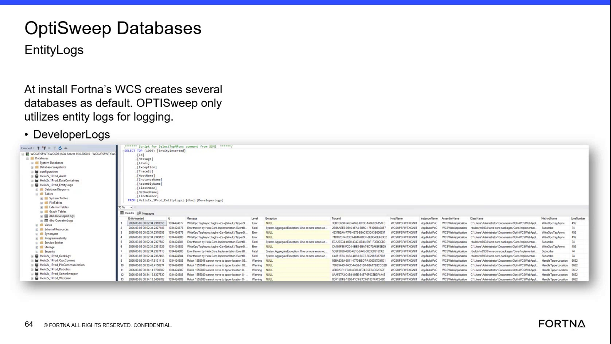

# Filter WCS Database Logs for Errors and Fatals

## Runbook Header

| Field | Value |
| --- | --- |
| Procedure ID | `proc_filter_wcs_database_logs_for_errors_and_fatals_v1` |
| Title | Filter WCS Database Logs for Errors and Fatals |
| Procedure Type | `diagnostic` |
| Primary Role | `L2_support` |
| Supporting Roles | None |
| Support Safe | Yes |
| Capability Tags | `wcs_system_faults` |
| Access Surface | `wcs_sql` |
| Audience Roles | `L2_support`, `L3_support` |
| Failure Pattern Tags | `system_fault` |
| Validation Status | `needs_sme_review` |
| Merge Status | `source_finalized` |

## Summary

Use the WCS / Helix DB (SSMS) read-only database logs to retrieve recent records and isolate records with Error or Fatal severity for support investigation. The logs can provide timestamps, messages, exception details, trace information, host and instance information, and source code location fields.

## When To Use

Use this diagnostic when support needs to inspect recent WCS / Helix DB log records for Error or Fatal severity during investigation of a system issue.

## Do Not Use For

* Do not use this procedure to modify database records.
* Do not use this procedure to run unsupported mutating scripts.
* Do not use this procedure as a resolution procedure for an identified error or fatal; escalate when diagnosis or remediation is not covered.

## Safety And Operational Notes

* This is a read-only diagnostic procedure.
* Do not modify database records or execute unsupported mutating scripts.
* Follow the support handoff when an Error or Fatal requires diagnosis or resolution steps not included here.

## Access Or Tools Needed

* WCS / Helix DB (SSMS)
* Read access to the relevant OptiSweep database logs
* SSMS log retrieval and filtering functions

## Related Operational Context

* ctx_training_video_database_logs_v1
* ctx_training_video_support_runbooks_v1

## Visual References

*SSMS example showing the WCS EntityLogs database, dbo.DeveloperLogs and dbo.OperatorLogs, a top-record query result, and visible log fields including EntityInserted, Message, Level, Exception, TraceId, HostName, InstanceName, AssemblyName, ClassName, MethodName, and LineNumber.*

## Procedure Steps

### Step 1 — Open the relevant WCS / Helix database in SSMS

**Responsible role:** L2_support

**Instruction:**
In WCS / Helix DB (SSMS), select the relevant OptiSweep database that contains the database logs. The source identifies the WCS EntityLogs database as the logging database; the example shows a Helix2x_1Prod_EntityLogs database with log tables.

**Expected result:**
The relevant WCS / Helix database is open in SSMS and its log records or log tables are available for inspection.

**Stop or Escalate If:**

* The relevant database logs cannot be opened in SSMS.
* Access requires permissions not available to the assigned support role.

---

### Step 2 — Retrieve the top 100 log records

**Responsible role:** L2_support

**Instruction:**
In the WCS / Helix DB (SSMS), open the available database log records or use the available log query or table action to retrieve the top 100 records. Use the read-only log retrieval action; do not run an unsupported write operation.

**Expected result:**
SSMS displays a recent set of up to 100 database log records.

**Stop or Escalate If:**

* The database log records cannot be queried or retrieved in SSMS.
* The available action would modify records or requires unsupported SQL syntax.

---

### Step 3 — Filter for Error and Fatal severity

**Responsible role:** L2_support

**Instruction:**
In the WCS / Helix DB (SSMS) result set, filter the displayed log records for the Error and Fatal severity values in the Level field.

**Expected result:**
The SSMS result set is narrowed to records classified as Error or Fatal, when such records are present.

**Stop or Escalate If:**

* The returned log records cannot be filtered in SSMS.
* An Error or Fatal record is present and requires diagnosis or resolution steps not covered by this runbook.

---

### Step 4 — Review the filtered log details

**Responsible role:** L2_support

**Instruction:**
Review the filtered Error and Fatal rows in the WCS / Helix DB (SSMS). Inspect the displayed timestamp field EntityInserted, Message, Level, Exception, TraceId, HostName, InstanceName, AssemblyName, ClassName, MethodName, and LineNumber fields when present.

**Expected result:**
The filtered records provide visible timestamps, severity, messages, and available exception and affected-system information for the support investigation.

**Stop or Escalate If:**

* A filtered Error or Fatal requires diagnosis or resolution steps not available in this runbook.
* The displayed records do not contain sufficient information for the support handoff.

---

## Success Criteria

* The relevant WCS / Helix database logs open in SSMS.
* A recent set of up to 100 log records is displayed.
* The returned records can be filtered for Error and Fatal severity.
* Filtered records expose visible timestamps, messages, and available affected-system or exception details for support investigation.

## Failure Conditions

* The relevant database logs cannot be opened in SSMS.
* The top-100 log retrieval cannot be performed.
* The returned records cannot be filtered for Error or Fatal severity.
* An Error or Fatal is present but the available information does not support further diagnosis.
* The required remediation would involve unsupported database modifications or scripts.

## Escalation Guidance

* Escalate through the support handoff when a filtered Error or Fatal requires diagnosis or resolution steps not covered by this procedure.
* Escalate when the WCS / Helix database logs cannot be opened, queried, or filtered in SSMS.
* Provide the visible timestamp, severity, message, exception, trace, host, instance, and source-location fields available in the filtered record.

## Missing Details / Known Gaps

* The exact production database name may vary by site; the source provides Helix2x_1Prod_EntityLogs as an example but does not establish it as the required database name for every deployment.
* The exact table, view, query syntax, and SSMS navigation sequence for retrieving the top 100 records are not fully specified.
* The source does not define Error or Fatal remediation steps.
* The source does not specify a required log-retention period or a precise time-range filter.

## Source Lineage

- Candidate IDs: candidate_training_video_database_log_error_filter
- Source ID: `training_video_day2`
- Source Type: `training_video`
