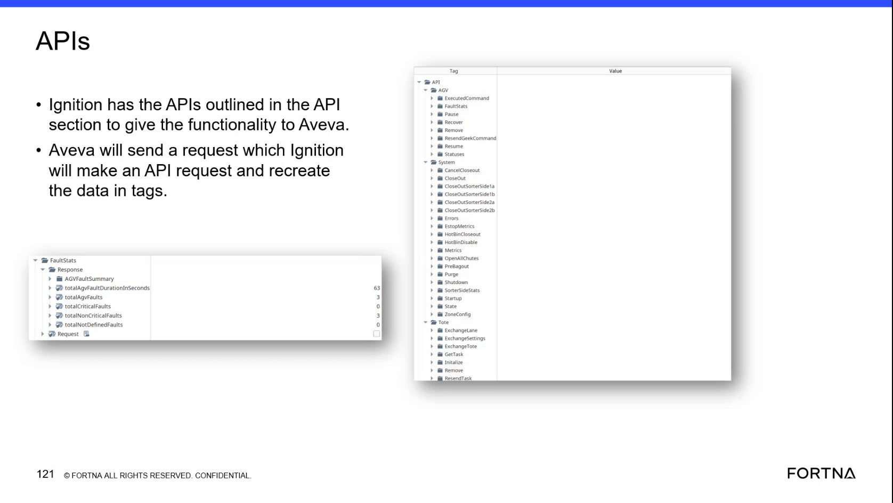

# Check OptiSweep API Status and Fault Responses in Apidog

## Runbook Header

| Field | Value |
| --- | --- |
| Procedure ID | `proc_check_optisweep_api_status_and_fault_responses_in_apidog_v1` |
| Title | Check OptiSweep API Status and Fault Responses in Apidog |
| Procedure Type | `diagnostic` |
| Primary Role | `L2_support` |
| Supporting Roles | None |
| Support Safe | Yes |
| Capability Tags | `wcs_api_responsiveness`, `agv_active_errors` |
| Access Surface | `apidog`, `wcs_api` |
| Audience Roles | `L2_support`, `L3_support` |
| Failure Pattern Tags | `api_unresponsive` |
| Validation Status | `needs_sme_review` |
| Merge Status | `source_finalized` |

## Summary

Use Apidog on a primary server to call documented read-oriented OptiSweep / WCS API requests and verify that the API returns an observable response. Use the returned system-state or AGV fault-summary fields to support troubleshooting. Apidog calls the same API functionality that feeds Ignition and AVEVA.

## When To Use

Use this diagnostic when support needs to verify that the locally hosted OptiSweep / WCS API on a primary server returns system-state or AGV fault data, or when an API response needs to be compared with the live operating condition.

## Do Not Use For

* Do not use this procedure to infer detailed module-to-module request flow, downstream request stacking, or internal request tracing; the source states that this level of tracing is not available.
* Do not create new request parameters or build a separate local API project.

## Safety And Operational Notes

* Use a documented read-oriented request such as Statuses, FaultStats, or System State for this diagnostic.
* Do not submit operational requests such as startup, shutdown, pause, recovery, closeout, purge, or configuration updates as part of the read-only check unless a separately approved procedure directs that action.

## Access Or Tools Needed

* Apidog / WCS API client on a primary server
* OptiSweep / WCS API
* Configured request parameters installed with the shared API project
* API guide

## Related Operational Context

* ctx_training_video_primary_server_api_hosting_v1
* ctx_training_video_ignition_aveva_api_integration_v1
* ctx_training_video_api_request_response_tracing_v1

## Visual References

*Apidog API overview on a primary server showing system, AGV, and tote request categories, including GetAgvFaultStats, System State, and Get Agv Statuses.*

*Apidog API list showing Statuses, FaultStats, Response, and the named AGV fault-summary fields.*

## Procedure Steps

### Step 1 — Open the Apidog project on the primary server

**Responsible role:** L2_support

**Instruction:**
On a primary server, open Apidog / WCS API client and open the shared OptiSweep / WCS API project. Use the project and request parameters already installed on the primary server.

**Expected result:**
The shared project opens and displays documented OptiSweep / WCS API request categories and requests.

**Stop or Escalate If:**

* Stop and escalate if the Apidog project or configured API requests are not available on the primary server.

---

### Step 2 — Select a documented read-oriented API request

**Responsible role:** L2_support

**Instruction:**
In Apidog / WCS API client, select a documented read-oriented request such as Statuses, FaultStats, GetAgvFaultStats, Get Agv Statuses, or System State. Use the configured request parameters already present in the project; do not create new request parameters.

**Expected result:**
A documented read-oriented OptiSweep / WCS API request is selected with its configured parameters available for submission.

**Stop or Escalate If:**

* Stop and escalate if the required documented request or its configured parameters are unavailable.

---

### Step 3 — Submit the request and inspect the API response

**Responsible role:** L2_support

**Instruction:**
Submit the selected request in Apidog / WCS API client and inspect the returned response. Record whether the response contains system-state data, fault-summary data, or an API or system error.

**Expected result:**
Apidog returns a response for the selected OptiSweep / WCS API request.

**Stop or Escalate If:**

* Stop and escalate if Apidog cannot reach the API.
* Stop and escalate if no response is returned.
* Stop and escalate if the response indicates an API or system error.

---

### Step 4 — Inspect AGV fault-summary fields

**Responsible role:** L2_support

**Instruction:**
When the selected request returns a FaultStats or GetAgvFaultStats response, inspect the response for totalAgvFaultDurationInSeconds, totalAgvFaults, totalCriticalFaults, totalNonCriticalFaults, and totalNotDefinedFaults.

**Expected result:**
The fault response exposes the named AGV fault-summary fields or clearly indicates that the requested fault data is unavailable.

**Stop or Escalate If:**

* Stop and escalate if the FaultStats response is unavailable or indicates an API or system error.
* Escalate if the named fault-summary fields are absent from a response expected to provide fault statistics.

---

### Step 5 — Interpret the returned system state

**Responsible role:** L2_support

**Instruction:**
For a System State or status response, inspect and record the returned system state, then compare it with the live operating condition. If a startup request is encountered while the system is already running, interpret the returned response stating that the system is not in the running state as the API's state response rather than as module-to-module trace information.

**Expected result:**
The returned system state is observable in Apidog and can be compared with the live operating condition.

**Stop or Escalate If:**

* Stop and escalate if the system-state response indicates an API or system error.
* Escalate if the returned system state cannot be reconciled with the live operating condition.
* Do not attempt to diagnose internal module flow from this response; detailed request tracing is not available.

---

## Success Criteria

* Apidog opens the shared OptiSweep / WCS API project on a primary server.
* A documented read-oriented request is submitted using configured request parameters.
* The OptiSweep / WCS API returns an observable response.
* The response provides readable system-state data or the named AGV fault-summary fields.
* The returned state or fault data can be used for live troubleshooting without relying on unavailable module-to-module request tracing.

## Failure Conditions

* Apidog cannot reach the OptiSweep / WCS API.
* No response is returned.
* The API response indicates an API or system error.
* Expected system-state or named fault-summary fields are absent.
* The returned state cannot be reconciled with the live operating condition.

## Escalation Guidance

* Escalate to the appropriate L2/L3 support path when the API is unreachable, produces no response, or returns an API or system error.
* Include the selected request and the observable response or error details in the escalation.
* Do not claim a specific downstream module failure from this check because detailed module-to-module request tracing and request stacking are not available.

## Missing Details / Known Gaps

* The packet does not provide the exact API endpoint URL, authentication method, or request parameter values.
* The packet does not define numeric healthy or failure thresholds for the returned fault-summary fields.
* The packet does not provide a complete response schema or specific API error-code interpretation.
* Detailed module-to-module request-flow tracing and request stacking are explicitly unavailable in the source.
* The packet does not provide a production-impact assessment for submitting requests beyond the read-oriented diagnostic requests.

## Source Lineage

- Candidate IDs: candidate_training_video_day2_apidog_check_optisweep_api_status_and_fault_response
- Source ID: `training_video_day2`
- Source Type: `training_video`
