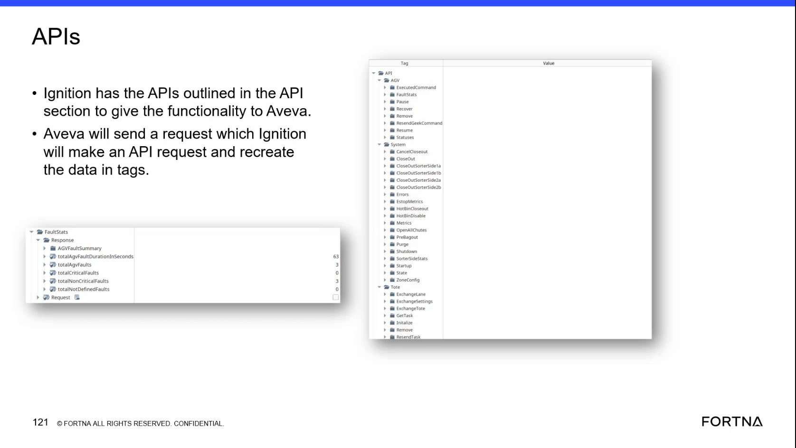

# Cancel Active Closeout Requests After Manual Bag Out Using the OptiSweep API

## Runbook Header

| Field | Value |
| --- | --- |
| Procedure ID | `proc_cancel_active_closeout_requests_after_manual_bag_out_v1` |
| Title | Cancel Active Closeout Requests After Manual Bag Out Using the OptiSweep API |
| Procedure Type | `recovery` |
| Primary Role | `L2_support` |
| Supporting Roles | `L3_support` |
| Support Safe | Yes |
| Capability Tags | `bag_out_or_closeout_state` |
| Access Surface | `apidog`, `wcs_api` |
| Audience Roles | `L2_support`, `L3_support` |
| Failure Pattern Tags | `bag_out_stuck` |
| Validation Status | `needs_sme_review` |
| Merge Status | `source_finalized` |

## Summary

Use Apidog on a primary server to submit the configured OptiSweep CancelCloseout request after a manual bag out, once the system is running again. Verify the returned response and confirm that the associated active exchange or closeout requests are no longer active.

## When To Use

Use the Apidog / WCS API client on a primary server after a manual bag out has occurred and the OptiSweep system is running again. The manual bag out marks items for exchange; CancelCloseout is used to cancel the resulting active exchange or closeout requests.

## Do Not Use For

* Do not use this procedure to submit undocumented API requests or to invent or modify undocumented request parameters.
* Do not use this procedure to establish module-to-module transaction tracing; the source states that this level of tracing is not provided.
* Do not use this procedure before the system is running again after the manual bag out.

## Safety And Operational Notes

* This is a recovery action for active exchange or closeout requests associated with a completed manual bag out.
* Confirm that the system is running again before submitting CancelCloseout.
* Use only the locally installed, shared OptiSweep API project and its configured request parameters.

## Access Or Tools Needed

* L2 or L3 access to a primary server.
* Apidog / WCS API client installed on the primary server.
* OptiSweep / WCS API access.
* The shared, configured CancelCloseout request and its existing request parameters.

## Related Operational Context

* ctx_training_video_manual_bag_out_v1
* ctx_training_video_primary_server_api_hosting_v1
* ctx_training_video_ignition_aveva_api_integration_v1

## Visual References

*Apidog / OptiSweep API list showing the CancelCloseout request in the System API section.*

## Procedure Steps

### Step 1 — Open the shared CancelCloseout API project on a primary server

**Responsible role:** L2_support

**Instruction:**
On a primary server, open the Apidog / WCS API client and open the shared OptiSweep API project. Locate the CancelCloseout request in the available System API requests.

**Expected result:**
The shared OptiSweep API project is open in Apidog and the CancelCloseout request is visible.

**Stop or Escalate If:**

* CancelCloseout is not available in the shared OptiSweep API project.
* The API project is unavailable on the primary server.

---

### Step 2 — Review the configured CancelCloseout request parameters

**Responsible role:** L2_support

**Instruction:**
In the Apidog / WCS API client, open the configured CancelCloseout request and review the existing request parameters. Use the configured parameters as provided; do not add, remove, or modify undocumented parameters.

**Expected result:**
The configured CancelCloseout request is ready to submit without undocumented parameter changes.

**Stop or Escalate If:**

* The configured request parameters are missing or unclear.
* The request cannot be completed without adding or changing undocumented parameters.

---

### Step 3 — Submit CancelCloseout in the OptiSweep API client

**Responsible role:** L2_support

**Instruction:**
In the Apidog / WCS API client, submit the configured CancelCloseout request after confirming that the OptiSweep system is running again.

**Expected result:**
Apidog returns a response to the submitted CancelCloseout request.

**Stop or Escalate If:**

* CancelCloseout returns an error.
* CancelCloseout produces no response.
* The response does not confirm completion.

---

### Step 4 — Verify the cancellation response and closeout state

**Responsible role:** L2_support

**Instruction:**
Review the returned response in the Apidog / WCS API client. Confirm that it indicates successful completion, then verify that the active exchange or closeout requests associated with the manual bag out are no longer active using the available live OptiSweep state.

**Expected result:**
The response indicates successful cancellation and the manual bag-out-associated exchange or closeout requests are no longer active.

**Stop or Escalate If:**

* The response does not confirm successful completion.
* The associated exchange or closeout requests remain active after the request.
* Repeated cancellation attempts are required.

---

## Success Criteria

* The configured CancelCloseout request is available in Apidog on a primary server.
* The request is submitted without undocumented parameters.
* Apidog returns a response indicating successful cancellation.
* The active exchange or closeout requests associated with the completed manual bag out are no longer active.

## Failure Conditions

* CancelCloseout is unavailable or not configured on the primary server.
* The request requires undocumented parameters.
* The request returns an error or no response.
* The response does not confirm completion.
* Active exchange or closeout requests remain after cancellation.

## Escalation Guidance

* Escalate to L3 support if CancelCloseout returns an error, produces no response, or does not confirm completion.
* Escalate if the associated exchange or closeout requests remain active after a completed request.
* Do not attempt undocumented API requests or use module-to-module tracing as a substitute for the returned response.

## Missing Details / Known Gaps

* The exact CancelCloseout request parameters are not included in the packet; use only the configured parameters already present in the shared Apidog project.
* The exact response success field, status value, or response schema is not provided.
* The packet does not identify a specific live query, field, or screen for independently verifying that the associated exchange or closeout requests are no longer active.
* No Apidog request/response artifact showing a successful CancelCloseout response is provided.
* No production-site identifier or primary-server identifier is provided.

## Source Lineage

- Candidate IDs: candidate_training_video_day2_cancel_manual_bagout_closeout_requests
- Source ID: `training_video_day2`
- Source Type: `training_video`
