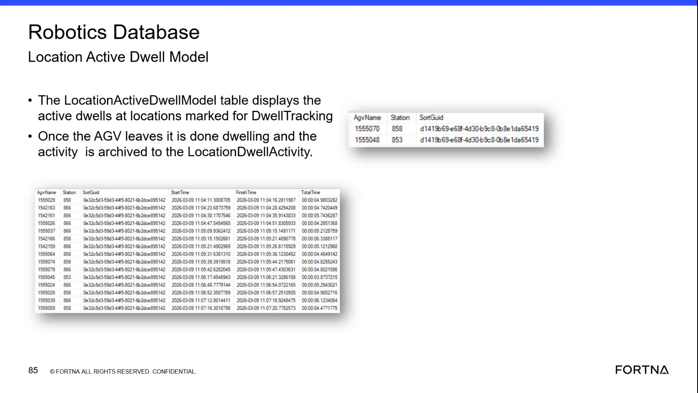

# Check Active and Archived Location Dwell Records

## Runbook Header

| Field | Value |
| --- | --- |
| Procedure ID | `proc_check_active_and_archived_location_dwell_records_v1` |
| Title | Check Active and Archived Location Dwell Records |
| Procedure Type | `diagnostic` |
| Primary Role | `L2_support` |
| Supporting Roles | None |
| Support Safe | Yes |
| Capability Tags | `robot_dwell_or_shutdown_staging` |
| Access Surface | `wcs_sql` |
| Audience Roles | `L2_support` |
| Failure Pattern Tags | `shutdown_or_dwell_abnormal` |
| Validation Status | `needs_sme_review` |
| Merge Status | `source_finalized` |

## Summary

Use read-only SSMS access to the WCS / Helix Robotics database to inspect active AGV dwell records at locations marked for dwell tracking, determine dwell time, and verify that the record is archived to Location Dwell Activity after the AGV leaves.

## When To Use

Use this diagnostic when investigating how long an AGV has remained at a tracked sort location or when verifying the transition from an active dwell record to an archived dwell record in the WCS / Helix DB (SSMS).

## Do Not Use For

* Do not use this procedure to modify, delete, or otherwise change dwell records.
* Do not expect a completed dwell to remain in Location Active Dwell after the AGV leaves the tracked location.

## Safety And Operational Notes

* Use read-only inspection only.
* Do not modify dwell records.

## Access Or Tools Needed

* WCS / Helix DB (SSMS)
* SSMS
* Robotics database
* Location Active Dwell model table
* Location Dwell Activity

## Related Operational Context

* ctx_training_video_location_dwell_current_archive_v1

## Visual References

*Robotics Database Location Active Dwell Model showing AgvName, Station, SortGuid, and archived dwell examples with Start Time, Finish Time, and Total Time.*

## Procedure Steps

### Step 1 — Open the Robotics database dwell model in SSMS

**Responsible role:** L2_support

**Instruction:**
In the WCS / Helix DB (SSMS), open the Robotics database and locate the Location Active Dwell model table.

**Expected result:**
The Location Active Dwell table is available for inspection and represents active dwells at sort locations marked for dwell tracking.

**Stop or Escalate If:**

* Escalate if the Robotics database or Location Active Dwell model table is unavailable.

---

### Step 2 — Inspect the active dwell record

**Responsible role:** L2_support

**Instruction:**
In the Location Active Dwell table on the WCS / Helix DB (SSMS), inspect the active record for the investigated sort location and AGV. Use the displayed AgvName, Station, and SortGuid values to identify the current dwell.

**Expected result:**
An AGV currently sitting at a tracked location has a corresponding active dwell record.

**Stop or Escalate If:**

* Escalate when an expected active dwell record is missing.

---

### Step 3 — Determine the active dwell time

**Responsible role:** L2_support

**Instruction:**
In the WCS / Helix DB (SSMS), use the available dwell-time information associated with the active dwell record to determine how long the AGV has been sitting at the location.

**Expected result:**
The active dwell record provides enough observable time information to determine the AGV's dwell duration.

**Stop or Escalate If:**

* Escalate when the dwell duration cannot be determined.

---

### Step 4 — Verify the archived dwell record after departure

**Responsible role:** L2_support

**Instruction:**
After the AGV leaves the tracked location, inspect Location Dwell Activity in the WCS / Helix DB (SSMS). Locate the completed dwell using the available AGV, station, sort, and time information rather than expecting it to remain in Location Active Dwell.

**Expected result:**
The completed dwell is present in Location Dwell Activity after the AGV leaves, with observable archived timing such as Start Time, Finish Time, and Total Time when displayed.

**Stop or Escalate If:**

* Escalate when a record remains active after the AGV has left.
* Escalate when the same dwell cannot be located in Location Dwell Activity.

---

## Success Criteria

* The investigated AGV and tracked station can be identified in Location Active Dwell while the AGV is dwelling.
* The available dwell-time information is sufficient to determine how long the AGV has been at the location.
* After the AGV leaves, the completed dwell is found in Location Dwell Activity with observable archived timing when displayed.
* No dwell records are modified.

## Failure Conditions

* An expected active dwell record is missing.
* The dwell duration cannot be determined.
* A dwell record remains active after the AGV leaves.
* The completed dwell cannot be located in Location Dwell Activity.

## Escalation Guidance

* Escalate to the appropriate WCS / Helix database support path when an expected active record is missing.
* Escalate when dwell duration cannot be determined from the available fields.
* Escalate when active-to-archived transition does not occur as expected.
* Do not modify dwell records while investigating.

## Missing Details / Known Gaps

* The packet does not provide the exact Robotics database schema, server or instance name, or a supported query/filter syntax.
* The packet does not identify the exact active-table column that directly stores a running dwell duration; use only the dwell-time information available in the live table.
* The packet does not define a required polling or waiting interval between AGV departure and archive verification.

## Source Lineage

- Candidate IDs: candidate_training_video_day2_check_location_active_dwell_archive
- Source ID: `training_video_day2`
- Source Type: `training_video`
