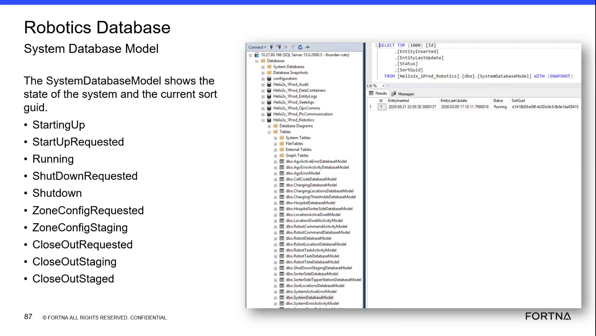

# Check Robotics SystemDatabaseModel State in SSMS

## Runbook Header

| Field | Value |
| --- | --- |
| Procedure ID | `proc_check_robotics_systemdatabasemodel_state_v1` |
| Title | Check Robotics SystemDatabaseModel State in SSMS |
| Procedure Type | `diagnostic` |
| Primary Role | `L2_support` |
| Supporting Roles | `L3_support` |
| Support Safe | Yes |
| Capability Tags | `wcs_system_faults` |
| Access Surface | `wcs_sql` |
| Audience Roles | `L2_support`, `L3_support` |
| Failure Pattern Tags | `system_fault` |
| Validation Status | `needs_sme_review` |
| Merge Status | `source_finalized` |

## Summary

Use the WCS / Helix DB (SSMS) surface to perform a read-only inspection of Helix2x_1Prod_Robotics.dbo.SystemDatabaseModel. Verify the live system configuration state, current SortGuid, EntityInserted timestamp, and EntityLastUpdate timestamp.

## When To Use

Use this WCS / Helix DB (SSMS) diagnostic when support needs to verify the live system configuration state, current sort GUID, and update timestamps in Helix2x_1Prod_Robotics.dbo.SystemDatabaseModel.

## Do Not Use For

* Do not use this read-only diagnostic to modify the database or configuration.
* Do not use this procedure as corrective action for a startup, shutdown, staging, requested, or close-out state; the source does not define corrective actions for those states.

## Safety And Operational Notes

* This is a read-only WCS / Helix DB (SSMS) diagnostic.
* Do not modify the database or configuration during this procedure.

## Access Or Tools Needed

* WCS / Helix DB (SSMS)
* SSMS
* Helix2x_1Prod_Robotics
* dbo.SystemDatabaseModel

## Related Operational Context

* ctx_training_video_system_database_model_v1
* ctx_training_video_system_database_statuses_v1
* ctx_training_video_robotics_database_landscape_v1

## Visual References

*SSMS Robotics Database view showing Helix2x_1Prod_Robotics, dbo.SystemDatabaseModel, and the EntityInserted, EntityLastUpdate, Status, and SortGuid result columns.*

*SSMS SystemDatabaseModel results and the displayed system status values, including Running, StartingUp, StartUpRequested, ShutDownRequested, Shutdown, ZoneConfigRequested, ZoneConfigStaging, CloseOutRequested, CloseOutStaging, and CloseOutStaged.*

## Procedure Steps

### Step 1 — Connect to the Robotics database in SSMS

**Responsible role:** L2_support

**Instruction:**
Open SSMS and connect to the Robotics Database, selecting the Helix2x_1Prod_Robotics database.

**Expected result:**
SSMS displays Helix2x_1Prod_Robotics as the selected database and exposes its database objects.

**Stop or Escalate If:**

* Escalate to L3 support or engineering if Helix2x_1Prod_Robotics cannot be opened.

---

### Step 2 — Open dbo.SystemDatabaseModel results

**Responsible role:** L2_support

**Instruction:**
In the SSMS object list for Helix2x_1Prod_Robotics, open dbo.SystemDatabaseModel and view its results in the read-only query view.

**Expected result:**
The SSMS results view displays the SystemDatabaseModel row with the EntityInserted, EntityLastUpdate, Status, and SortGuid columns.

**Stop or Escalate If:**

* Escalate to L3 support or engineering if dbo.SystemDatabaseModel cannot be opened, the expected row is absent, or the required fields are unavailable.

---

### Step 3 — Inspect the current model fields

**Responsible role:** L2_support

**Instruction:**
In the SSMS SystemDatabaseModel results, inspect the current row's EntityInserted, EntityLastUpdate, Status, and SortGuid fields.

**Expected result:**
The current row exposes observable values for Status and SortGuid and displayed values for EntityInserted and EntityLastUpdate.

**Stop or Escalate If:**

* Escalate to L3 support or engineering if the required fields are unavailable or the expected row does not contain the fields.

---

### Step 4 — Interpret the displayed Status

**Responsible role:** L2_support

**Instruction:**
Compare the displayed Status in the WCS / Helix DB (SSMS) results with the status values shown for SystemDatabaseModel: Running, StartingUp, StartUpRequested, ShutDownRequested, Shutdown, ZoneConfigRequested, ZoneConfigStaging, CloseOutRequested, CloseOutStaging, and CloseOutStaged.

**Expected result:**
The current row has one explicitly displayed Status value that identifies the current system configuration or lifecycle state.

**Stop or Escalate If:**

* Escalate if the live Status is unexpected for the reported condition.
* Escalate if the Status remains in a startup, shutdown, staging, requested, or close-out state without the expected state transition.

---

### Step 5 — Confirm SortGuid and timestamps

**Responsible role:** L2_support

**Instruction:**
Confirm in the SSMS SystemDatabaseModel results that SortGuid is populated and that EntityInserted and EntityLastUpdate contain displayed timestamps rather than being empty or missing.

**Expected result:**
The row shows a populated SortGuid and displayed EntityInserted and EntityLastUpdate timestamps.

**Stop or Escalate If:**

* Escalate to L3 support or engineering if SortGuid is not populated or either timestamp is empty or unavailable.

---

## Success Criteria

* SSMS opens Helix2x_1Prod_Robotics.dbo.SystemDatabaseModel in a read-only view.
* A current row is available with EntityInserted, EntityLastUpdate, Status, and SortGuid.
* The displayed Status is identified from the live result.
* SortGuid is populated.
* EntityInserted and EntityLastUpdate contain displayed timestamps.

## Failure Conditions

* The database or dbo.SystemDatabaseModel cannot be opened.
* The expected row is absent.
* EntityInserted, EntityLastUpdate, Status, or SortGuid is unavailable.
* SortGuid is empty or missing.
* EntityInserted or EntityLastUpdate is empty or missing.
* The live Status is unexpected for the reported condition or does not transition as expected from a startup, shutdown, staging, requested, or close-out state.

## Escalation Guidance

* Stop the diagnostic and escalate to L3 support or engineering if dbo.SystemDatabaseModel cannot be opened, the expected row is absent, or the required fields are unavailable.
* Escalate when the live Status is unexpected for the reported condition or remains in a startup, shutdown, staging, requested, or close-out state without the expected state transition.
* Do not modify the database or configuration during this read-only diagnostic.

## Missing Details / Known Gaps

* The source does not define corrective actions for individual SystemDatabaseModel Status values.
* The source does not define an expected timestamp age or freshness threshold for EntityInserted or EntityLastUpdate.
* The source does not define how to determine the expected state transition timing.
* No SQL command is included because the source provides no command beyond the displayed model reference.

## Source Lineage

- Candidate IDs: candidate_training_video_day2_check_robotics_system_database_state
- Source ID: `training_video_day2`
- Source Type: `training_video`
