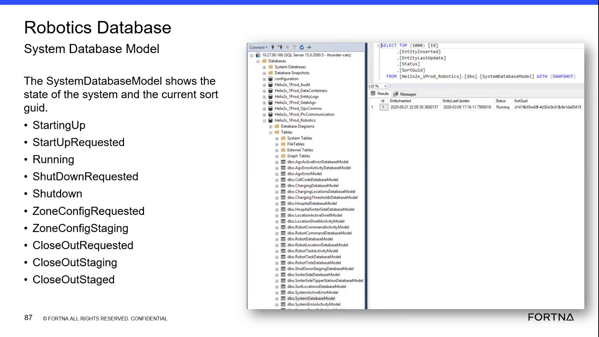

# Check OptiSweep System State and Sort GUID in SSMS

## Runbook Header

| Field | Value |
| --- | --- |
| Procedure ID | `proc_check_optisweep_system_state_and_sort_guid_in_ssms_v1` |
| Title | Check OptiSweep System State and Sort GUID in SSMS |
| Procedure Type | `diagnostic` |
| Primary Role | `L2_support` |
| Supporting Roles | `L3_support` |
| Support Safe | Yes |
| Capability Tags | `fleet_system_status` |
| Access Surface | `wcs_sql` |
| Audience Roles | `L2_support`, `L3_support` |
| Failure Pattern Tags | None |
| Validation Status | `needs_sme_review` |
| Merge Status | `source_finalized` |

## Summary

Use the WCS / Helix DB (SSMS) to perform a read-only check of the Helix2x_1Prod_Robotics dbo.SystemDatabaseModel record. Verify the current system lifecycle Status, SortGuid, EntityInserted, and EntityLastUpdate values.

## When To Use

Use the WCS / Helix DB (SSMS) when troubleshooting or validating the current OptiSweep system lifecycle state and associated sort identifier. This diagnostic verifies the live SystemDatabaseModel record without changing system state.

## Do Not Use For

* Do not use this read-only diagnostic to start up, shut down, close out, purge, reset metrics, or update zone configuration.
* Do not use it as a physical AGV recovery or safety-stop procedure.

## Safety And Operational Notes

* This procedure is read-only and does not include lifecycle commands or recovery actions.
* Do not modify the database record while performing this diagnostic.

## Access Or Tools Needed

* WCS / Helix DB (SSMS)
* Helix2x_1Prod_Robotics database
* dbo.SystemDatabaseModel

## Related Operational Context

* ctx_training_video_day2_system_database_model_v1
* ctx_training_video_day2_system_statuses_v1
* ctx_training_video_day2_system_database_fields_v1

## Visual References

*WCS / Helix DB (SSMS) Robotics Database view showing dbo.SystemDatabaseModel, its results grid, EntityInserted, EntityLastUpdate, Status, and SortGuid.*

*WCS / Helix DB (SSMS) SystemDatabaseModel results view showing the lifecycle status list and a returned record with timestamps, Running status, and SortGuid.*

## Procedure Steps

### Step 1 — Open the Robotics database in WCS / Helix DB (SSMS)

**Responsible role:** L2_support

**Instruction:**
In WCS / Helix DB (SSMS), select the Helix2x_1Prod_Robotics database.

**Expected result:**
Helix2x_1Prod_Robotics is selected and its database objects are visible in SSMS.

**Stop or Escalate If:**

* Escalate to L3_support if the Helix2x_1Prod_Robotics database cannot be opened or selected.

---

### Step 2 — Open dbo.SystemDatabaseModel in WCS / Helix DB (SSMS)

**Responsible role:** L2_support

**Instruction:**
In WCS / Helix DB (SSMS), open dbo.SystemDatabaseModel under Helix2x_1Prod_Robotics, or use the displayed read-only SystemDatabaseModel query.

**Expected result:**
SSMS displays a SystemDatabaseModel results grid containing the system-state record.

**Stop or Escalate If:**

* Escalate to L3_support if dbo.SystemDatabaseModel cannot be opened or the record cannot be returned.

---

### Step 3 — Inspect the SystemDatabaseModel fields in WCS / Helix DB (SSMS)

**Responsible role:** L2_support

**Instruction:**
In the WCS / Helix DB (SSMS) results grid, inspect the EntityInserted, EntityLastUpdate, Status, and SortGuid columns.

**Expected result:**
The returned row shows values for EntityInserted, EntityLastUpdate, Status, and SortGuid.

**Stop or Escalate If:**

* Escalate if Status, SortGuid, EntityInserted, or EntityLastUpdate is missing from the returned record.

---

### Step 4 — Compare Status with the documented lifecycle values in WCS / Helix DB (SSMS)

**Responsible role:** L2_support

**Instruction:**
Compare the Status value in the WCS / Helix DB (SSMS) results grid with StartingUp, StartUpRequested, Running, ShutDownRequested, Shutdown, ZoneConfigRequested, ZoneConfigStaging, CloseOutRequested, CloseOutStaging, and CloseOutStaged.

**Expected result:**
The current Status matches one of the documented SystemDatabaseModel lifecycle values.

**Stop or Escalate If:**

* Escalate if Status is missing or does not match a documented lifecycle value.

---

### Step 5 — Record the system state, SortGuid, and timestamps from WCS / Helix DB (SSMS)

**Responsible role:** L2_support

**Instruction:**
Record the displayed Status, SortGuid, EntityInserted, and EntityLastUpdate values from the WCS / Helix DB (SSMS) SystemDatabaseModel row.

**Expected result:**
A recognized Status, populated SortGuid, and the displayed timestamp values are available as the diagnostic result.

**Stop or Escalate If:**

* Escalate if the returned record does not provide the expected SortGuid or required state fields.

---

## Success Criteria

* WCS / Helix DB (SSMS) returns the Helix2x_1Prod_Robotics dbo.SystemDatabaseModel record.
* EntityInserted, EntityLastUpdate, Status, and SortGuid are visible.
* Status matches one of the documented lifecycle values.
* SortGuid is populated and the displayed timestamps are available for the diagnostic record.

## Failure Conditions

* Helix2x_1Prod_Robotics or dbo.SystemDatabaseModel cannot be opened.
* No SystemDatabaseModel record is returned.
* Status is missing or outside the documented lifecycle values.
* SortGuid or one of the required state and timestamp fields is missing.

## Escalation Guidance

* Escalate to L3_support if the Helix2x_1Prod_Robotics database or dbo.SystemDatabaseModel cannot be opened or returned.
* Escalate if Status is missing or unrecognized.
* Escalate if SortGuid, EntityInserted, EntityLastUpdate, or another required state field is not provided.

## Missing Details / Known Gaps

* The packet does not provide a site-specific SSMS connection method or authentication procedure.
* The packet does not provide an exact executable SQL command; this runbook therefore uses the table/model view or displayed read-only query without adding a command.
* The packet does not define the escalation destination or response action for each individual lifecycle status.

## Source Lineage

- Candidate IDs: candidate_training_video_day2_check_system_database_model_status
- Source ID: `training_video_day2`
- Source Type: `training_video`
