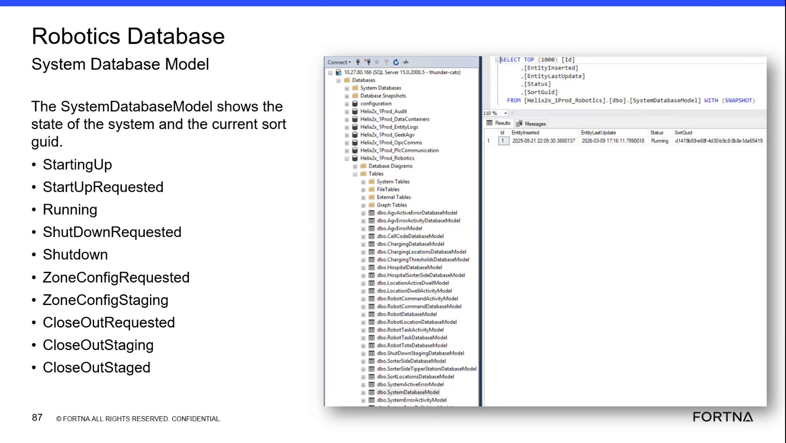

# Check SystemDatabaseModel state and SortGuid in Helix2x_1Prod_Robotics (Robotics Database)

## Runbook Header

| Field | Value |
| --- | --- |
| Procedure ID | `proc_check_systemdatabasemodel_state_and_sortguid_helix2x_1prod_robotics_v1` |
| Title | Check SystemDatabaseModel state and SortGuid in Helix2x_1Prod_Robotics (Robotics Database) |
| Procedure Type | `diagnostic` |
| Primary Role | `L2_support` |
| Supporting Roles | None |
| Support Safe | Yes |
| Capability Tags | `sort_lifecycle_state` |
| Access Surface | `wcs_sql` |
| Audience Roles | `L2_support` |
| Failure Pattern Tags | None |
| Validation Status | `needs_sme_review` |
| Merge Status | `source_finalized` |

## Summary

Use WCS / Helix DB (SSMS) to view the Robotics database model [Helix2x_1Prod_Robotics].[dbo].[SystemDatabaseModel] and confirm the current Status value and the current SortGuid.

## When To Use

When you need to verify the current system lifecycle state and the current sort GUID by checking the Robotics database model fields Status and SortGuid in [Helix2x_1Prod_Robotics].[dbo].[SystemDatabaseModel].

## Access Or Tools Needed

* SSMS / WCS SQL access (allowed surface: wcs_sql)
* Helix database: [Helix2x_1Prod_Robotics]
* Table/model: [dbo].[SystemDatabaseModel]
* Fields/columns: Status, SortGuid

## Related Operational Context

* ctx_training_video_system_database_model_overview_v1
* ctx_training_video_status_reference_system_database_model_statuses_v1
* ctx_training_video_hmi_screen_reference_robotics_database_view_v1

## Visual References

*Frame showing the query context for [Helix2x_1Prod_Robotics].[dbo].[SystemDatabaseModel] (WITH (SNAPSHOT)) and the presence of Status and SortGuid fields.*

## Procedure Steps

### Step 1 — Query [dbo].[SystemDatabaseModel] in [Helix2x_1Prod_Robotics] using SSMS

**Responsible role:** L2_support

**Instruction:**
Using SSMS on the WCS / Helix DB (allowed surface: wcs_sql), connect to the Helix database named [Helix2x_1Prod_Robotics], and open a query against [dbo].[SystemDatabaseModel] (the source shows it using WITH (SNAPSHOT)).

**Expected result:**
You have a result set/grid for [Helix2x_1Prod_Robotics].[dbo].[SystemDatabaseModel] that includes columns labeled Status and SortGuid.

**Stop or Escalate If:**

* If you cannot access the Helix2x_1Prod_Robotics database or the SystemDatabaseModel view/table, stop and escalate for access/DB connectivity.

---

### Step 2 — Locate Status and SortGuid in the SystemDatabaseModel result

**Responsible role:** L2_support

**Instruction:**
In the SSMS result grid for [dbo].[SystemDatabaseModel], locate the columns labeled Status and SortGuid.

**Expected result:**
The result grid clearly shows columns labeled Status and SortGuid.

**Stop or Escalate If:**

* If Status and SortGuid columns are not present, stop and escalate (DB query/view mismatch or access issue).

---

### Step 3 — Validate Status is one of the documented system states

**Responsible role:** L2_support

**Instruction:**
Read the current Status value from the live [dbo].[SystemDatabaseModel] result and confirm it matches one of the documented states: StartingUp, StartUpRequested, Running, ShutDownRequested, Shutdown, ZoneConfigRequested, ZoneConfigStaging, CloseOutRequested, CloseOutStaging, CloseOutStaged.

**Expected result:**
The Status value shown in the live result is exactly one of: StartingUp, StartUpRequested, Running, ShutDownRequested, Shutdown, ZoneConfigRequested, ZoneConfigStaging, CloseOutRequested, CloseOutStaging, CloseOutStaged.

**Stop or Escalate If:**

* Stop and escalate if Status is not one of the documented values.

---

### Step 4 — Record SortGuid and ensure it is present

**Responsible role:** L2_support

**Instruction:**
Read the current SortGuid value from the live [dbo].[SystemDatabaseModel] result and record it. Confirm SortGuid is present (not blank/missing).

**Expected result:**
A non-blank SortGuid value is visible in the live result set.

**Stop or Escalate If:**

* Stop and escalate if SortGuid is missing/blank (no valid current sort GUID shown).

---

## Success Criteria

* SystemDatabaseModel.Status is one of the documented values: StartingUp, StartUpRequested, Running, ShutDownRequested, Shutdown, ZoneConfigRequested, ZoneConfigStaging, CloseOutRequested, CloseOutStaging, CloseOutStaged.
* SystemDatabaseModel.SortGuid is present (not blank) in the live result set.

## Failure Conditions

* Status value is outside the documented set.
* SortGuid is missing/blank while a system state is expected.
* Unable to access the Helix2x_1Prod_Robotics database or the SystemDatabaseModel view/table.

## Escalation Guidance

* Escalate if Status is outside the documented set or if SortGuid is missing/blank.
* Escalate if you cannot access the Helix2x_1Prod_Robotics database or the SystemDatabaseModel view/table (access/DB connectivity issue).

## Missing Details / Known Gaps

* The packet does not provide exact SSMS navigation/click-by-click steps (e.g., which SSMS object explorer nodes to expand) beyond the database/table names and that the source uses WITH (SNAPSHOT).

## Source Lineage

- Candidate IDs: candidate_training_video_day2_check_systemdatabase_model_status_sortguid
- Source ID: `training_video_day2`
- Source Type: `training_video`
