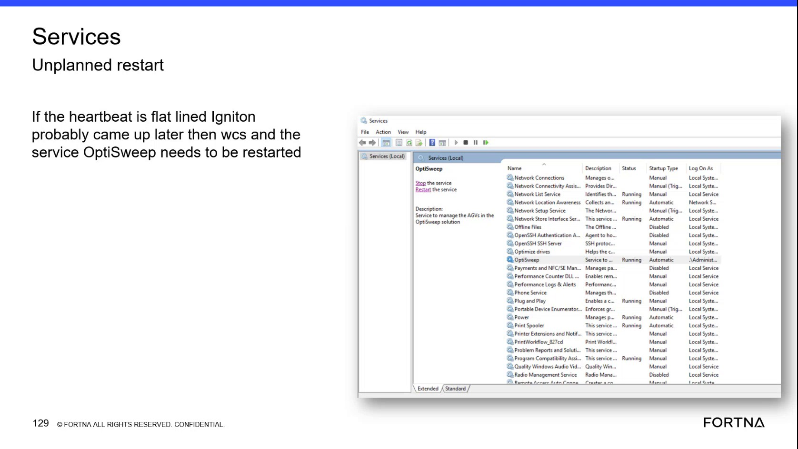
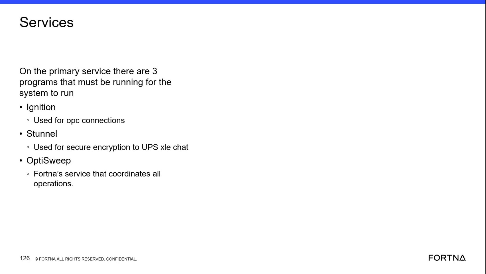

# Check Windows Service State and Logs When the OptiSweep Gateway Is Unavailable

## Runbook Header

| Field | Value |
| --- | --- |
| Procedure ID | `proc_check_windows_service_state_and_logs_gateway_unavailable_v1` |
| Title | Check Windows Service State and Logs When the OptiSweep Gateway Is Unavailable |
| Procedure Type | `diagnostic` |
| Primary Role | `L2_support` |
| Supporting Roles | None |
| Support Safe | Yes |
| Capability Tags | `wcs_service_health` |
| Access Surface | `event_viewer` |
| Audience Roles | `L2_support` |
| Failure Pattern Tags | `service_crash_or_restart` |
| Validation Status | `needs_sme_review` |
| Merge Status | `source_finalized` |

## Summary

Use Windows Event Viewer / services to inspect the relevant OptiSweep-related service, determine whether it is running or stopped, review available service or Event Viewer logs for crash or inactive-period evidence, and correlate the service state with gateway availability.

## When To Use

Use this Windows Event Viewer / services diagnostic when the OptiSweep gateway is unavailable, does not open, or does not appear to be running, and a stopped service or service crash is suspected.

## Do Not Use For

* Do not use this procedure to restart a service or change service configuration; the supplied evidence supports inspection only.
* Do not use this procedure as a complete recovery procedure when the service state or logs do not explain the gateway outage.

## Safety And Operational Notes

* This is a read-only diagnostic procedure.
* Do not perform an unsupported service restart or configuration change based only on this procedure.

## Access Or Tools Needed

* event_viewer: Windows Event Viewer / services
* Windows Services MMC
* Windows service logs or Event Viewer logs

## Related Operational Context

* ctx_training_video_service_crash_stopped_gateway_impact_v1
* ctx_training_video_windows_service_visibility_logs_v1

## Visual References

*Windows Services view showing the OptiSweep service and service status fields.*

*Windows Services view showing the OptiSweep service and the running-service state used when correlating service health with operation.*

*Service reference identifying Ignition, Stunnel, and OptiSweep as programs required for system operation.*

## Procedure Steps

### Step 1 — Inspect the OptiSweep-related service in Windows Services

**Responsible role:** L2_support

**Instruction:**
In the Windows Event Viewer / services surface, open Windows Services MMC and inspect the relevant OptiSweep-related service. The source identifies OptiSweep as a service involved in coordinating system operation; it also identifies Ignition and Stunnel as primary services used by the system.

**Expected result:**
The relevant service entry is visible with an observable status such as Running or a stopped/inactive state.

**Stop or Escalate If:**

* The relevant service is stopped or inactive.
* The relevant service cannot be identified from the available Windows Services view.

---

### Step 2 — Record the observed service state

**Responsible role:** L2_support

**Instruction:**
In Windows Services MMC, record whether the relevant OptiSweep-related service is Running, stopped, or otherwise inactive. Do not restart or reconfigure the service as part of this diagnostic.

**Expected result:**
The current service state is explicitly identified and can be compared with the reported gateway condition.

**Stop or Escalate If:**

* The service is stopped or inactive.
* The gateway does not open or run while the service is stopped or inactive.

---

### Step 3 — Review service and Event Viewer logs

**Responsible role:** L2_support

**Instruction:**
Use Windows Event Viewer / services to review the available Windows service logs or Event Viewer entries for the relevant service and the reported outage period. Look for observable evidence of a crash, restart, or period in which service activity was absent.

**Expected result:**
Available log entries either correlate the outage with a service crash, restart, or inactive interval, or show that the available logs do not explain the outage.

**Stop or Escalate If:**

* A crash, restart, or inactive interval is identified.
* The logs do not explain the observed gateway outage.

---

### Step 4 — Correlate service state with gateway operation

**Responsible role:** L2_support

**Instruction:**
Confirm the current gateway condition while the relevant service state is known. Compare whether the gateway opens or runs when the service is Running with the reported condition when the service is stopped or inactive. Do not perform a service restart as part of this step.

**Expected result:**
The service state and gateway condition are correlated as either consistent or unexplained.

**Stop or Escalate If:**

* The gateway does not open or run while the service is stopped or inactive.
* The gateway remains unavailable while the relevant service is Running.
* The service state and available logs do not explain the outage.

---

## Success Criteria

* The relevant OptiSweep-related service state is observed in Windows Services MMC.
* Available Windows service or Event Viewer logs are reviewed for crash, restart, or inactive-period evidence.
* The service state is correlated with whether the gateway opens or runs.
* Any unexplained outage or stopped/inactive service is escalated without performing an unsupported restart or configuration change.

## Failure Conditions

* The relevant service is stopped or inactive.
* Windows logs show a crash, restart, or inactive interval associated with the outage.
* The gateway does not open or run while the service is stopped or inactive.
* The gateway remains unavailable even though the relevant service is Running.
* Available logs do not explain the observed outage.

## Escalation Guidance

* Escalate when the relevant service is stopped or inactive.
* Escalate when the gateway does not open or run in correlation with a stopped or inactive service.
* Escalate when logs show a crash, restart, or inactive interval.
* Escalate when the service is Running but the gateway remains unavailable.
* Do not restart the service or change service configuration under this diagnostic procedure; the source does not provide verified recovery steps.

## Missing Details / Known Gaps

* The exact Windows service name to inspect is not specified beyond the OptiSweep-related service shown in the supplied evidence.
* The service host name or server location is not specified.
* No specific Windows Event Viewer log name, event identifier, timestamp query, or retention period is provided.
* The source does not provide verified service restart, recovery, or configuration-change steps.
* The source does not define a confirmed gateway health field or endpoint beyond whether the gateway opens or runs.

## Source Lineage

- Candidate IDs: candidate_training_video_day2_check_windows_service_state_and_logs
- Source ID: `training_video_day2`
- Source Type: `training_video`
