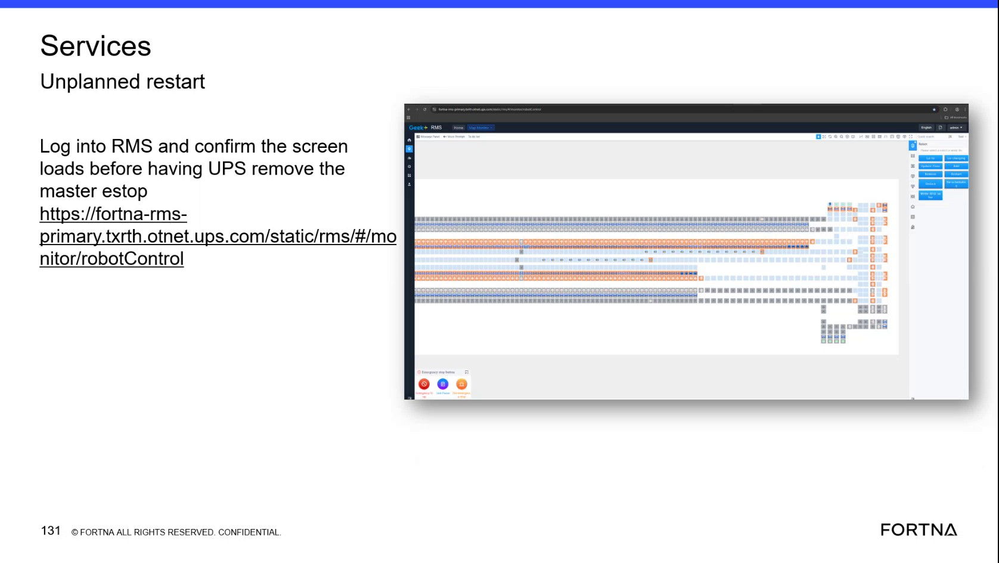

# Confirm Geek+ RMS Robot Control Screen Loads Before Master E-Stop Clear

## Runbook Header

| Field | Value |
| --- | --- |
| Procedure ID | `proc_confirm_geek_rms_robotcontrol_before_estop_clear_v1` |
| Title | Confirm Geek+ RMS Robot Control Screen Loads Before Master E-Stop Clear |
| Procedure Type | `diagnostic` |
| Primary Role | `L2_support` |
| Supporting Roles | `operator` |
| Support Safe | Yes |
| Capability Tags | `e_stop_or_safety_stop` |
| Access Surface | `rms_ui` |
| Audience Roles | `L2_support`, `operator` |
| Failure Pattern Tags | `web_app_fault` |
| Validation Status | `needs_sme_review` |
| Merge Status | `source_finalized` |

## Summary

Use the live RMS / fleet status UI to sign in, open the monitor/robotControl screen, and confirm that it is available for viewing before the site or UPS coordinates removal of the physical master E-stop. This procedure does not authorize or perform the physical E-stop reset.

## When To Use

Use during an unplanned-restart situation when the site or UPS needs confirmation that the live RMS monitor/robotControl screen is available before removing the physical master E-stop.

## Do Not Use For

* Do not use this procedure to remove, reset, or otherwise operate the physical master E-stop.
* Do not use this procedure as a substitute for site safety confirmation or physical-floor control.

## Safety And Operational Notes

* Do not remove or reset the physical master E-stop through the RMS / fleet status UI.
* If the RMS robotControl screen is unavailable, do not communicate a successful screen-load check or proceed with the screen-availability confirmation.

## Access Or Tools Needed

* Live RMS / fleet status UI
* Geek+ RMS monitor/robotControl screen
* Administrator-related RMS access indicated by the source; exact permissions and credentials are not specified

## Related Operational Context

* ctx_training_video_geek_rms_v1
* ctx_training_video_rms_robot_control_screen_v1
* ctx_training_video_rms_admin_access_v1
* ctx_training_video_master_estop_ups_reference_v1

## Visual References

*RMS / fleet status UI reference showing the unplanned-restart context, administrator-related access notation, instruction to confirm that the screen loads, and the monitor/robotControl path.*

## Procedure Steps

### Step 1 — Open the live RMS monitor/robotControl path

**Responsible role:** L2_support

**Instruction:**
On the live RMS / fleet status UI, open the displayed monitor/robotControl path: https://fortna-rms-primary.txrth.otnet.ups.com/static/rms/#/monitor/robotControl.

**Expected result:**
The RMS sign-in page or RMS monitor/robotControl entry point is displayed.

**Stop or Escalate If:**

* The RMS / fleet status UI or the monitor/robotControl path is unreachable.

---

### Step 2 — Sign in to the live RMS / fleet status UI

**Responsible role:** L2_support

**Instruction:**
Sign in to the live RMS / fleet status UI using the available administrator-related access indicated by the source. Do not infer or create credentials or permissions that are not provided.

**Expected result:**
The RMS / fleet status UI accepts the available access and presents the authenticated RMS interface.

**Stop or Escalate If:**

* The required RMS access is unavailable or sign-in does not provide access to the RMS interface.

---

### Step 3 — Confirm the RMS robotControl screen loads

**Responsible role:** L2_support

**Instruction:**
In the live RMS / fleet status UI, open or remain on monitor/robotControl and verify that the robotControl screen finishes loading and is available for viewing.

**Expected result:**
The RMS monitor/robotControl screen is displayed and available for viewing.

**Stop or Escalate If:**

* The RMS robotControl screen does not load or is unavailable.

---

### Step 4 — Communicate RMS screen availability

**Responsible role:** L2_support

**Instruction:**
After the RMS robotControl screen-load check succeeds, communicate to the site or UPS that the RMS screen is available. Do not communicate approval to perform any physical action beyond reporting the screen state.

**Expected result:**
The site or UPS receives a clear report that the RMS robotControl screen is available for viewing.

**Stop or Escalate If:**

* The robotControl screen-load check has not succeeded.
* The site or UPS requests remote performance of the physical master E-stop action.

---

## Success Criteria

* The live RMS / fleet status UI is reachable.
* L2_support can sign in using the available RMS access.
* The monitor/robotControl screen loads and is available for viewing.
* The successful screen-availability result is communicated to the site or UPS before physical master E-stop removal is coordinated.

## Failure Conditions

* The RMS / fleet status UI or robotControl path is unreachable.
* RMS access is unavailable or sign-in fails.
* The robotControl screen does not load or remains unavailable.
* Physical master E-stop removal is requested without a successful RMS screen-load confirmation.

## Escalation Guidance

* Escalate when the RMS robotControl screen cannot be loaded or viewed.
* Escalate access or authentication issues because the source does not specify the exact administrator permissions or credentials.
* The site or UPS must retain responsibility for any physical master E-stop removal or reset; L2_support must not perform that physical action.

## Missing Details / Known Gaps

* The exact RMS administrator credentials, permission scope, and authentication method are not specified.
* The source defines successful availability as the robotControl screen loading but does not provide additional page-health criteria or a timeout.
* The communication channel and required confirmation format for notifying the site or UPS are not specified.
* This runbook does not contain physical master E-stop removal or reset instructions.

## Source Lineage

- Candidate IDs: candidate_training_video_day2_confirm_rms_robotcontrol_before_estop_clear
- Source ID: `training_video_day2`
- Source Type: `training_video`
