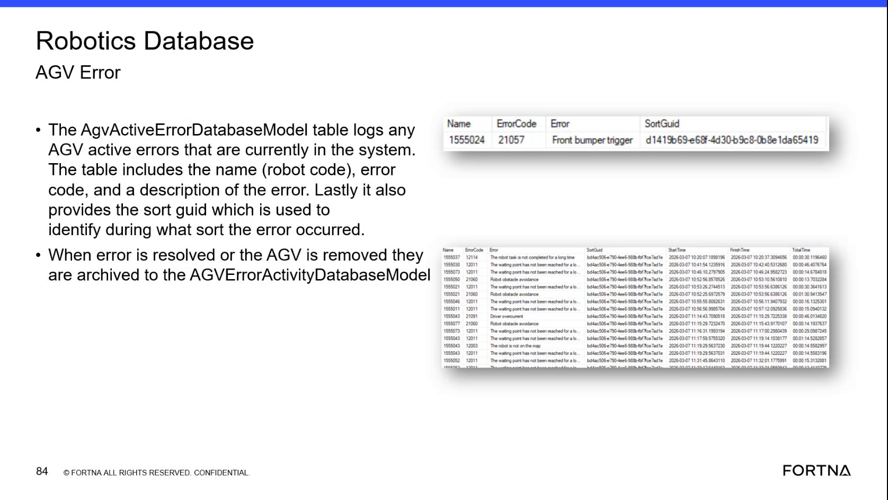

# Diagnose Active AGV Errors in the Robotics Database

## Runbook Header

| Field | Value |
| --- | --- |
| Procedure ID | `proc_diagnose_active_agv_errors_in_the_robotics_database_v1` |
| Title | Diagnose Active AGV Errors in the Robotics Database |
| Procedure Type | `diagnostic` |
| Primary Role | `L2_support` |
| Supporting Roles | None |
| Support Safe | Yes |
| Capability Tags | `agv_active_errors` |
| Access Surface | `wcs_sql` |
| Audience Roles | `L2_support` |
| Failure Pattern Tags | `bump_fault` |
| Validation Status | `needs_sme_review` |
| Merge Status | `source_finalized` |

## Summary

Use read-only SSMS access to the WCS / Helix DB (SSMS) Robotics database to inspect current AGV active-error records and identify the affected robot code, error code, description, and SortGuid. When an error is resolved or an AGV is removed, verify that the record is archived to AGVErrorActivityDatabaseModel with available timing fields.

## When To Use

Use the WCS / Helix DB (SSMS) Robotics database when an AGV error must be correlated to the affected robot code, error code, error description, and sort during which the error occurred.

## Do Not Use For

* Do not use this procedure to modify or delete database records.
* Do not use this procedure as a physical AGV recovery or production-stop procedure.

## Safety And Operational Notes

* Use read-only inspection only.
* Do not modify or delete database records.

## Access Or Tools Needed

* WCS / Helix DB (SSMS)
* SSMS
* Robotics database
* AgvActiveErrorDatabaseModel
* AGVErrorActivityDatabaseModel

## Related Operational Context

* ctx_training_video_agv_active_error_activity_v1

## Visual References

*Robotics database view showing AgvActiveErrorDatabaseModel fields including Name, ErrorCode, error description, and SortGuid.*

## Procedure Steps

### Step 1 — Open the Robotics active-error table in WCS / Helix DB (SSMS)

**Responsible role:** L2_support

**Instruction:**
In WCS / Helix DB (SSMS), open the Robotics database and locate the AgvActiveErrorDatabaseModel table.

**Expected result:**
The AgvActiveErrorDatabaseModel table is available for read-only inspection and exposes the active-error fields used for correlation.

**Stop or Escalate If:**

* Escalate if L2_support cannot access the Robotics database or the AgvActiveErrorDatabaseModel table.

---

### Step 2 — Check for the affected AGV active-error row

**Responsible role:** L2_support

**Instruction:**
In the AgvActiveErrorDatabaseModel table in WCS / Helix DB (SSMS), check whether a row is present for the affected AGV. Use the Name field as the robot code and inspect ErrorCode, the error description, and SortGuid.

**Expected result:**
The result shows either no active-error row for the affected AGV or a row containing the robot code, error code, error description, and SortGuid.

**Stop or Escalate If:**

* Escalate when the active record lacks the expected robot code, error code, description, or SortGuid fields.
* Escalate when an active-error row cannot be correlated to the reported AGV condition.

---

### Step 3 — Capture the active error and sort correlation

**Responsible role:** L2_support

**Instruction:**
From the active-error row in WCS / Helix DB (SSMS), capture the Name robot code, ErrorCode, error description, and SortGuid. For example, the source shows error code 21057 with the description "Front bumper trigger." Use SortGuid as the identifier for the sort during which the error occurred.

**Expected result:**
The diagnostic record contains the affected robot code, active error code, description, and SortGuid, including the sort association when the active row provides it.

**Stop or Escalate If:**

* Stop the database diagnostic and escalate when the error description cannot be correlated to the reported condition.
* Escalate when the active record is missing the robot code, error code, description, or SortGuid.

---

### Step 4 — Verify resolution in AGV error activity

**Responsible role:** L2_support

**Instruction:**
After the error is resolved or the AGV is removed, recheck AgvActiveErrorDatabaseModel in WCS / Helix DB (SSMS) and verify that the record is no longer an active-error row. Then inspect AGVErrorActivityDatabaseModel for the archived record and available Start Time, Finish Time, and Total Time fields.

**Expected result:**
The resolved or removed error is absent from the active-error table and is present in AGVErrorActivityDatabaseModel with Start Time, Finish Time, and Total Time when those fields are available.

**Stop or Escalate If:**

* Escalate when an active-error row remains for the AGV after the error is reported resolved or the AGV has been removed.
* Escalate when the corresponding archived record or expected timing fields cannot be found.

---

## Success Criteria

* The affected AGV can be identified by the Name robot code in the Robotics database.
* The active error evidence includes ErrorCode, error description, and SortGuid when an active row is present.
* A resolved or removed error is no longer present as an active-error row and is archived to AGVErrorActivityDatabaseModel with available timing fields.
* No database records are modified or deleted.

## Failure Conditions

* An active-error row remains after the error is reported resolved or the AGV is removed.
* The active row lacks the robot code, error code, description, or SortGuid.
* The error description cannot be correlated to the reported AGV condition.
* The corresponding archived error activity record or expected timing fields cannot be found.

## Escalation Guidance

* Escalate to the appropriate WCS / Helix database support path when the Robotics database or required table cannot be accessed.
* Escalate when an active error remains after resolution or AGV removal.
* Escalate when the active record lacks expected identifying fields or cannot be correlated to the reported condition.
* Do not modify or delete database records while investigating.

## Missing Details / Known Gaps

* No supplied artifact specifically shows the AGVErrorActivityDatabaseModel archived table; archived-record verification is supported by transcript and OCR text only.
* The packet does not provide connection details, database server names, or an approved query for locating the tables.
* The packet does not define a separate escalation owner or response path for an active row that remains after resolution.
* The source discussion is uncertain about whether RMS or an API provides equivalent error-code mapping; this procedure relies on the Robotics database fields and does not assume that mapping.

## Source Lineage

- Candidate IDs: candidate_training_video_day2_diagnose_agv_active_errors_in_robotics_db
- Source ID: `training_video_day2`
- Source Type: `training_video`
