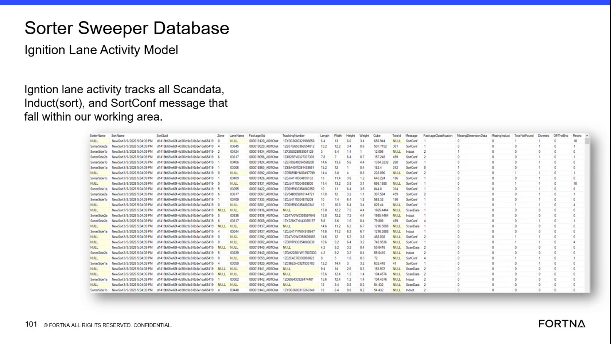
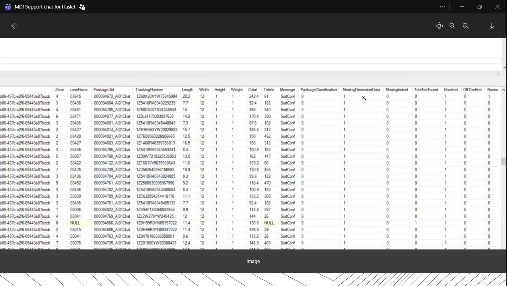
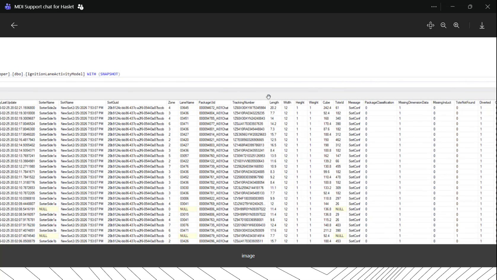

# Diagnose Missing Package Dimensions in the Ignition Lane Activity Model

## Runbook Header

| Field | Value |
| --- | --- |
| Procedure ID | `proc_diagnose_missing_package_dimensions_ignition_lane_activity_model_v1` |
| Title | Diagnose Missing Package Dimensions in the Ignition Lane Activity Model |
| Procedure Type | `diagnostic` |
| Primary Role | `L2_support` |
| Supporting Roles | `operator` |
| Support Safe | Yes |
| Capability Tags | `sorter_item_or_scan_state` |
| Access Surface | `ignition_gateway` |
| Audience Roles | `L2_support` |
| Failure Pattern Tags | `miss_scan_or_dimension_fallback` |
| Validation Status | `needs_sme_review` |
| Merge Status | `source_finalized` |

## Summary

Use the live Ignition gateway's Lane Activity Model in the Sorter Sweeper Database view to determine whether incomplete package dimensions are associated with Scan Data 2, Induct, or SortConf records and whether the condition is concentrated on an auto-induct source. Inspect package identifiers, tracking numbers, dimensional fields, cube, package classification, and MissingDimensionData.

## When To Use

Use this live Ignition gateway diagnostic when sorter totes are overfilling or package data appears incomplete and support needs to determine whether default dimensions were used, which dimensional attribute is missing, and whether the condition is associated with a particular auto-induct source.

## Do Not Use For

* Do not use this procedure to change default dimensions, package classification, or database values.
* Do not use this procedure to direct or perform dimensioner reboot or other physical equipment remediation.
* Do not treat the observed MissingDimensionData rate as a universal pass/fail threshold; the source provides examples but no universal threshold.

## Safety And Operational Notes

* This is an inspection-only diagnostic. Do not modify default dimensions, package classification, or database values.
* If physical dimensioner remediation is being considered, communicate the observed data condition to the site support contact rather than directing the physical action from this procedure.

## Access Or Tools Needed

* Ignition gateway
* Ignition Lane Activity Model
* Sorter Sweeper Database view
* Recent lane activity records
* Package ID or tracking number for the affected parcels

## Related Operational Context

* ctx_training_video_scan_data_2_package_attributes_v1
* ctx_training_video_item_dimension_models_v1
* ctx_training_video_missing_dimension_data_indicator_v1
* ctx_training_video_lane_activity_messages_v1

## Visual References

*Ignition Lane Activity Model view showing message, package identifier, tracking number, dimensional fields, cube, package classification, and MissingDimensionData-related columns.*

*Lane activity records filtered to sort-confirmation data, illustrating repeated missing width, height, and weight values and correlation with an auto-induct source.*

*Lane Activity Model records used to inspect missing dimension data during a reported dimensioner-data interruption.*

## Procedure Steps

### Step 1 — Open the Ignition gateway Lane Activity Model

**Responsible role:** L2_support

**Instruction:**
In the Ignition gateway, open the Sorter Sweeper Database view and select the Ignition Lane Activity Model.

**Expected result:**
The live Lane Activity Model displays recent sorter records with package, message, dimensional, cube, and missing-data fields.

**Stop or Escalate If:**

* Escalate if the Ignition gateway view cannot be loaded or the required Lane Activity Model fields are unavailable.

---

### Step 2 — Review recent Message records in the Ignition gateway

**Responsible role:** L2_support

**Instruction:**
In the Ignition gateway Lane Activity Model, review recent rows and inspect the Message field. Distinguish Scan Data 2, Induct, and SortConf records.

**Expected result:**
Recent rows can be categorized by Message value, showing whether the affected package data appears on Scan Data 2, Induct, or SortConf records.

**Stop or Escalate If:**

* Escalate if affected records cannot be associated with a package ID, tracking number, or message type.

---

### Step 3 — Inspect package and dimensional fields in the Ignition gateway

**Responsible role:** L2_support

**Instruction:**
For the affected records in the Ignition gateway Lane Activity Model, inspect PackageLid or package ID, PackageUID where displayed, TrackingNumber, Length, Width, Height, Weight, Cube, PackageClassification, and MissingDimensionData.

**Expected result:**
The records show observable package identifiers and dimensional values, including any NULL or missing Length, Width, Height, or Weight values and the associated Cube value.

**Stop or Escalate If:**

* Escalate when the table cannot associate affected records with a package ID or tracking number.
* Escalate when the displayed dimensional data does not explain the reported sorter behavior.

---

### Step 4 — Interpret MissingDimensionData against the live dimensions

**Responsible role:** L2_support

**Instruction:**
Compare MissingDimensionData with Length, Width, Height, Weight, and Cube for each affected record in the Ignition gateway Lane Activity Model. Treat MissingDimensionData=true as an indication that default dimensional values were used, then identify which dimensional field is NULL or otherwise missing.

**Expected result:**
The comparison identifies whether defaults were used and shows the missing attribute, such as Weight, Width, or Height, while retaining the observed Cube value.

**Stop or Escalate If:**

* Escalate if MissingDimensionData is true across a substantial set of recent records, especially when the records coincide with tote overfilling.
* Do not assign a universal percentage threshold; the source does not define one.

---

### Step 5 — Correlate missing dimensions with the auto-induct source

**Responsible role:** L2_support

**Instruction:**
Use the package ID or related induct identifier in the Ignition gateway Lane Activity Model to compare affected records from the same source, such as Auto Induct 1 or Auto Induct 2. Review the associated Message and dimensional fields for the grouped records.

**Expected result:**
The records show whether MissingDimensionData and the missing dimensional attribute are concentrated on one auto-induct source.

**Stop or Escalate If:**

* Escalate if affected records cluster on one auto-induct source.
* Escalate if the table cannot associate affected records with an induct source.

---

### Step 6 — Summarize the observed missing-dimension pattern

**Responsible role:** L2_support

**Instruction:**
Count or estimate the observed proportion of recent records with MissingDimensionData=true, identify the dominant missing field, record the relevant Message values and auto-induct source, and relate the findings to the reported sorter behavior. Do not apply a threshold that is not defined by the source.

**Expected result:**
The diagnostic summary states the observed MissingDimensionData condition, missing dimensional attribute, affected message type, package or tracking examples, associated auto-induct source, and any relationship to tote overfilling.

**Stop or Escalate If:**

* Escalate to L2 support or the site support contact if MissingDimensionData is true across a substantial set of recent records, especially when records cluster on one auto-induct source or coincide with tote overfilling.
* Escalate when the displayed dimensional data does not explain the reported sorter behavior.

---

## Success Criteria

* The live Ignition gateway Lane Activity Model loads and provides recent records for inspection.
* Affected records are categorized by Message value, including Scan Data 2, Induct, or SortConf where present.
* Package identifiers, tracking numbers, dimensional fields, Cube, PackageClassification, and MissingDimensionData are compared.
* The diagnostic identifies whether default dimensions were used and which dimensional attribute is missing.
* The diagnostic determines whether the condition is concentrated on Auto Induct 1, Auto Induct 2, or another identifiable source.
* The findings are summarized without changing database values, package classification, or default dimensions.

## Failure Conditions

* The Lane Activity Model cannot be loaded or required fields are unavailable.
* Affected records cannot be associated with a package ID, tracking number, message type, or auto-induct source.
* MissingDimensionData=true occurs across a substantial set of recent records.
* Repeated NULL or missing Width, Height, or Weight values are concentrated on one auto-induct source.
* The displayed dimensional data does not explain reported tote overfilling or incomplete package data.

## Escalation Guidance

* Escalate to L2 support or the site support contact when MissingDimensionData is true across a substantial set of recent records, particularly when records cluster on one auto-induct source or coincide with tote overfilling.
* Escalate when the Ignition gateway view cannot load or the table cannot associate affected records with package, message, or induct information.
* Provide package or tracking identifiers, Message values, dimensional fields, Cube, MissingDimensionData, the observed count or percentage, and the associated auto-induct source.
* Do not direct physical dimensioner remediation or change default dimensions as part of this diagnostic.

## Missing Details / Known Gaps

* The source does not define a universal healthy percentage or escalation threshold for MissingDimensionData.
* The packet does not provide exact Ignition gateway navigation labels beyond the Sorter Sweeper Database view and Ignition Lane Activity Model.
* The packet does not provide a standard query, filter syntax, or export procedure.
* The source uses both PackageLid and PackageUID/package ID terminology; the exact live field label should be confirmed by SME review.
* The source does not define remediation steps for dimensioner equipment or establish who performs any physical reset.

## Source Lineage

- Candidate IDs: candidate_training_video_day2_diagnose_missing_dimension_data_in_lane_activity
- Source ID: `training_video_day2`
- Source Type: `training_video`
