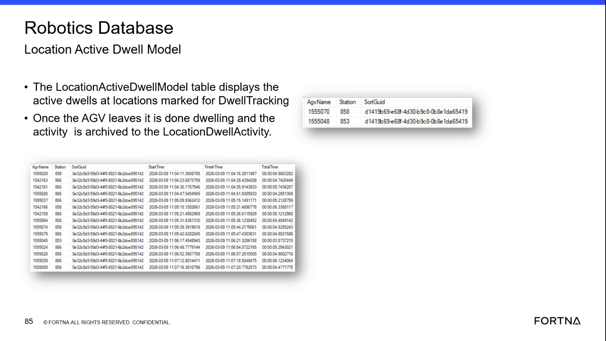

# Diagnose AGV Location Dwell in the Robotics Database

## Runbook Header

| Field | Value |
| --- | --- |
| Procedure ID | `proc_diagnose_agv_location_dwell_in_the_robotics_database_v1` |
| Title | Diagnose AGV Location Dwell in the Robotics Database |
| Procedure Type | `diagnostic` |
| Primary Role | `L2_support` |
| Supporting Roles | `L3_support` |
| Support Safe | Yes |
| Capability Tags | `robot_dwell_or_shutdown_staging` |
| Access Surface | `wcs_sql` |
| Audience Roles | `L2_support`, `L3_support` |
| Failure Pattern Tags | `shutdown_or_dwell_abnormal` |
| Validation Status | `needs_sme_review` |
| Merge Status | `source_finalized` |

## Summary

Use read-only SSMS access to the WCS / Helix Robotics Database to inspect active and completed AGV dwell records. Identify the AGV, station, SortGuid, and elapsed-time evidence associated with a tracked location dwell.

## When To Use

Use this diagnostic when investigating AGV waiting, idle time, or possible bottlenecks at a tracked hospital, tipper, or other station. Inspect the WCS / Helix Robotics Database in SSMS to determine whether the dwell is currently active or has been archived.

## Do Not Use For

* Do not use this procedure to modify DwellTracking settings or database records.
* Do not use dwell records to identify a specific worker or tipper operator; the available evidence does not provide personnel cycling information.
* Do not use this procedure as a complete throughput investigation or to optimize one location without considering system-level throughput.

## Safety And Operational Notes

* This is a read-only database diagnostic. Do not modify DwellTracking settings or database records.
* Treat dwell information as system-throughput evidence. A dwell interval at one location may not represent the effect on overall system throughput.

## Access Or Tools Needed

* WCS / Helix DB (SSMS)
* Robotics Database
* LocationActiveDwellModel
* LocationDwellActivity

## Related Operational Context

* ctx_training_video_location_active_dwell_model_v1
* ctx_training_video_location_dwell_activity_archive_v1
* ctx_training_video_operational_dwell_metrics_v1

## Visual References

*Robotics Database view showing LocationActiveDwellModel and LocationDwellActivity fields, including AgvName, Station, SortGuid, Start Time, Finish Time, and Total Time.*

## Procedure Steps

### Step 1 — Open the Robotics Database in SSMS

**Responsible role:** L2_support

**Instruction:**
In the WCS / Helix DB (SSMS), select the Robotics Database and locate the LocationActiveDwellModel and LocationDwellActivity tables.

**Expected result:**
The Robotics Database is selected and the two named dwell tables are available for read-only inspection.

**Stop or Escalate If:**

* Escalate to L3_support if the Robotics Database or named dwell tables cannot be accessed.

---

### Step 2 — Inspect active dwell records

**Responsible role:** L2_support

**Instruction:**
In the WCS / Helix DB (SSMS), inspect LocationActiveDwellModel for active rows at locations marked for DwellTracking. Review the AgvName, Station, and SortGuid fields.

**Expected result:**
An active dwell row, when present, identifies the AGV in AgvName, the tracked location in Station, and the associated sort in SortGuid.

**Stop or Escalate If:**

* Escalate to L2/L3 engineering if a station expected to use DwellTracking has no corresponding active dwell evidence.
* Escalate if the active record lacks the displayed identifying fields needed for interpretation.

---

### Step 3 — Correlate the active row with the reported AGV station

**Responsible role:** L2_support

**Instruction:**
In the WCS / Helix DB (SSMS), compare the LocationActiveDwellModel Station and AgvName values with the AGV's current location or reported station when that evidence is available through the live support investigation.

**Expected result:**
The active database row associates the AGV named in AgvName with the station named in Station for the current dwell.

**Stop or Escalate If:**

* Escalate for further review if available live AGV location evidence conflicts with the active database row.

---

### Step 4 — Inspect the archived dwell activity

**Responsible role:** L2_support

**Instruction:**
In the WCS / Helix DB (SSMS), inspect LocationDwellActivity for the AGV and station of interest. Review AgvName, Station, SortGuid, Start Time, Finish Time, and Total Time.

**Expected result:**
A completed activity row contains the AGV, station, and sort identifiers together with Start Time, Finish Time, and Total Time. A displayed interval may appear in a format such as 00:00:04.9803282.

**Stop or Escalate If:**

* Escalate to L2/L3 engineering if expected completed dwell evidence is missing.
* Escalate if the archived record lacks the displayed identifying or timing fields needed for interpretation.

---

### Step 5 — Interpret the dwell interval and station

**Responsible role:** L2_support

**Instruction:**
In the WCS / Helix DB (SSMS), use the LocationDwellActivity Station and Total Time values to record the observed dwell interval and determine whether the live record names a hospital, tipper, or another tracked location.

**Expected result:**
The recorded result identifies the station named in Station and the elapsed interval shown in Total Time, such as 00:00:04.9803282.

**Stop or Escalate If:**

* Do not attribute a tipper dwell interval to a specific worker because personnel cycling information is not available in this evidence.

---

## Success Criteria

* The WCS / Helix Robotics Database was inspected read-only through SSMS.
* The active or completed dwell record was identified in LocationActiveDwellModel or LocationDwellActivity.
* The result includes the available AgvName, Station, SortGuid, and timing fields.
* For a completed dwell, the observed interval is taken from Total Time and associated with the station named in the live record.

## Failure Conditions

* A station expected to use DwellTracking has no active or completed dwell evidence.
* A dwell record lacks the identifying fields needed to associate it with an AGV, station, or sort.
* A completed record lacks Start Time, Finish Time, or Total Time.
* Available live AGV location evidence conflicts with the active database Station or AgvName.

## Escalation Guidance

* Escalate to L2/L3 engineering when expected active or completed dwell evidence is missing.
* Escalate when identifying or timing fields are absent or insufficient for interpretation.
* Use the dwell result as system-throughput evidence and avoid attributing a tipper interval to a specific worker.
* Do not modify DwellTracking or database records during this diagnostic.

## Missing Details / Known Gaps

* The packet does not provide SQL text, query filters, or exact SSMS navigation instructions.
* The packet does not identify a live source or surface for independently verifying the AGV's current location or reported station; perform that comparison only when such evidence is already available.
* No duration threshold is provided for classifying a dwell as abnormal.
* No complete escalation routing, contact, or response workflow is provided.

## Source Lineage

- Candidate IDs: candidate_training_video_day2_diagnose_robot_location_dwell
- Source ID: `training_video_day2`
- Source Type: `training_video`
