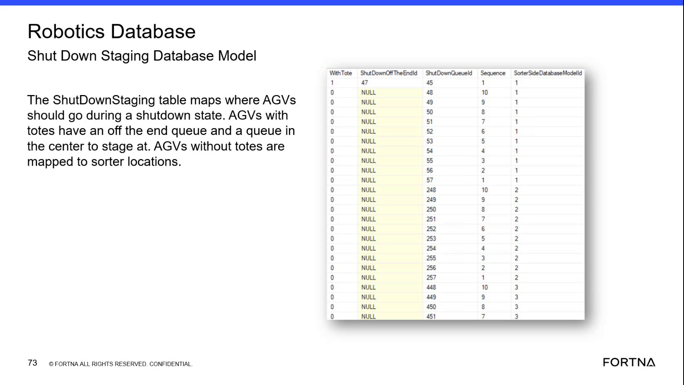
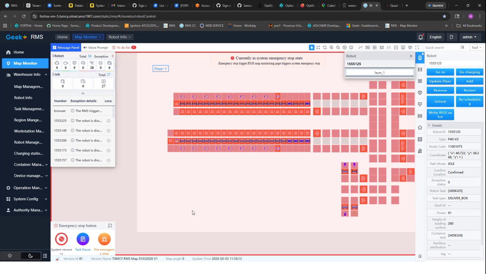
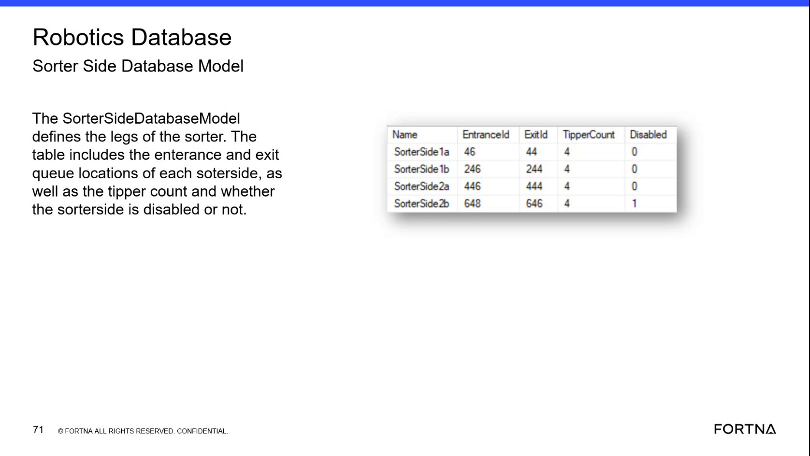

# Diagnose Sorter Location and Queue Mapping in the Robotics Database

## Runbook Header

| Field | Value |
| --- | --- |
| Procedure ID | `proc_diagnose_sorter_location_queue_mapping_in_robotics_database_v1` |
| Title | Diagnose Sorter Location and Queue Mapping in the Robotics Database |
| Procedure Type | `diagnostic` |
| Primary Role | `L2_support` |
| Supporting Roles | `L3_support` |
| Support Safe | Yes |
| Capability Tags | `zone_config_state` |
| Access Surface | `wcs_sql` |
| Audience Roles | `L2_support`, `L3_support` |
| Failure Pattern Tags | `mapping_abnormal`, `zone_agv_mismatch` |
| Validation Status | `needs_sme_review` |
| Merge Status | `source_finalized` |

## Summary

Use read-only SSMS access to the WCS / Helix Robotics database to verify sorted-location rows, associated queue locations, sorter-side associations, and sorter-entry sequence when investigating sorter mapping behavior.

## When To Use

Use this diagnostic on the WCS / Helix DB (SSMS) when support needs to verify sorter-side, sorted-location, queue-location, or sorter-entry sequence configuration associated with an observed sorter mapping issue.

## Do Not Use For

* Do not use this procedure to modify Robotics database configuration.
* Do not use this procedure as a substitute for confirming the physical sorter layout when the database-to-floor relationship is unknown.
* Do not use this procedure to diagnose unrelated AGV errors, robot commands, charging, or dwell behavior.

## Safety And Operational Notes

* Keep the SSMS check read-only.
* Do not modify database configuration as part of this procedure.

## Access Or Tools Needed

* WCS / Helix DB (SSMS)
* SSMS
* Robotics database
* SortLocationsDatabaseModel table/model

## Related Operational Context

* ctx_training_video_sort_locations_database_v1
* ctx_training_video_sorter_tipper_mapping_v1

## Visual References

*Robotics database view showing sort-location concepts, queue locations, sorter-side association, and sequence-related data.*

*RMS / fleet status UI and mapping explanation showing sequence values beginning at the sorter entrance queue and resolving the corresponding location.*

*Robotics database view showing sorter-side fields including entrance and exit queue locations, tipper count, and disabled state.*

## Procedure Steps

### Step 1 — Open the Robotics database model in SSMS

**Responsible role:** L2_support

**Instruction:**
In the WCS / Helix DB (SSMS), open the Robotics database and locate the SortLocationsDatabaseModel table/model. Do not edit rows or database configuration.

**Expected result:**
The Robotics database exposes the sort-location model for read-only inspection.

**Stop or Escalate If:**

* The Robotics database or sort locations model is unavailable to the assigned support role.
* The investigation would require modifying database configuration.

---

### Step 2 — Inspect sorted-location and queue-location rows

**Responsible role:** L2_support

**Instruction:**
In the WCS / Helix DB (SSMS), review the relevant SortLocationsDatabaseModel rows. Inspect the sorted-location identifier and its associated queue-location identifier; where present, use the model fields SorterId, StagingId, and QueueId to distinguish the sorter location, staging location, and queue location.

**Expected result:**
The affected sorted locations and their associated queue locations are visible as rows that can be compared with the observed sorter configuration.

**Stop or Escalate If:**

* The required location row is missing.
* The queue-location association is absent.
* The database row cannot be related to the affected sorter location.

---

### Step 3 — Check sorter-side and entrance-queue sequence

**Responsible role:** L2_support

**Instruction:**
In the WCS / Helix DB (SSMS), inspect the sorter-side association and Sequence for each relevant row. Compare the recorded sequence with the observed sorter entrance queue order. Sequence values are used to order the locations from the sorter entrance queue; the supplied model reference describes sequence values 1–4 as starting at that entrance queue.

**Expected result:**
Each relevant location has a sorter-side association and a sequence that can be compared to its expected position from the sorter entrance queue.

**Stop or Escalate If:**

* Sorter-side and sequence values do not correspond to the observed configuration.
* The sequence cannot be reconciled with the sorter entrance queue order.
* The observed configuration is insufficient to determine whether the database mapping is correct.

---

### Step 4 — Confirm complete mapping for the affected sorter side

**Responsible role:** L2_support

**Instruction:**
In the WCS / Helix DB (SSMS), verify that all locations and queue associations needed for the affected sorter side are present and that their sorter-side and Sequence values remain consistent with the observed sorter entrance queue order. Keep the inspection read-only.

**Expected result:**
The affected sorter side has a complete, internally consistent set of sorted-location and queue-location mappings.

**Stop or Escalate If:**

* The required location row is missing.
* The queue-location association is absent.
* Sorter-side or sequence values do not correspond to the observed configuration.
* A database change would be needed to make the mapping consistent.

---

## Success Criteria

* The Robotics database is accessible in SSMS for read-only inspection.
* Required sorted-location rows are present.
* Each required sorted location has an associated queue location.
* Sorter-side associations match the affected sorter side.
* Sequence values are consistent with the expected order from the sorter entrance queue.

## Failure Conditions

* A required sorted-location row is missing.
* A queue-location association is absent.
* The sorter-side association is missing or does not match the affected side.
* Sequence values do not correspond to the observed sorter entrance queue order.
* The database mapping cannot be reconciled with the observed configuration.

## Escalation Guidance

* Escalate to L3_support or engineering when a required location row is missing, a queue-location association is absent, or sorter-side and sequence values do not correspond to the observed configuration.
* Preserve the read-only findings, including the affected location, queue association, sorter-side value, and sequence value, for escalation.
* Do not correct the mapping by editing the database within this procedure.

## Missing Details / Known Gaps

* The packet does not provide a complete SSMS navigation path.
* The exact deployed database and table names should be confirmed for the target site; the source names the Robotics database and SortLocationsDatabaseModel but does not provide a complete site-specific schema validation.
* The packet does not provide a SQL statement; no SQL command is included in this runbook.
* The observed sorter configuration or physical queue order must be supplied before the database sequence can be judged against the live layout.
* The packet does not define a remediation procedure for correcting an inconsistent mapping.

## Source Lineage

- Candidate IDs: candidate_training_video_day2_diagnose_sort_locations_database_mapping
- Source ID: `training_video_day2`
- Source Type: `training_video`
