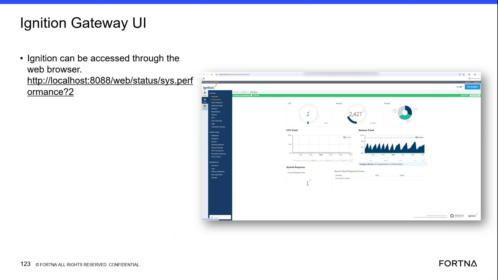

# Check Ignition Gateway system performance status via Ignition Gateway UI (sys.perf)

## Runbook Header

| Field | Value |
| --- | --- |
| Procedure ID | `proc_check_ignition_gateway_sys_perf_v1` |
| Title | Check Ignition Gateway system performance status via Ignition Gateway UI (sys.perf) |
| Procedure Type | `diagnostic` |
| Primary Role | `L1_support` |
| Supporting Roles | None |
| Support Safe | Yes |
| Capability Tags | `gateway_health` |
| Access Surface | `ignition_gateway` |
| Audience Roles | `L1_support` |
| Failure Pattern Tags | `gateway_unhealthy` |
| Validation Status | `needs_sme_review` |
| Merge Status | `source_finalized` |

## Summary

Use the Ignition Gateway web UI to open the system performance status page (/web/status/sys.perf) and confirm the page is reachable and loads successfully so support can assess Ignition Gateway health/performance.

## When To Use

When you need to verify whether the Ignition Gateway is reachable and whether its system performance status page loads successfully (sys.perf), to support gateway health/performance assessment.

## Safety And Operational Notes

* Do not attempt administrative recovery actions from this procedure; use escalation for deeper Ignition Gateway health troubleshooting.

## Access Or Tools Needed

* Web browser access to the Ignition host
* Ignition Gateway UI at http://localhost:8088/web/status/sys.perf

## Related Operational Context

* ctx_training_video_ignition_gateway_ui_overview_v1
* ctx_training_video_ignition_gateway_localhost_access_reference_v1
* ctx_training_video_ignition_gateway_system_performance_status_v1

## Visual References

*Training frame showing Ignition Gateway UI access via a web browser and the URL containing http://localhost:8088/web/status/sys.perf.*

## Procedure Steps

### Step 1 — Open the Ignition Gateway sys.perf status page in a browser

**Responsible role:** L1_support

**Instruction:**
On the Ignition host, open a web browser and navigate to http://localhost:8088/web/status/sys.perf.

**Expected result:**
The browser navigates to the /web/status/sys.perf page (no browser error preventing page load).

**Stop or Escalate If:**

* If the page does not load (gateway down/unresponsive), stop and escalate for Ignition Gateway health troubleshooting.

---

### Step 2 — Confirm sys.perf page content corresponds to a system performance/status view

**Responsible role:** L1_support

**Instruction:**
After the page loads, confirm the content corresponds to a system performance/status view for sys.perf.

**Expected result:**
The sys.perf page loads successfully and displays a system performance/status view.

**Stop or Escalate If:**

* If the page does not load or does not present the expected sys.perf performance/status view, escalate for Ignition Gateway health troubleshooting.

---

### Step 3 — If sys.perf is unreachable, record the failure symptom and escalate

**Responsible role:** L1_support

**Instruction:**
If the sys.perf page does not load, note the exact browser failure symptom (for example, connection refused/unreachable) and stop; escalate for Ignition Gateway health troubleshooting.

**Expected result:**
You have an exact failure symptom description from the browser error state and you stop further actions in this procedure.

**Stop or Escalate If:**

* Stop and escalate if the sys.perf page is unreachable or fails to load (gateway down/unresponsive).

---

## Success Criteria

* http://localhost:8088/web/status/sys.perf loads successfully in the browser
* The loaded page presents a system performance/status view (sys.perf)

## Failure Conditions

* sys.perf page is unreachable or fails to load (gateway down/unresponsive)
* sys.perf page does not present a system performance/status view

## Escalation Guidance

* Escalate for Ignition Gateway health troubleshooting when the sys.perf page is unreachable/unresponsive or does not load successfully.

## Missing Details / Known Gaps

* The packet does not specify which exact sys.perf UI fields/values to verify beyond successful page load and that it is a system performance/status view.

## Source Lineage

- Candidate IDs: candidate_training_video_day2_ignition_gateway_sys_perf_check
- Source ID: `training_video_day2`
- Source Type: `training_video`
