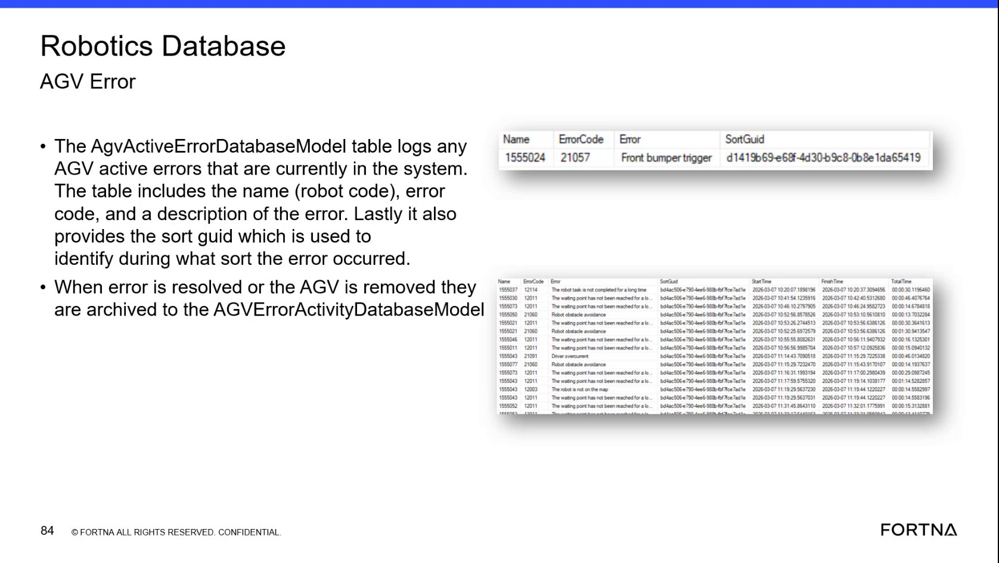

# Look Up an AGV Error Code and Severity Classification

## Runbook Header

| Field | Value |
| --- | --- |
| Procedure ID | `proc_look_up_agv_error_code_and_severity_classification_v1` |
| Title | Look Up an AGV Error Code and Severity Classification |
| Procedure Type | `diagnostic` |
| Primary Role | `L2_support` |
| Supporting Roles | None |
| Support Safe | Yes |
| Capability Tags | `agv_active_errors` |
| Access Surface | `wcs_sql` |
| Audience Roles | `L2_support`, `L3_support` |
| Failure Pattern Tags | `bump_fault` |
| Validation Status | `needs_sme_review` |
| Merge Status | `source_finalized` |

## Summary

Use read-only WCS / Helix DB (SSMS) access to compare an observed AGV ErrorCode with the Robotics database AGV error reference and active AGV error record. Read the stored description and critical or non-critical classification when available.

## When To Use

Use this diagnostic when an AGV error code needs to be interpreted in the Robotics database through WCS / Helix DB (SSMS), including comparison with an active AGV error record.

## Do Not Use For

* Do not use the Robotics database lookup to infer RMS error-code mappings; the source indicates that the RMS/API relationship is uncertain.
* Do not modify the AGV error lookup table.

## Safety And Operational Notes

* Use read-only access. Do not modify the lookup table.

## Access Or Tools Needed

* WCS / Helix DB (SSMS)
* Robotics database
* AGV Error model table

## Related Operational Context

* ctx_training_video_agv_error_reference_v1

## Visual References

*Robotics database AGV error reference and active-error examples showing Name, ErrorCode, Description, and SortGuid; the example includes ErrorCode 21057 with description "Front bumper trigger."*

## Procedure Steps

### Step 1 — Open the Robotics database in WCS / Helix DB (SSMS)

**Responsible role:** L2_support

**Instruction:**
In WCS / Helix DB (SSMS), open the Robotics database and locate the AGV Error model table. Use read-only access.

**Expected result:**
The AGV Error model table is available for inspection in the Robotics database.

**Stop or Escalate If:**

* Escalate if the Robotics database or AGV Error model table cannot be located.
* Stop if the procedure would require modifying the lookup table.

---

### Step 2 — Find the observed ErrorCode and read its description

**Responsible role:** L2_support

**Instruction:**
In the AGV Error model table in WCS / Helix DB (SSMS), find the row matching the observed ErrorCode and read the stored error description. The source example shows ErrorCode 21057 with the description "Front bumper trigger."

**Expected result:**
A matching row returns the observed ErrorCode and its stored description.

**Stop or Escalate If:**

* Escalate when the observed ErrorCode has no matching AGV Error model row.
* Escalate when the returned description conflicts with the active AGV error record.

---

### Step 3 — Read the critical or non-critical classification

**Responsible role:** L2_support

**Instruction:**
In the AGV Error model table in WCS / Helix DB (SSMS), inspect the row or field that classifies the observed error as critical or non-critical.

**Expected result:**
The matching AGV error reference provides an observable critical or non-critical classification.

**Stop or Escalate If:**

* Escalate if the matching error row has no observable critical or non-critical classification.

---

### Step 4 — Compare the reference row with the active AGV error record

**Responsible role:** L2_support

**Instruction:**
In WCS / Helix DB (SSMS), compare the reference ErrorCode and description with the active AGV error record. The active record includes the robot code in Name, ErrorCode, Description, and SortGuid, which identifies the sort during which the error occurred.

**Expected result:**
The active AGV error record contains an ErrorCode and Description consistent with the reference lookup; the active record's Name and SortGuid identify the robot and associated sort when present.

**Stop or Escalate If:**

* Escalate when the reference description conflicts with the active-error record.
* Do not infer an RMS/API mapping from a discrepancy; the source indicates that this relationship is uncertain.

---

## Success Criteria

* The Robotics database AGV Error model returns a matching row for the observed ErrorCode.
* The matching row provides an observable error description and critical or non-critical classification.
* The reference ErrorCode and description agree with the active AGV error record when an active record is available.
* The diagnostic result is identified as confirmed only when the code and description can be matched.

## Failure Conditions

* No matching AGV Error model row exists for the observed ErrorCode.
* The reference description conflicts with the active AGV error record.
* The critical or non-critical classification is not available for the matching row.
* The procedure attempts to use the Robotics lookup to infer an RMS/API error-code mapping.

## Escalation Guidance

* Escalate when the observed ErrorCode has no matching AGV Error model row.
* Escalate when the reference description conflicts with the active AGV error record.
* Escalate when the severity classification cannot be observed for the matching row.
* Do not infer RMS error-code mappings from this lookup because the source indicates that the RMS/API relationship is uncertain.

## Missing Details / Known Gaps

* The source does not provide a complete live WCS / Helix DB (SSMS) navigation sequence for opening the Robotics database and locating the AGV Error model table.
* The exact database table name and column name containing the critical or non-critical classification are not specified.
* The source does not specify the live lookup method for retrieving the active AGV error record.
* The source does not establish a confirmed mapping between Robotics ErrorCode values and RMS/API error representations.

## Source Lineage

- Candidate IDs: candidate_training_video_day2_lookup_agv_error_code_description
- Source ID: `training_video_day2`
- Source Type: `training_video`
