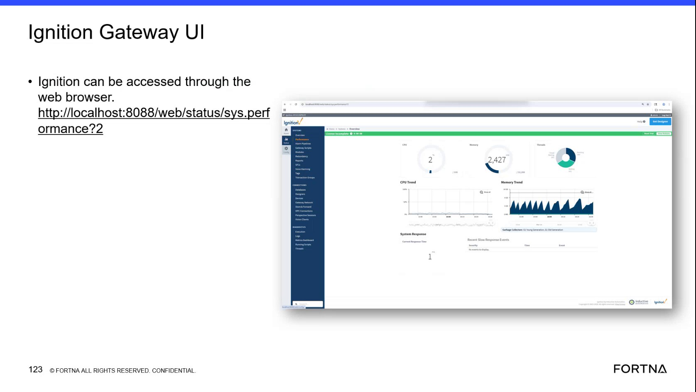

# Check OPC COM tag subscription updates flowing to Sorter Sweeper (Ignition tag provider → OPC server → Sorter Sweeper processing)

## Runbook Header

| Field | Value |
| --- | --- |
| Procedure ID | `proc_check_opc_com_tag_subscription_updates_to_sorter_sweeper_v1` |
| Title | Check OPC COM tag subscription updates flowing to Sorter Sweeper (Ignition tag provider → OPC server → Sorter Sweeper processing) |
| Procedure Type | `diagnostic` |
| Primary Role | `L2_support` |
| Supporting Roles | None |
| Support Safe | Yes |
| Capability Tags | `wcs_api_responsiveness`, `gateway_health` |
| Access Surface | `wcs_sql`, `ignition_gateway` |
| Audience Roles | `L2_support` |
| Failure Pattern Tags | `api_unresponsive`, `gateway_unhealthy` |
| Validation Status | `needs_sme_review` |
| Merge Status | `source_finalized` |

## Summary

Verify that OPC COM is actively subscribing to tags and that tag updates are being written to the OPC server and forwarded to the Sorter Sweeper module for processing by checking live WCS/Helix DB (SSMS) tables/models for OPC COM activity and correlating it to Sorter Sweeper processing records; also confirm Ignition gateway health when needed.

## When To Use

Use when you need to confirm the live tag flow: OPC COM subscribes to tags, tag updates are written via the OPC server/ignition tag provider, and Sorter Sweeper receives/acts on those updates.

## Access Or Tools Needed

* SSMS / Helix DB (wcs_sql)
* Ignition gateway (ignition_gateway) for basic health check

## Related Operational Context

* ctx_training_video_opc_com_tag_flow_v1
* ctx_training_video_sorter_sweeper_system_overview_v1

## Visual References

*Ignition gateway performance page used as a support view for memory/performance behavior (used here only as a health-check visual reference).*

## Procedure Steps

### Step 1 — Open WCS/Helix DB (SSMS) and connect to the live OptiSweep/WCS database catalog

**Responsible role:** L2_support

**Instruction:**
Using SSMS / Helix DB (wcs_sql), connect to the live OptiSweep/WCS database catalog that includes the OPC Comms and Sorter Sweeper modules.

**Expected result:**
SSMS connection is established and you can browse the live database objects for the OPC Comms and Sorter Sweeper modules.

**Stop or Escalate If:**

* If you cannot connect to the live WCS/Helix DB, stop and escalate (database access/connectivity issue).

---

### Step 2 — Locate live OPC COM communications and Sorter Sweeper processing models/tables

**Responsible role:** L2_support

**Instruction:**
In SSMS / Helix DB (wcs_sql), locate the live tables/models for OPC COM communications and for Sorter Sweeper processing.

**Expected result:**
You have identified the live OPC COM communications objects and the live Sorter Sweeper processing objects that will be used for correlation.

**Stop or Escalate If:**

* If you cannot locate the correct live OPC Comms and Sorter Sweeper objects, stop and escalate (schema mapping gap).

---

### Step 3 — Check for recent OPC COM tag update activity in OPC COM communications objects

**Responsible role:** L2_support

**Instruction:**
Using the OPC COM communications objects you identified in SSMS / Helix DB (wcs_sql), check for recent tag update activity (e.g., recently updated records/timestamps) for the relevant subscribed tags.

**Expected result:**
There are recent records showing tag update activity (updated timestamps/entries) in the OPC COM communications objects.

**Stop or Escalate If:**

* Stop and escalate if OPC COM shows no recent tag updates (possible OPC server connectivity/subscription issue).

---

### Step 4 — Correlate OPC COM tag updates to Sorter Sweeper processing records

**Responsible role:** L2_support

**Instruction:**
In SSMS / Helix DB (wcs_sql), correlate the timeframe of the recent OPC COM tag update activity to Sorter Sweeper processing records; if available, match tag identifiers between the two.

**Expected result:**
Sorter Sweeper has corresponding processing entries for the same tag update timeframe (and, if available, matching tag identifiers).

**Stop or Escalate If:**

* Escalate if OPC COM updates exist but there are no corresponding Sorter Sweeper processing records.

---

### Step 5 — If applicable, verify Ignition gateway health for tag provider connectivity

**Responsible role:** L2_support

**Instruction:**
Using Ignition gateway (ignition_gateway), perform a basic health check to confirm the gateway is not in a failed/unreachable state.

**Expected result:**
Ignition gateway status indicates it is reachable/healthy enough to provide tag updates.

**Stop or Escalate If:**

* Stop and escalate if Ignition gateway health indicates it is failed/unreachable (tag provider connectivity issue).

---

### Step 6 — Stop and escalate based on correlation results

**Responsible role:** L2_support

**Instruction:**
Based on your findings from Steps 3–4, stop and escalate using the failure mode that matches the observed evidence.

**Expected result:**
Escalation is triggered only when the evidence indicates missing tag updates or missing Sorter Sweeper processing correlation.

**Stop or Escalate If:**

* OPC COM shows no recent tag updates (possible OPC server connectivity/subscription issue).
* OPC COM updates exist but there are no corresponding Sorter Sweeper processing records (possible Sorter Sweeper subscription/processing failure).

---

## Success Criteria

* Live evidence shows recent OPC COM tag update activity (recent records with updated timestamps for relevant tags).
* Sorter Sweeper has corresponding processing entries for the same tag update timeframe (and, if available, matching tag identifiers).

## Failure Conditions

* No recent tag update activity in OPC COM communications objects.
* OPC COM updates exist but Sorter Sweeper processing records are missing for the same timeframe.

## Escalation Guidance

* If OPC COM shows no recent tag updates: escalate as a likely OPC server connectivity/subscription issue.
* If OPC COM updates exist but Sorter Sweeper processing does not: escalate as a likely Sorter Sweeper subscription/processing failure.

## Missing Details / Known Gaps

* The training segment does not provide concrete SSMS table/model names or column names for the OPC COM communications objects and Sorter Sweeper processing objects; the runbook therefore cannot specify exact queries/fields beyond the observable requirement of recent updated records and correlated processing entries.
* The candidate references specific model/table identifiers (opc_comms, sorter_sweeper), but the packet does not confirm exact live object names/fields for those identifiers.

## Source Lineage

- Candidate IDs: candidate_training_video_day2_opc_com_tag_subscription_update_to_sorter_sweeper_check
- Source ID: `training_video_day2`
- Source Type: `training_video`
