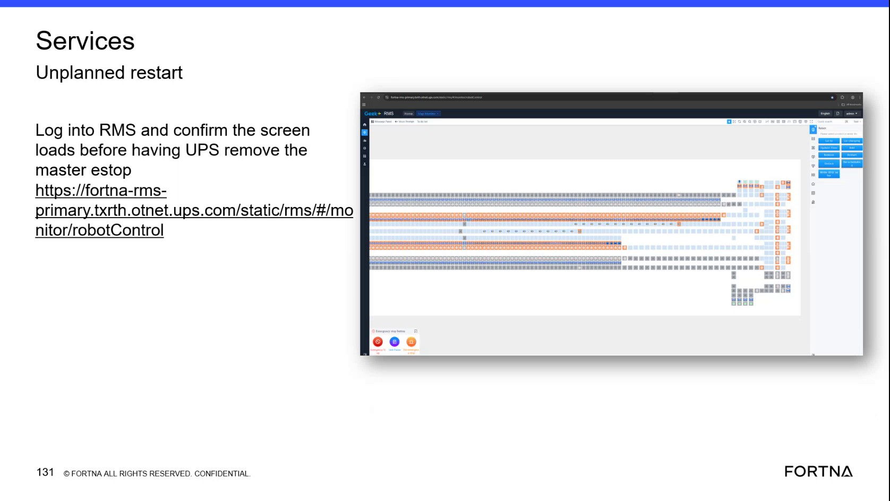

# Confirm RMS robotControl screen loads during Services Unplanned restart (before UPS removes master estop)

## Runbook Header

| Field | Value |
| --- | --- |
| Procedure ID | `proc_confirm_rms_robotcontrol_load_during_services_unplanned_restart_v1` |
| Title | Confirm RMS robotControl screen loads during Services Unplanned restart (before UPS removes master estop) |
| Procedure Type | `diagnostic` |
| Primary Role | `L1_support` |
| Supporting Roles | `L2_support` |
| Support Safe | Yes |
| Capability Tags | `gateway_health`, `wcs_service_health` |
| Access Surface | `rms_ui` |
| Audience Roles | `L1_support` |
| Failure Pattern Tags | `gateway_unhealthy`, `api_unresponsive`, `web_app_fault` |
| Validation Status | `needs_sme_review` |
| Merge Status | `source_finalized` |

## Summary

Use the RMS / fleet status UI to confirm the robotControl/monitor screen fully loads before proceeding with the Services Unplanned restart sequence timing that is tied to UPS removing the master estop.

## When To Use

When performing (or preparing to perform) the Services Unplanned restart sequence and you must verify the RMS robotControl/monitor screen is reachable and fully loads before the UPS-related step involving master estop removal.

## Safety And Operational Notes

* Do not proceed to the UPS/master estop timing step if the RMS robotControl/monitor screen fails to load or remains in a loading/error state.

## Access Or Tools Needed

* RMS / fleet status UI (rms_ui)
* Browser access to the RMS URL path fragment ending in "monitor/robotControl"

## Related Operational Context

* ctx_training_video_services_unplanned_restart_rms_screen_v1
* ctx_training_video_rms_robotcontrol_monitor_reference_v1
* ctx_training_video_master_estop_ups_reference_v1

## Visual References

*Training frame showing the RMS URL path fragment ending in "monitor/robotControl" and the instruction text tying screen load to the Services Unplanned restart timing before UPS removes the master estop.*

## Procedure Steps

### Step 1 — Open RMS / fleet status UI to the robotControl monitor path

**Responsible role:** L1_support

**Instruction:**
In a browser, open the RMS / fleet status UI using the RMS URL path fragment shown in the reference that ends with "monitor/robotControl".

**Expected result:**
The browser navigates to the RMS robotControl/monitor view (URL path includes "monitor/robotControl").

**Stop or Escalate If:**

* If you cannot reach the robotControl/monitor path, stop and escalate for RMS connectivity/service troubleshooting.

---

### Step 2 — Log into RMS

**Responsible role:** L1_support

**Instruction:**
Log into RMS using the site/FORTNA credentials workflow you normally use for RMS access.

**Expected result:**
You are authenticated in RMS and the robotControl/monitor view can begin loading.

**Stop or Escalate If:**

* If login fails, stop and escalate for RMS access/authentication troubleshooting.

---

### Step 3 — Wait for robotControl/monitor screen to fully load

**Responsible role:** L1_support

**Instruction:**
Wait for the robotControl/monitor screen to fully load until the page finishes loading and the robotControl view elements are visible (not blank, not stuck loading, not showing an error state).

**Expected result:**
The RMS robotControl/monitor view loads successfully and is visibly present in the RMS UI (not blank, not stuck loading, not showing an error).

**Stop or Escalate If:**

* If the robotControl screen does not load (blank page, persistent loading, or an error state), stop and escalate for RMS connectivity/service troubleshooting rather than proceeding with the UPS/master estop timing step.

---

## Success Criteria

* robotControl/monitor view is visibly present in RMS UI (not blank, not stuck loading, not showing an error).

## Failure Conditions

* robotControl/monitor page is blank, remains in loading, or shows an error state.

## Escalation Guidance

* If the robotControl screen fails to load or remains in a loading/error state, stop and escalate for RMS connectivity/service troubleshooting rather than proceeding with the UPS/master estop timing step.

## Missing Details / Known Gaps

* The packet does not provide explicit UI field names or a detailed visual checklist for what specific robotControl elements must be visible beyond the general requirement that the page is not blank/loading/error.

## Source Lineage

- Candidate IDs: candidate_training_video_day2_rms_services_unplanned_restart_confirm_robotcontrol_load
- Source ID: `training_video_day2`
- Source Type: `training_video`
