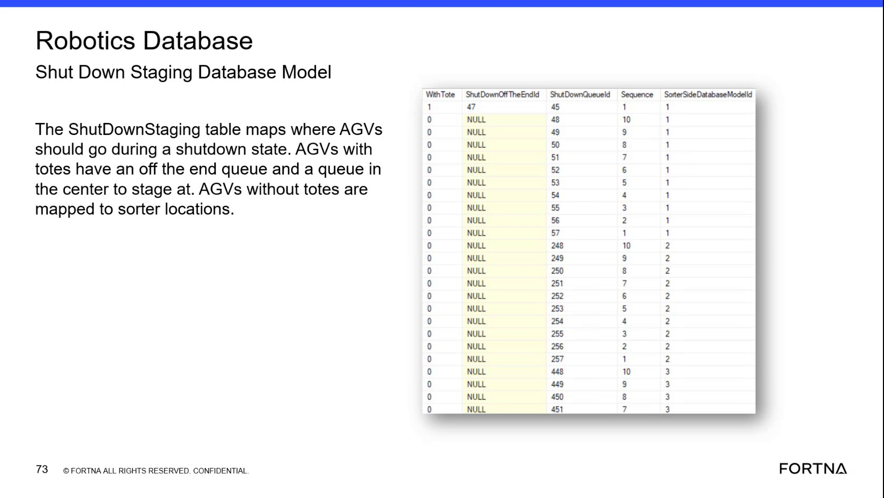
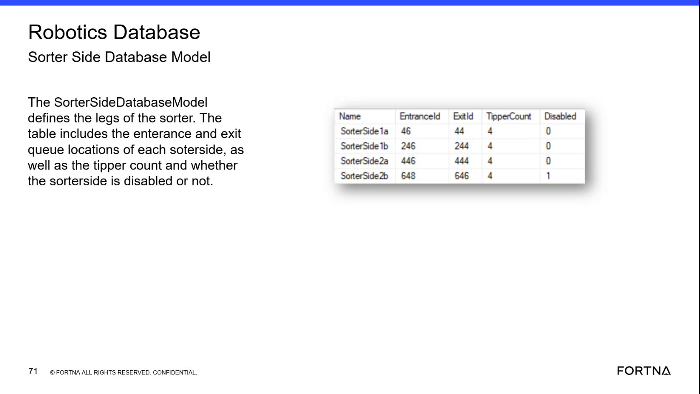

# Verify Shutdown Staging Mapping for AGVs With Tote vs Without Tote Using the ShutDownStaging Table

## Runbook Header

| Field | Value |
| --- | --- |
| Procedure ID | `proc_verify_shutdown_staging_mapping_shutdowndstaging_v1` |
| Title | Verify Shutdown Staging Mapping for AGVs With Tote vs Without Tote Using the ShutDownStaging Table |
| Procedure Type | `diagnostic` |
| Primary Role | `L2_support` |
| Supporting Roles | None |
| Support Safe | Yes |
| Capability Tags | `robot_dwell_or_shutdown_staging` |
| Access Surface | `wcs_sql` |
| Audience Roles | `L2_support` |
| Failure Pattern Tags | `mapping_abnormal` |
| Validation Status | `needs_sme_review` |
| Merge Status | `source_finalized` |

## Summary

Use SSMS/Helix DB (WCS) to validate that the ShutDownStaging table maps shutdown destinations correctly based on whether an AGV has a tote (tote=true) versus no tote (tote=false), including the expected use of ShutdownOffTheEndId and center queue staging for tote-carrying AGVs, and the expected sorter-location/nearest-open-available shutdown queue behavior for non-tote AGVs. Also confirm that the ShutDownStaging Sequence values align with the zone/entrance sequence behavior used to select the correct shutdown queue destination.

## When To Use

When you need to troubleshoot or confirm that AGVs stage correctly during shutdown, specifically validating that tote-carrying AGVs and non-tote AGVs are routed to the correct shutdown staging destinations per the ShutDownStaging table mapping rules (including off-the-end queue vs nearest open available shutdown queue behavior) and that Sequence mapping is consistent.

## Access Or Tools Needed

* SSMS / Helix DB (WCS / Helix DB (SSMS)) access to the OptiSweep/WCS database that contains the shutdown staging model table

## Related Operational Context

* ctx_training_video_shutdown_staging_table_v1
* ctx_training_video_shutdown_with_tote_vs_without_tote_v1

## Visual References

*Frame showing the ShutDownStaging database model fields including WithTote, ShutDownOffTheEndid, ShutDownQueueld, Sequence, and SorterSideDatabaseModelid, plus the tote vs without-tote mapping explanation.*

*Frame describing sorter-side location types/queues (including shutdown/off-the-end queue and related location types) used to interpret the 'mapped to sorter locations' expectation for tote=false rows.*

## Procedure Steps

### Step 1 — Open SSMS / Helix DB (WCS / Helix DB (SSMS)) and connect to the OptiSweep/WCS database

**Responsible role:** L2_support

**Instruction:**
Using SSMS / Helix DB (WCS / Helix DB (SSMS)) (surface: wcs_sql), connect to the OptiSweep/WCS database that contains the shutdown staging model table.

**Expected result:**
You are connected in SSMS/Helix DB to the OptiSweep/WCS database and can browse/query the database schema/models.

---

### Step 2 — Locate the ShutDownStaging model/table in the WCS database

**Responsible role:** L2_support

**Instruction:**
In the WCS database schema, locate the shutdown staging database model/table named ShutDownStaging (or the exact table/model name used in the database schema).

**Expected result:**
You identify the ShutDownStaging table/model and can view its relevant fields/columns (including WithTote, ShutDownOffTheEndid, ShutDownQueueld, Sequence, and SorterSideDatabaseModelid as shown in the referenced model frame).

---

### Step 3 — Validate tote=true rows map to ShutdownOffTheEndid and center queue staging (ShutdownQueueld)

**Responsible role:** L2_support

**Instruction:**
In ShutDownStaging, review rows where WithTote / tote=true and confirm they map to a shutdown off-the-end queue destination (ShutdownOffTheEndid) and a center queue staging destination (ShutdownQueueld / center queue staging fields as shown in the table).

**Expected result:**
For tote=true rows, ShutdownOffTheEndid is populated with an off-the-end queue destination and ShutdownQueueld is populated with the center queue staging destination.

**Stop or Escalate If:**

* Stop and escalate if the table shows tote=true rows missing ShutdownOffTheEndid mappings.

---

### Step 4 — Validate tote=false rows map to sorter locations / nearest open available shutdown queue behavior

**Responsible role:** L2_support

**Instruction:**
In ShutDownStaging, review rows where WithTote / tote=false and confirm they map to sorter locations (i.e., the destination is mapped to sorter locations rather than the shutdown off-the-end queue path).

**Expected result:**
For tote=false rows, the mapped destination corresponds to sorter locations / nearest open available shutdown queue behavior rather than the off-the-end queue path used for tote=true.

**Stop or Escalate If:**

* Stop and escalate if tote=false rows are mapped to the off-the-end queue path instead of sorter locations / nearest open available shutdown queue behavior.

---

### Step 5 — Check Sequence behavior aligns with zone/entrance sequence selection of shutdown queue destination

**Responsible role:** L2_support

**Instruction:**
In ShutDownStaging, check that the table uses a sequence value (Sequence / sequence #) that matches the AGV’s zone/entrance sequence so the system can select the correct shutdown queue destination.

**Expected result:**
Sequence values in ShutDownStaging are present and consistent such that a given zone/entrance sequence selects the corresponding shutdown queue destination.

**Stop or Escalate If:**

* Stop and escalate if sequence values do not align with the described “zone/sequence selects shutdown queue destination” behavior (e.g., sequence rows are missing or inconsistent).

---

### Step 6 — Stop and escalate on mapping or sequence inconsistencies

**Responsible role:** L2_support

**Instruction:**
If any of the validation checks fail (tote=true missing ShutdownOffTheEndid, tote=false routed to off-the-end queue path, or Sequence behavior inconsistent), stop further analysis and escalate.

**Expected result:**
A clear escalation decision is made based on the specific failing condition(s).

**Stop or Escalate If:**

* tote=true rows missing ShutdownOffTheEndid mappings
* tote=false rows mapped to off-the-end queue path instead of sorter locations / nearest open available shutdown queue behavior
* Sequence values do not align with zone/sequence selects shutdown queue destination behavior (missing or inconsistent sequence rows)

---

## Success Criteria

* In ShutDownStaging, tote=true rows include a mapped ShutdownOffTheEndid (off-the-end queue destination) and a mapped center queue staging destination (ShutdownQueueld).
* In ShutDownStaging, tote=false rows are mapped to sorter locations / nearest open available shutdown queue behavior rather than the off-the-end queue path.
* ShutDownStaging Sequence values are present and align with the described zone/entrance sequence behavior used to select the correct shutdown queue destination.

## Failure Conditions

* tote=true rows missing ShutdownOffTheEndid mappings.
* tote=false rows mapped to the off-the-end queue path instead of sorter locations / nearest open available shutdown queue behavior.
* Sequence values missing or inconsistent with zone/sequence selection behavior.

## Escalation Guidance

* Escalate when ShutDownStaging violates tote=true vs tote=false mapping expectations (ShutdownOffTheEndid missing for tote=true; off-the-end queue path used for tote=false) or when Sequence behavior is inconsistent/missing.

## Missing Details / Known Gaps

* The packet does not provide exact SSMS navigation steps (e.g., which specific database name/catalog to select) beyond 'OptiSweep/WCS database' and 'ShutDownStaging (or exact table/model name used in the database schema)'.
* The packet does not provide explicit column names for 'tote=true' vs 'tote=false' beyond the model field name shown in the referenced frame (WithTote) and the candidate's 'tote=true/false' wording; exact SQL filter syntax is not provided.

## Source Lineage

- Candidate IDs: candidate_training_video_day2_shutdown_staging_table_check
- Source ID: `training_video_day2`
- Source Type: `training_video`
