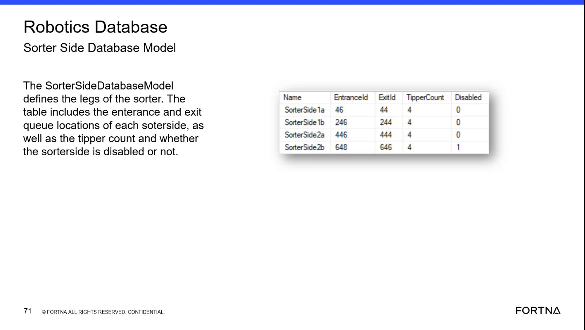

# Check SorterSide Entrance, Exit, Tipper Count, and Disabled State in SSMS

## Runbook Header

| Field | Value |
| --- | --- |
| Procedure ID | `proc_check_sorterside_fields_in_ssms_v1` |
| Title | Check SorterSide Entrance, Exit, Tipper Count, and Disabled State in SSMS |
| Procedure Type | `diagnostic` |
| Primary Role | `L2_support` |
| Supporting Roles | `L3_support` |
| Support Safe | Yes |
| Capability Tags | `zone_config_state` |
| Access Surface | `wcs_sql` |
| Audience Roles | `L2_support`, `L3_support` |
| Failure Pattern Tags | `mapping_abnormal` |
| Validation Status | `needs_sme_review` |
| Merge Status | `source_finalized` |

## Summary

Use the WCS / Helix DB (SSMS) surface to perform a read-only inspection of the OptiSweep Robotics SorterSideDatabaseModel. Verify the live sorter-side Name, EntranceId, ExitId, TipperCount, and Disabled fields against the available sorter-side configuration examples.

## When To Use

Use this read-only WCS / Helix DB (SSMS) diagnostic when validating sorter-side queue mappings, the number of associated tippers, or whether a sorter side is disabled.

## Do Not Use For

* Do not use this procedure to change TipperCount, EntranceId, ExitId, or Disabled values.
* Do not use this procedure as a substitute for confirming whether a disabled sorter side is intentionally excluded from the current rollout phase.
* Do not use this procedure for live sorter control, tote exchange, or AGV commands.

## Safety And Operational Notes

* This is a read-only SSMS check.
* Do not modify TipperCount, queue IDs, or Disabled values during the inspection.

## Access Or Tools Needed

* WCS / Helix DB (SSMS)
* OptiSweep Robotics database
* SorterSideDatabaseModel
* Name, EntranceId, ExitId, TipperCount, and Disabled fields

## Related Operational Context

* ctx_training_video_sorter_side_database_model_v1
* ctx_training_video_sorter_side_tipper_distribution_v1

## Visual References

*Robotics Database SorterSideDatabaseModel table showing Name, EntranceId, ExitId, TipperCount, Disabled, and sorter-side example rows.*

## Procedure Steps

### Step 1 — Open the OptiSweep Robotics database in SSMS

**Responsible role:** L2_support

**Instruction:**
In the WCS / Helix DB (SSMS) surface, open SSMS and select the OptiSweep Robotics database.

**Expected result:**
The OptiSweep Robotics database is selected and available for inspection in SSMS.

**Stop or Escalate If:**

* Escalate to L3 support if the OptiSweep Robotics database cannot be accessed.

---

### Step 2 — Locate SorterSideDatabaseModel in the Robotics database

**Responsible role:** L2_support

**Instruction:**
In the WCS / Helix DB (SSMS) surface, locate the SorterSideDatabaseModel table or model in the OptiSweep Robotics database.

**Expected result:**
The SorterSideDatabaseModel is available for inspection.

**Stop or Escalate If:**

* Escalate to L3 support if the model or table is missing from the Robotics database.

---

### Step 3 — Inspect the relevant sorter-side fields

**Responsible role:** L2_support

**Instruction:**
In the WCS / Helix DB (SSMS) surface, find the relevant SorterSide record and inspect its Name, EntranceId, ExitId, TipperCount, and Disabled fields.

**Expected result:**
The relevant SorterSide row is present with a readable Name, entrance and exit queue IDs, a numeric TipperCount, and a Disabled value.

**Stop or Escalate If:**

* Escalate to L2/L3 support if the SorterSide row is missing, an entrance or exit ID is absent, TipperCount is blank or unexpected, or the Disabled state cannot be interpreted.

---

### Step 4 — Compare the live row with the sorter-side configuration examples

**Responsible role:** L2_support

**Instruction:**
In the WCS / Helix DB (SSMS) surface, compare the live SorterSide row with the available examples: SorterSide 1a has EntranceId 46, ExitId 44, TipperCount 4, Disabled 0; SorterSide 1b has EntranceId 246, ExitId 244, TipperCount 4, Disabled 0; SorterSide 2a has EntranceId 446, ExitId 444, TipperCount 4, Disabled 0; and SorterSide 2b has EntranceId 648, ExitId 646, TipperCount 4, Disabled 1.

**Expected result:**
The live row can be compared field by field with the named sorter-side examples, and the Disabled value is identified as either 0 or 1 where displayed.

**Stop or Escalate If:**

* Escalate to L2/L3 support if the live row does not match the expected sorter-side mapping and no approved configuration explanation is available.
* Do not change TipperCount, EntranceId, ExitId, or Disabled values during this check.

---

## Success Criteria

* The OptiSweep Robotics database is opened in SSMS.
* SorterSideDatabaseModel is located and readable.
* The relevant sorter-side row is present.
* Name, EntranceId, ExitId, TipperCount, and Disabled are inspected.
* Any discrepancy is recorded for L2/L3 review without modifying the database.

## Failure Conditions

* SorterSideDatabaseModel or the relevant row is missing.
* EntranceId or ExitId is absent.
* TipperCount is blank or unexpected.
* Disabled cannot be read or does not match the expected live sorter-side condition.
* The live mapping differs from the available configuration examples without an approved explanation.

## Escalation Guidance

* Escalate missing rows, missing queue IDs, blank or unexpected TipperCount values, and unexplained Disabled states to L2/L3 support.
* A Disabled value of 1 should be investigated in the context of the live sorter-side configuration; the source describes disabled sorter sides as potentially related to phased rollout configuration.
* Do not make database changes during this diagnostic.

## Missing Details / Known Gaps

* The source does not provide SQL statements or exact query syntax.
* The packet does not establish whether SorterSideDatabaseModel is exposed as a physical table, view, or another model representation in every site database.
* Site-specific expected sorter-side mappings and rollout phase are not supplied; a Disabled value of 1 therefore requires live configuration context before being treated as a fault.
* The packet does not define the exact escalation channel or ticketing process for L2/L3 support.

## Source Lineage

- Candidate IDs: candidate_training_video_day2_sorter_side_model_diagnostic
- Source ID: `training_video_day2`
- Source Type: `training_video`
