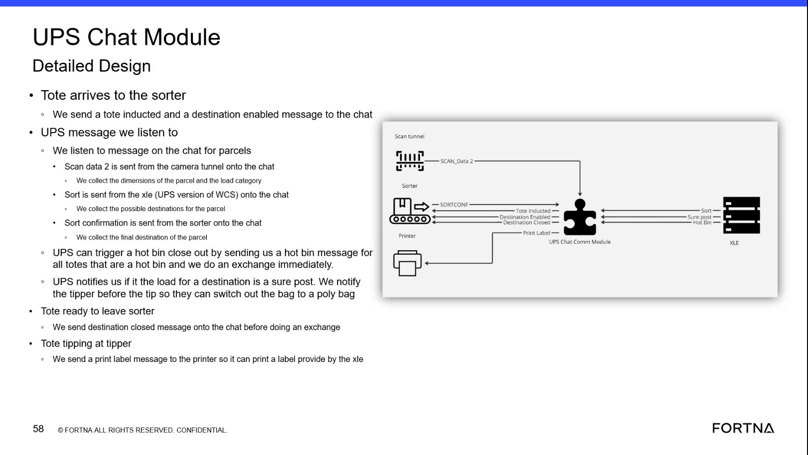
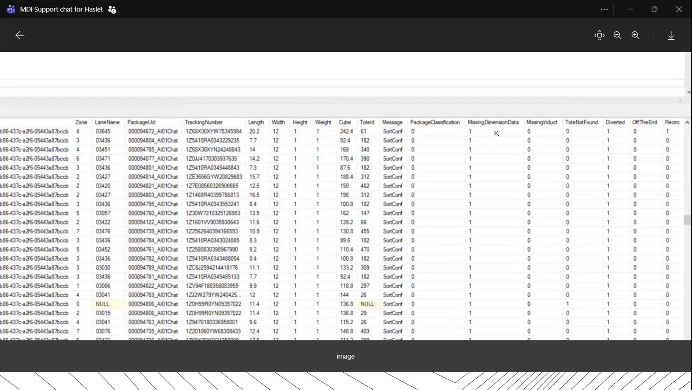

# Verify UPS chat message flow for sorter induction, destination enable/close, and label print triggers

## Runbook Header

| Field | Value |
| --- | --- |
| Procedure ID | `proc_verify_ups_chat_message_flow_sorter_sweeper_induction_v1` |
| Title | Verify UPS chat message flow for sorter induction, destination enable/close, and label print triggers |
| Procedure Type | `diagnostic` |
| Primary Role | `L2_support` |
| Supporting Roles | None |
| Support Safe | Yes |
| Capability Tags | `tote_exchange_sequence`, `wcs_api_responsiveness` |
| Access Surface | `wcs_api`, `apidog`, `ignition_gateway` |
| Audience Roles | `L2_support` |
| Failure Pattern Tags | None |
| Validation Status | `needs_sme_review` |
| Merge Status | `source_finalized` |

## Summary

Verify that the live Sorter Sweeper ↔ UPS chat message sequence is occurring for a tote/parcel: tote inducted + destination enabled, scan-derived dimensions/load category collection, sort confirmation, optional hot bin/hop-in closeout triggering exchange, destination close before exchange, and print label message to the printer at the tipper stage.

## When To Use

Use when you need to confirm that the UPS-facing chat message sequence described for the Sorter Sweeper module is present and progressing for totes/parcels (induction → destination enable → scan data → sort confirmation → hot bin/hop-in exchange → destination close → print label).

## Access Or Tools Needed

* Apidog / WCS API client (wcs_api)
* Live tote/parcel identifiers to correlate message evidence

## Related Operational Context

* ctx_training_video_ups_chat_message_flow_v1
* ctx_training_video_sorter_sweeper_system_overview_v1

## Visual References

*Frame showing the UPS chat message sequence: tote inducted + destination enabled; scan data (dimensions/load category); sort sent and sort confirmation; hot bin/hop-in closeout triggers exchange; destination close before exchange; print label message to printer.*

*Example evidence view showing dimension fields (Length/Width/Height/Weight) alongside sort confirmation filtering; used to visually confirm that dimension fields should be populated when sort confirmation exists.*

## Procedure Steps

### Step 1 — Open the live OptiSweep/WCS API client surface (Apidog / WCS API)

**Responsible role:** L2_support

**Instruction:**
Open the live OptiSweep/WCS API client surface (Apidog / WCS API) to begin querying for message evidence tied to the tote/parcel in process.

**Expected result:**
You are able to run live API queries against the OptiSweep/WCS API from the Apidog client.

**Stop or Escalate If:**

* If the API cannot be queried reliably, escalate for deeper API responsiveness investigation (wcs_api_responsiveness).

---

### Step 2 — Identify the live API requests/endpoints that correspond to each UPS chat message type in the sequence

**Responsible role:** L2_support

**Instruction:**
Using the live OptiSweep/WCS API client, identify the API requests/endpoints that provide evidence for: tote inducted message, destination enabled message, scan-derived dimensions/load category, sort confirmation, hot bin/hop-in message (if applicable), destination close message, and print label message to the printer.

**Expected result:**
You have a set of live API queries that can return evidence records for each message type listed above.

**Stop or Escalate If:**

* If the API evidence mapping cannot be established for required message types, stop and escalate for SME mapping of message types to live API fields/endpoints.

---

### Step 3 — Verify tote inducted + destination enabled evidence for the same tote/parcel

**Responsible role:** L2_support

**Instruction:**
For a tote/parcel currently in process, query the live OptiSweep/WCS API evidence for both: (1) tote inducted message and (2) destination enabled message. Correlate both evidence records to the same tote/parcel identifier.

**Expected result:**
Both tote inducted and destination enabled evidence records are present for the same tote/parcel identifier.

**Stop or Escalate If:**

* Stop and escalate if tote inducted is present but destination enabled is missing for the same tote/parcel.

---

### Step 4 — Verify scan-derived dimensions and load category evidence

**Responsible role:** L2_support

**Instruction:**
For the same tote/parcel context, query the live OptiSweep/WCS API evidence for scan-derived parcel dimensions and load category fields that are described as coming from the scan tunnel onto the chat.

**Expected result:**
Dimensions and load category fields are populated for the parcel/tote context.

**Stop or Escalate If:**

* If scan-derived dimensions/load category are missing while induction evidence exists, escalate for deeper module-level investigation (Sorter Sweeper vs XLE COM vs OPC COM).

---

### Step 5 — Verify sort confirmation evidence includes final destination

**Responsible role:** L2_support

**Instruction:**
For the same tote/parcel, query the live OptiSweep/WCS API evidence for sort confirmation records. Confirm that a sort confirmation record exists and includes a final destination for the parcel.

**Expected result:**
A sort confirmation evidence record exists for the tote/parcel and includes a final destination.

**Stop or Escalate If:**

* Stop and escalate if sort confirmation evidence is missing for the tote/parcel.

---

### Step 6 — Verify hot bin closeout / hop-in exchange evidence (when expected)

**Responsible role:** L2_support

**Instruction:**
If the tote(s) are expected to be hop-in/hot-bin, query the live OptiSweep/WCS API evidence for hot bin message/hop-in message records for those totes. Confirm that the exchange-related state advances immediately after the hot bin/hop-in evidence.

**Expected result:**
Hot bin/hop-in evidence exists for the tote(s) and exchange-related state advances immediately after.

**Stop or Escalate If:**

* Stop and escalate if hot bin/hop-in evidence is missing for totes that are expected to be hop-in.

---

### Step 7 — Verify destination close message exists before exchange advancement

**Responsible role:** L2_support

**Instruction:**
Before the exchange-related state advances for the tote/parcel, query the live OptiSweep/WCS API evidence for a destination close message being sent onto the chat. Correlate it to the destination tied to the tote.

**Expected result:**
A destination close message evidence record exists for the destination tied to the tote before exchange-related state advances.

**Stop or Escalate If:**

* Stop and escalate if destination close message is missing before the exchange-related state advances.

---

### Step 8 — Verify print label message is sent at the tipper stage

**Responsible role:** L2_support

**Instruction:**
At the tipper stage for the tote/parcel, query the live OptiSweep/WCS API evidence for a print label message being sent to the printer. Confirm it is associated with the label provided by XLE (e.g., label payload/identifier present).

**Expected result:**
A print label message evidence record exists and is associated with the label provided by XLE (label payload/identifier present).

**Stop or Escalate If:**

* Stop and escalate if print label message evidence is missing at the tipper stage.

---

### Step 9 — Stop and escalate on missing/out-of-order message evidence

**Responsible role:** L2_support

**Instruction:**
If any required message evidence is missing or out of order for the same tote/parcel (tote inducted present but destination enabled missing; sort confirmation missing; destination close missing before exchange; print label missing at tipper), stop further checks and escalate for deeper module-level investigation.

**Expected result:**
A clear escalation decision is made based on which message evidence is missing/out of order.

**Stop or Escalate If:**

* tote inducted present but destination enabled missing
* sort confirmation missing
* destination close missing before exchange
* print label message missing at tipper
* only one side present (e.g., scan data present but sort confirmation missing)

---

## Success Criteria

* For the tote/parcel in process, evidence shows tote inducted + destination enabled present for the same identifier.
* Scan-derived dimensions and load category are populated for the same tote/parcel context.
* Sort confirmation evidence exists and includes a final destination for the parcel.
* If hop-in/hot-bin is expected, hot bin/hop-in evidence exists and exchange advancement occurs immediately.
* Destination close message evidence exists before exchange advancement.
* At the tipper stage, print label message evidence exists and is associated with the label provided by XLE.

## Failure Conditions

* Destination enabled missing after tote inducted for the same tote/parcel.
* Scan-derived dimensions/load category missing or not populated for the tote/parcel.
* Sort confirmation missing or missing final destination.
* Hot bin/hop-in evidence missing when tote(s) are expected to be hop-in.
* Destination close missing before exchange advancement.
* Print label message missing at the tipper stage.

## Escalation Guidance

* If required message evidence is missing or out of order for the same tote/parcel, escalate for deeper module-level investigation (Sorter Sweeper vs XLE COM vs OPC COM).
* If the API cannot be queried reliably, escalate for WCS/OptiSweep API responsiveness investigation.

## Missing Details / Known Gaps

* The candidate does not provide concrete live API endpoint names, request names, or exact field names to query for each message type (tote inducted, destination enabled, sort confirmation, hot bin/hop-in, destination close, print label). Stage 6 requires SME mapping from the live API catalog to concrete endpoints/fields.

## Source Lineage

- Candidate IDs: candidate_training_video_day2_sorter_sweeper_ups_chat_message_flow_check
- Source ID: `training_video_day2`
- Source Type: `training_video`
