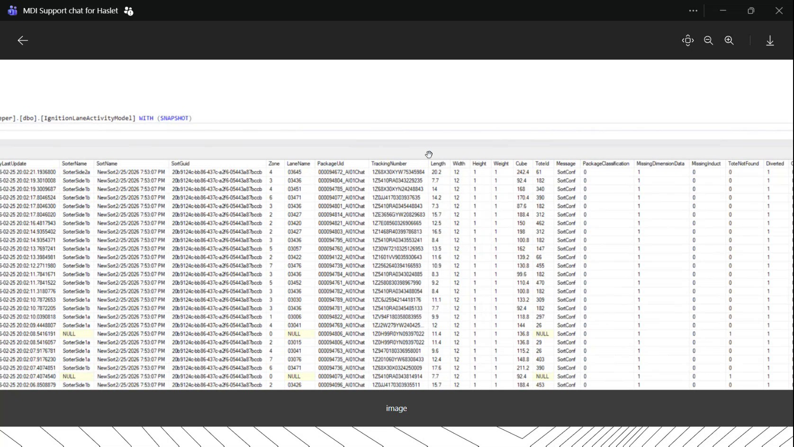
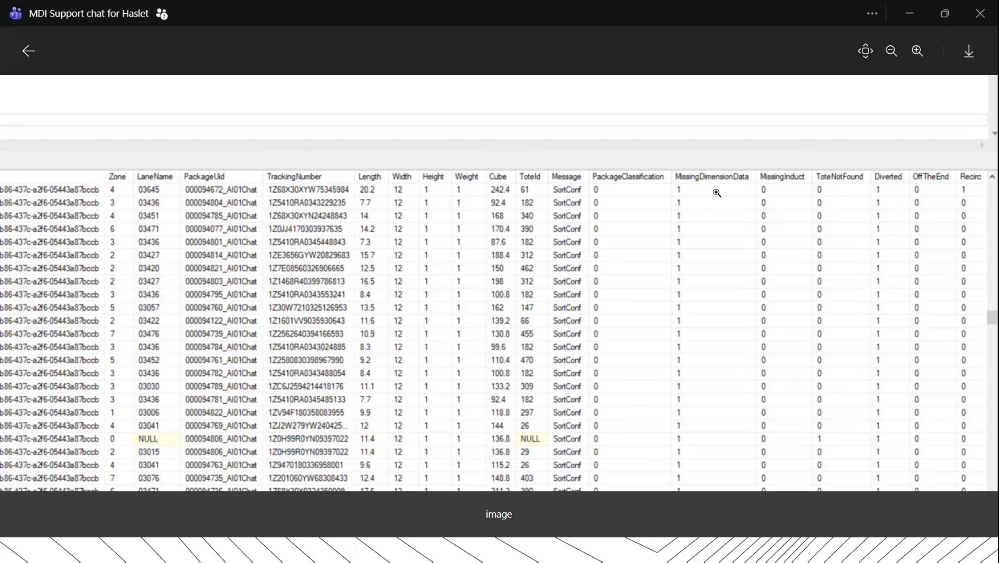
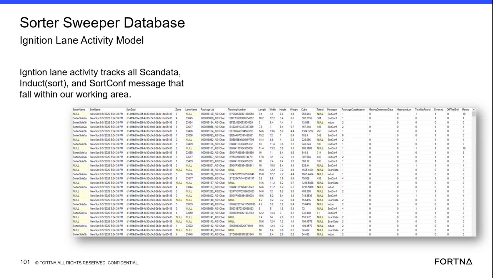

# Check IgnitionLaneActivityModel for Missing Dimension Data in SSMS

## Runbook Header

| Field | Value |
| --- | --- |
| Procedure ID | `proc_check_ignition_lane_activity_model_missing_dimension_data_v1` |
| Title | Check IgnitionLaneActivityModel for Missing Dimension Data in SSMS |
| Procedure Type | `diagnostic` |
| Primary Role | `L2_support` |
| Supporting Roles | `L3_support` |
| Support Safe | Yes |
| Capability Tags | `sorter_item_or_scan_state` |
| Access Surface | `wcs_sql` |
| Audience Roles | `L2_support`, `L3_support` |
| Failure Pattern Tags | `miss_scan_or_dimension_fallback` |
| Validation Status | `needs_sme_review` |
| Merge Status | `source_finalized` |

## Summary

Use the WCS / Helix DB (SSMS) to inspect the read-only dbo.IgnitionLaneActivityModel view and determine whether recent lane activity records contain dimension data expected from the dimensioners. Correlate dimension fields with package identifiers, Message, PackageClassification, Missing DimensionData, MissingInduct, Tote Not Found, and Diverted indicators. This procedure does not modify or reboot dimensioners.

## When To Use

Use this WCS / Helix DB (SSMS) diagnostic when support needs to verify whether recent lane activity records contain expected dimension data, especially when Missing DimensionData is suspected or affected records show blank or absent dimension values.

## Do Not Use For

* Do not use this procedure to reboot, reconfigure, or otherwise modify dimensioners.
* Do not use this procedure as a dimensioner recovery procedure; the source supports database verification only.

## Safety And Operational Notes

* Use the read-only database view for inspection.
* Do not reboot, reconfigure, or otherwise modify the dimensioners from this database check.
* The source describes dimensioner behavior after a power flicker but does not provide a supported dimensioner recovery procedure.

## Access Or Tools Needed

* WCS / Helix DB (SSMS)
* Read-only access to the applicable WCS / Helix database
* dbo.IgnitionLaneActivityModel

## Related Operational Context

* ctx_training_video_dimension_data_dependency_v1
* ctx_training_video_ignition_lane_activity_fields_v1
* ctx_training_video_lane_activity_status_flags_v1
* ctx_training_video_dimensioner_power_flicker_behavior_v1

## Visual References

*SSMS database view containing dbo.IgnitionLaneActivityModel with Last Update, sorter and lane identifiers, package identifiers, dimension fields, and status fields.*

*Lane activity table view showing dimension fields and filtering or inspection of SortConf records with missing dimension data.*

*IgnitionLaneActivityModel field view showing package identifiers, Length, Width, Height, Weight, Cube, Message, PackageClassification, and MissingDimensionData-related fields.*

## Procedure Steps

### Step 1 — Open the applicable WCS / Helix database in SSMS

**Responsible role:** L2_support

**Instruction:**
In SSMS, select the applicable WCS / Helix database containing the dbo.IgnitionLaneActivityModel view or model. Use the database for inspection only.

**Expected result:**
The applicable WCS / Helix database is selected and dbo.IgnitionLaneActivityModel is available to open.

**Stop or Escalate If:**

* Escalate to L3 support if the applicable WCS / Helix database or dbo.IgnitionLaneActivityModel cannot be accessed.

---

### Step 2 — Open dbo.IgnitionLaneActivityModel in read-only view

**Responsible role:** L2_support

**Instruction:**
Open dbo.IgnitionLaneActivityModel in the read-only WCS / Helix DB (SSMS) view. Confirm that the lane activity table displays the record and field set used for this check.

**Expected result:**
The live view displays dbo.IgnitionLaneActivityModel records with lane, package, dimension, and status-related columns.

**Stop or Escalate If:**

* Escalate to L3 support if the model cannot be opened or the required fields are not available.

---

### Step 3 — Identify recent lane activity records

**Responsible role:** L2_support

**Instruction:**
Review recent values in Last Update, SorterName, SortName, Zone, LaneName, PackageUid, and Tracking Number in the WCS / Helix DB (SSMS) lane activity view. Use these fields to identify the records relevant to the reported lane or sorter condition.

**Expected result:**
Relevant recent lane activity records are identified with their update time, sorter and lane location, PackageUid, and Tracking Number.

**Stop or Escalate If:**

* Escalate to L2/L3 support if recent lane activity records are absent for the affected area or investigation period.

---

### Step 4 — Inspect dimension and weight fields

**Responsible role:** L2_support

**Instruction:**
In the WCS / Helix DB (SSMS) records identified in the previous step, inspect Length, Width, Height, Weight, and Cube. Compare whether these fields contain values or are blank or missing for the affected records.

**Expected result:**
Each relevant record shows the observable state of Length, Width, Height, Weight, and Cube.

**Stop or Escalate If:**

* Escalate to L2/L3 support if dimension fields remain blank or missing for affected records.

---

### Step 5 — Review lane activity status indicators

**Responsible role:** L2_support

**Instruction:**
For the same records in the WCS / Helix DB (SSMS), review Message, PackageClassification, Missing DimensionData, MissingInduct, Tote Not Found, and Diverted. Record the observed values without assigning undocumented meanings to binary-like or value-like indicators.

**Expected result:**
The affected records show their Message and PackageClassification values together with the observed Missing DimensionData, MissingInduct, Tote Not Found, and Diverted values.

**Stop or Escalate If:**

* Escalate to L2/L3 support if Missing DimensionData is present for affected records.
* Escalate to L2/L3 support if the status fields and dimension fields do not provide a clear observable result.

---

## Success Criteria

* The applicable WCS / Helix database and dbo.IgnitionLaneActivityModel are accessible in SSMS.
* Recent lane activity records are identified using Last Update, sorter, zone, lane, PackageUid, and Tracking Number values.
* Length, Width, Height, Weight, and Cube values are observed for the affected records.
* Message, PackageClassification, Missing DimensionData, MissingInduct, Tote Not Found, and Diverted values are reviewed for the same records.
* The result clearly states whether expected dimension data is present, missing, or not determinable from the available records.

## Failure Conditions

* Recent lane activity records are absent for the affected sorter, zone, lane, or investigation period.
* Length, Width, Height, Weight, or Cube is blank or absent for affected records.
* Missing DimensionData is indicated for affected records.
* The WCS / Helix database or dbo.IgnitionLaneActivityModel cannot be accessed.
* The available records do not provide enough observable information to determine the dimension-data state.

## Escalation Guidance

* Escalate to L2/L3 support if recent lane activity records are absent.
* Escalate to L2/L3 support if dimension fields remain blank or missing for affected records.
* Escalate to L2/L3 support if Missing DimensionData is present for affected records.
* Report the affected sorter, SortName, Zone, LaneName, PackageUid, Tracking Number, Last Update, observed dimension fields, Message, PackageClassification, and status indicators.
* Do not direct support or site personnel to reboot or reconfigure dimensioners based solely on this database check; the source supports verification and escalation only.

## Missing Details / Known Gaps

* The source does not provide a universal numeric threshold or complete interpretation for the dimension fields.
* The source does not define universal values for Missing DimensionData, MissingInduct, Tote Not Found, or Diverted; record the observed values without assigning undocumented meanings.
* The source does not provide a supported query, filtering syntax, database server name, database name, connection path, or command.
* The source does not provide a dimensioner reboot, reconfiguration, or recovery procedure.
* The packet does not identify a site code, site label, customer, or incident case ID.

## Source Lineage

- Candidate IDs: candidate_training_video_day2_ssms_check_missing_dimension_data
- Source ID: `training_video_day2`
- Source Type: `training_video`
