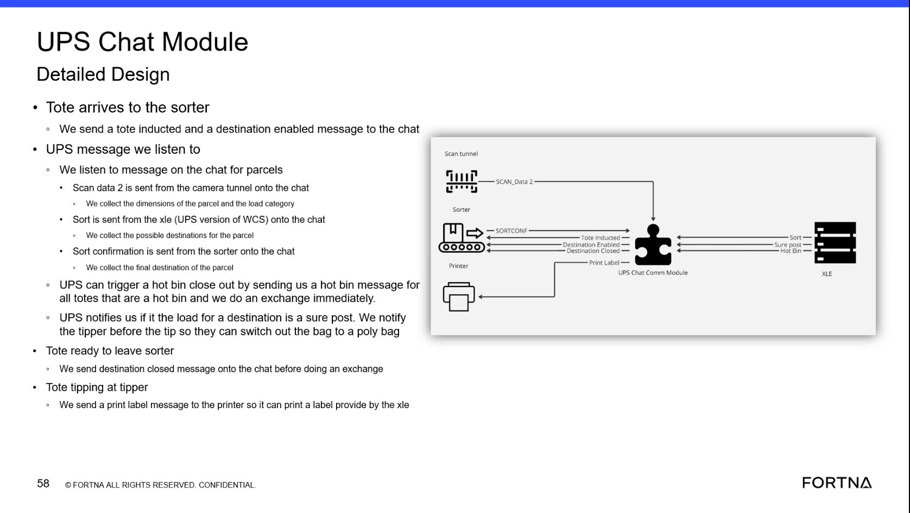

# Verify Robotics module AGV state machine generates Geek Plus execution commands from Sorter Sweeper tote tasks

## Runbook Header

| Field | Value |
| --- | --- |
| Procedure ID | `proc_verify_robotics_module_agv_state_machine_generates_geek_plus_commands_from_tote_tasks_v1` |
| Title | Verify Robotics module AGV state machine generates Geek Plus execution commands from Sorter Sweeper tote tasks |
| Procedure Type | `diagnostic` |
| Primary Role | `L2_support` |
| Supporting Roles | None |
| Support Safe | Yes |
| Capability Tags | `agv_active_errors` |
| Access Surface | `wcs_api`, `wcs_sql` |
| Audience Roles | `L2_support` |
| Failure Pattern Tags | `api_unresponsive`, `robot_task_or_command_stuck` |
| Validation Status | `needs_sme_review` |
| Merge Status | `source_finalized` |

## Summary

Validate the handoff from Sorter Sweeper tote tasks to the Robotics module’s AGV state machine and confirm that the Robotics module generates Geek Plus execution commands for the documented AGV task set (induct tote, remove tote, initialize AGV, go to, pick up tote, move tote, drop off tote, cancel request, go charge).

## When To Use

Use when you need to confirm that tote tasks created by Sorter Sweeper are received by the Robotics module (AGV state machine) and that the Robotics module generates Geek Plus execution commands matching the expected AGV command/task names.

## Do Not Use For

* Do not use this procedure as a substitute for physical safety actions (e.g., E-stop). This procedure is for validating software command generation/handoff behavior only.

## Access Or Tools Needed

* Access to Robotics module command-generation evidence (exact live tool/screen not specified in the provided segment).
* Access to Geek Plus command execution evidence (exact live tool/screen not specified in the provided segment).

## Related Operational Context

* ctx_training_video_robotics_agv_state_machine_v1

## Visual References

*Segment describing Sorter Sweeper orchestration, tote tasks, and that the Robotics module acts as the AGV state machine receiving tote tasks and generating Geek Plus commands; includes the expected AGV command/task names list.*

## Procedure Steps

### Step 1 — Confirm the Robotics module is the AGV state machine that receives tote tasks and generates Geek Plus commands

**Responsible role:** L2_support

**Instruction:**
On the live OptiSweep/WCS/Robotics command-generation evidence you have access to, confirm that the Robotics module is the component responsible for acting as the AGV state machine that receives tote tasks from Sorter Sweeper and generates commands for Geek Plus to execute.

**Expected result:**
You can observe that tote tasks originating from Sorter Sweeper are handled by the Robotics module as the AGV state machine, and that Geek Plus execution commands are produced from those tote tasks.

**Stop or Escalate If:**

* If you cannot find any live evidence that Robotics module generates Geek Plus commands from tote tasks, stop and escalate for deeper Robotics module / Geek Plus command-generation troubleshooting.

---

### Step 2 — Verify the Robotics module receives tote tasks from the Sorter Sweeper module

**Responsible role:** L2_support

**Instruction:**
Using the live evidence you have access to for Robotics module command generation and/or Robotics-side task/command tracking, verify that tote tasks created by Sorter Sweeper are present/consumed by the Robotics module.

**Expected result:**
For the relevant tote tasks, Robotics module shows corresponding command-generation activity (or command records) that indicate it received/processed those tote tasks.

**Stop or Escalate If:**

* If tote tasks are received but Robotics module does not generate Geek Plus commands, stop and escalate for deeper Robotics module / Geek Plus command generation troubleshooting.

---

### Step 3 — Check that the Robotics module generates Geek Plus commands for the expected AGV task set

**Responsible role:** L2_support

**Instruction:**
For the relevant tote tasks, verify that the Robotics module generates Geek Plus execution commands corresponding to the documented AGV task set: induct tote, remove tote, initialize AGV, go to, pick up tote, move tote, drop off tote, cancel request, go charge.

**Expected result:**
Support can confirm that for the relevant tote tasks, the Robotics module produces Geek Plus execution commands corresponding to the documented AGV task set.

**Stop or Escalate If:**

* If tote tasks are received but Geek Plus commands are not generated (or the generated command set does not match the documented task names), stop and escalate for deeper Robotics module / Geek Plus command generation troubleshooting.

---

## Success Criteria

* For the relevant tote tasks, the Robotics module produces Geek Plus execution commands corresponding to the documented AGV task set (induct tote, remove tote, initialize AGV, go to, pick up tote, move tote, drop off tote, cancel request, go charge).

## Failure Conditions

* Tote tasks are received but Geek Plus commands are not generated.
* Generated command set does not match the documented AGV task names.

## Escalation Guidance

* If tote tasks are received but Geek Plus commands are not generated (or the generated command set does not match the documented task names), stop and escalate for deeper Robotics module / Geek Plus command generation troubleshooting (no specific remediation steps are provided in the provided segment).

## Missing Details / Known Gaps

* The provided segment does not specify the exact live tool/screen/API endpoint where Robotics module command generation evidence and Geek Plus command execution evidence can be viewed.
* The provided segment does not specify how to select the “relevant tote tasks” on the live system (e.g., by tote ID, task ID, or time window).

## Source Lineage

- Candidate IDs: candidate_training_video_day2_verify_robotics_module_agv_state_machine_generates_geek_plus_commands_from_tote_tasks
- Source ID: `training_video_day2`
- Source Type: `training_video`
