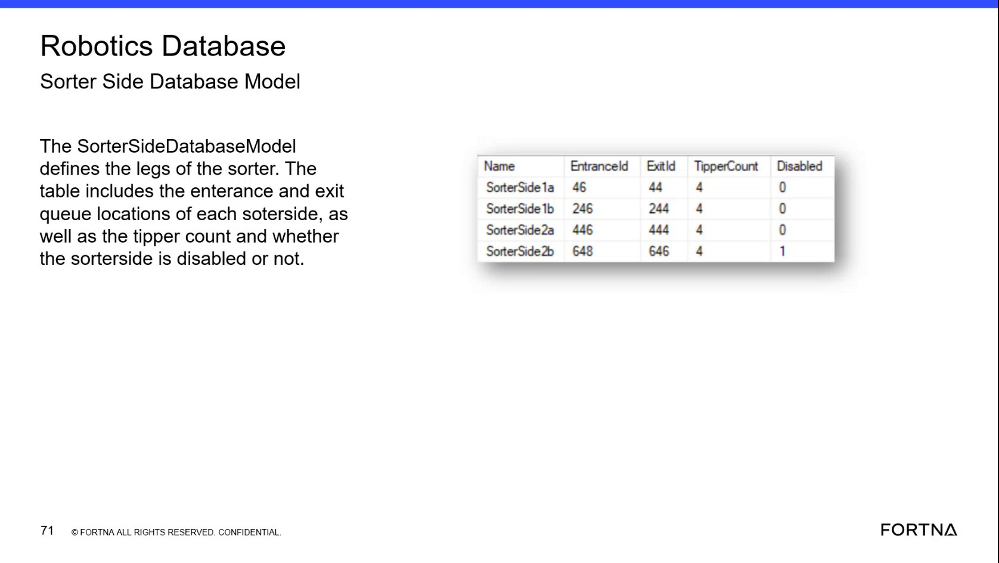

# Verify Robot Location model fields and location types/statuses used by RMS orange locations

## Runbook Header

| Field | Value |
| --- | --- |
| Procedure ID | `proc_verify_robot_location_model_fields_and_rms_orange_location_types_v1` |
| Title | Verify Robot Location model fields and location types/statuses used by RMS orange locations |
| Procedure Type | `diagnostic` |
| Primary Role | `L2_support` |
| Supporting Roles | None |
| Support Safe | Yes |
| Capability Tags | `zone_config_state` |
| Access Surface | `wcs_sql` |
| Audience Roles | `L2_support` |
| Failure Pattern Tags | None |
| Validation Status | `needs_sme_review` |
| Merge Status | `source_finalized` |

## Summary

Using the WCS / Helix DB (SSMS) read-only access surface, verify the Robot Location database model table includes the expected location attributes (station number, occupied, zone, closeout zone, location type, max AGVs, dwell-time tracking) and that the enumerated location types/statuses match the RMS orange location categories (sorter/tipper/hospital/shut down/GLD pre queue).

## When To Use

When you need to confirm that RMS orange location categories are backed by the expected Robot Location model/table definition in the WCS/Robotics database (fields present and location type/status enumerations match the expected categories).

## Access Or Tools Needed

* SSMS (WCS / Helix DB read-only access)

## Related Operational Context

* ctx_training_video_robot_location_database_model_v1
* ctx_training_video_location_types_and_statuses_v1
* ctx_training_video_rms_orange_locations_and_station_mapping_v1

## Visual References

*Robot Location database model table content: expected location attributes and the listed location types/statuses that correspond to RMS orange locations.*

## Procedure Steps

### Step 1 — Open WCS / Helix DB (SSMS) read-only access surface

**Responsible role:** L2_support

**Instruction:**
Use the WCS / Helix DB (SSMS) access surface to connect to the OptiSweep/WCS database that contains the Robotics database model table definitions for the Robot Location model.

**Expected result:**
SSMS is connected to the OptiSweep/WCS database that contains the Robotics database model table definitions for the Robot Location model.

---

### Step 2 — Locate Robot Location database model table and verify required location attributes

**Responsible role:** L2_support

**Instruction:**
In SSMS, locate the Robot Location database model table definition and verify it includes fields/attributes for: station number, occupied (occupied or not), zone, closeout zone, location type, Max number of AGVs allowed at that location, and whether the location should be tracked for dwell time there.

**Expected result:**
The Robot Location database model table definition shows the expected location attributes: station number, occupied, zone, closeout zone, location type, Max number of AGVs allowed, and dwell-time tracking (tracked vs not tracked).

**Stop or Escalate If:**

* If required fields (station number, occupied, zone/closeout zone, location type, max AGVs, dwell-time tracking) are missing or named differently than expected, escalate to deeper model/catalog review.

---

### Step 3 — Verify Robot Location model includes expected location types/statuses for RMS orange categories

**Responsible role:** L2_support

**Instruction:**
In the same Robot Location model/table definition, verify the listed location types/statuses include the categories: sorter entrance queue, sorter queue, sorter exit queue; tipper, tipper queue, tipper exit queue; hospital drop off, hospital entrance queue, hospital pickup, hospital exit queue; queue shut down, off the end shut down queue; GLD pre queue entrance, GLD pre queue exit.

**Expected result:**
The Robot Location model/table definition includes the named location types/statuses for sorter/tipper/hospital/shut down/GLD pre queue categories.

**Stop or Escalate If:**

* If the named location types/statuses (sorter entrance/queue/exit, tipper/queues, hospital queues, shut down queues, GLD pre queue entrance/exit) are missing from the Robot Location model, escalate because RMS orange location categories may not be backed by the expected model.

---

### Step 4 — Cross-check RMS orange location categories map to the same Robot Location types/statuses

**Responsible role:** L2_support

**Instruction:**
Using the Robot Location model/table definition you verified, confirm that the segment’s RMS orange location categories correspond to the same named location types/statuses you see in the Robot Location model/table definition.

**Expected result:**
The RMS orange location categories map consistently to the location types/statuses present in the Robot Location model/table definition.

**Stop or Escalate If:**

* If the mapping is inconsistent (e.g., missing or mismatched location types/statuses), escalate to deeper model/catalog review.

---

## Success Criteria

* Robot Location model/table definition includes required location attributes: station number, occupied, zone, closeout zone, location type, max AGVs, dwell-time tracking.
* Robot Location model/table definition includes expected location types/statuses: sorter entrance/queue/exit; tipper/tipper queue/tipper exit; hospital drop off/entrance queue/pickup/exit queue; queue shut down/off-the-end shut down; GLD pre queue entrance/exit.
* RMS orange location categories map consistently to the same named location types/statuses in the Robot Location model/table definition.

## Failure Conditions

* One or more required Robot Location attributes are missing or named differently such that the expected set cannot be confirmed.
* One or more expected location types/statuses are missing from the Robot Location model/table definition.
* RMS orange location categories cannot be mapped consistently to the Robot Location model/table definition.

## Escalation Guidance

* Escalate to deeper model/catalog review if required fields are missing/mismatched or if expected location types/statuses are missing, because RMS orange location categories may not be backed by the expected model.

## Missing Details / Known Gaps

* The packet does not provide the exact SSMS navigation path or the exact Robot Location table name/column names; it only states the expected attributes and enumerated location types/statuses to verify once the Robot Location model/table definition is located.

## Source Lineage

- Candidate IDs: candidate_training_video_diagnostic_robot_location_model_fields
- Source ID: `training_video_day2`
- Source Type: `training_video`
