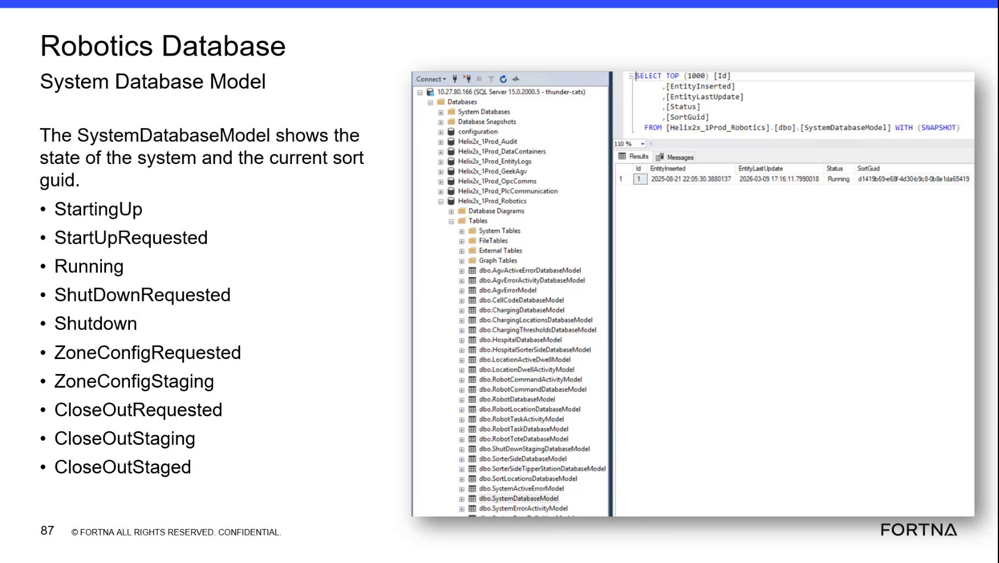

# Check SystemDatabaseModel lifecycle/staging status in Helix2x_1Prod_Robotics (SSMS)

## Runbook Header

| Field | Value |
| --- | --- |
| Procedure ID | `proc_check_systemdatabasemodel_lifecycle_staging_status_ssms_v1` |
| Title | Check SystemDatabaseModel lifecycle/staging status in Helix2x_1Prod_Robotics (SSMS) |
| Procedure Type | `diagnostic` |
| Primary Role | `L2_support` |
| Supporting Roles | `L2_support` |
| Support Safe | Yes |
| Capability Tags | `sort_lifecycle_state` |
| Access Surface | `wcs_sql` |
| Audience Roles | `L2_support` |
| Failure Pattern Tags | None |
| Validation Status | `needs_sme_review` |
| Merge Status | `source_finalized` |

## Summary

Use SSMS against the Helix2x_1Prod_Robotics database to confirm the SystemDatabaseModel snapshot lifecycle/staging status value is currently one of the expected states (StartingUp, StartUpRequested, Running, ShutDownRequested, ZoneConfigRequested, ZoneConfigStaging, CloseOutRequested, CloseOutStaging, CloseOutStaged).

## When To Use

When you need to verify the current system lifecycle/staging state (startup, running, shutdown, zone config, closeout) by checking the SystemDatabaseModel snapshot status values in the Robotics database.

## Access Or Tools Needed

* SSMS (WCS / Helix DB (SSMS))
* Helix2x_1Prod_Robotics database
* dbo.SystemDatabaseModel

## Related Operational Context

* ctx_training_video_system_database_model_v1
* ctx_training_video_system_status_values_v1

## Visual References

*Training frame showing [Helix2x_1Prod_Robotics].[dbo].[SystemDatabaseModel] WITH (SNAPSHOT) and the lifecycle/staging status values list (StartingUp, StartUpRequested, Running, ShutDownRequested, ZoneConfigRequested, ZoneConfigStaging, CloseOutRequested, CloseOutStaging, CloseOutStaged).*

*Training frame showing the SystemDatabaseModel status concept and the status values set used for interpreting current system state.*

## Procedure Steps

### Step 1 — Connect to the WCS / Helix DB (SSMS) and select Helix2x_1Prod_Robotics

**Responsible role:** L2_support

**Instruction:**
Using SSMS (WCS / Helix DB (SSMS)), connect to the environment and select the Helix2x_1Prod_Robotics database.

**Expected result:**
SSMS is connected and the Helix2x_1Prod_Robotics database is selected as the active database.

**Stop or Escalate If:**

* Stop if you cannot connect to SSMS or cannot access the Helix2x_1Prod_Robotics database (permissions/query errors).

---

### Step 2 — Locate dbo.SystemDatabaseModel in the dbo schema

**Responsible role:** L2_support

**Instruction:**
In SSMS, navigate to the dbo schema and locate the table/model named [dbo].[SystemDatabaseModel].

**Expected result:**
dbo.SystemDatabaseModel is found and visible in the SSMS database object tree.

**Stop or Escalate If:**

* Stop if dbo.SystemDatabaseModel cannot be located or accessed (permissions/query errors).

---

### Step 3 — Read the SystemDatabaseModel snapshot status using WITH (SNAPSHOT)

**Responsible role:** L2_support

**Instruction:**
Run a read-only query/view of [dbo].[SystemDatabaseModel] using WITH (SNAPSHOT) to view the current snapshot row(s) and the status field(s) that represent lifecycle/staging state.

**Expected result:**
You can view the current SystemDatabaseModel snapshot row(s) and identify the lifecycle/staging status value present in the status field(s).

**Stop or Escalate If:**

* Stop and escalate if the snapshot cannot be read (permissions/query errors).
* Stop and escalate if the status value(s) are outside the documented lifecycle/staging set or appear inconsistent (e.g., multiple lifecycle states simultaneously).

---

### Step 4 — Confirm the current lifecycle/staging status is within the documented set

**Responsible role:** L2_support

**Instruction:**
Identify which lifecycle/staging status value is currently present in the SystemDatabaseModel status field(s) and confirm it matches one of: StartingUp, StartUpRequested, Running, ShutDownRequested, ZoneConfigRequested, ZoneConfigStaging, CloseOutRequested, CloseOutStaging, CloseOutStaged.

**Expected result:**
Exactly one current lifecycle/staging status value is present and it matches one of the documented values.

**Stop or Escalate If:**

* Escalate if the snapshot shows an unexpected combination (e.g., multiple lifecycle states simultaneously).
* Escalate if the status value is outside the documented lifecycle/staging set.

---

## Success Criteria

* SystemDatabaseModel snapshot status is readable in SSMS.
* The current lifecycle/staging status value is present and matches one of the documented values: StartingUp, StartUpRequested, Running, ShutDownRequested, ZoneConfigRequested, ZoneConfigStaging, CloseOutRequested, CloseOutStaging, CloseOutStaged.
* No inconsistent/unexpected combination is observed (e.g., multiple lifecycle states simultaneously).

## Failure Conditions

* Snapshot cannot be read due to permissions/query errors.
* Status value(s) are outside the documented lifecycle/staging set.
* Inconsistent/unexpected combination is observed (e.g., multiple lifecycle states simultaneously).

## Escalation Guidance

* Escalate to appropriate support if the snapshot cannot be read (permissions/query errors) or if the status value(s) are outside the documented set or appear inconsistent (e.g., multiple lifecycle states simultaneously).

## Missing Details / Known Gaps

* The packet does not provide the exact column name(s) within [dbo].[SystemDatabaseModel] that hold the lifecycle/staging status value(s); the operator must identify the status field(s) from the live schema/query results.

## Source Lineage

- Candidate IDs: candidate_training_video_diagnostic_systemdatabasemodel_lifecycle_status
- Source ID: `training_video_day2`
- Source Type: `training_video`
