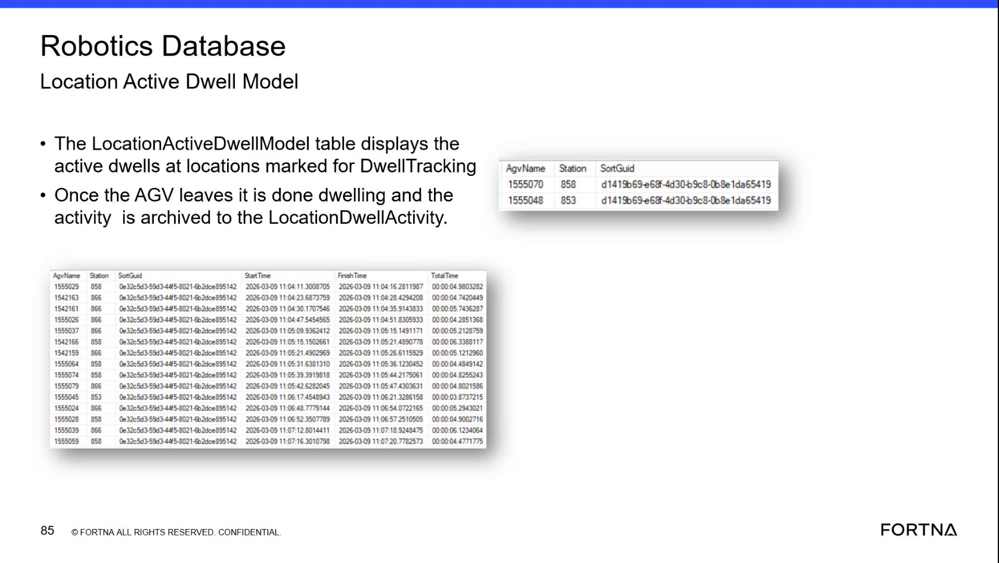
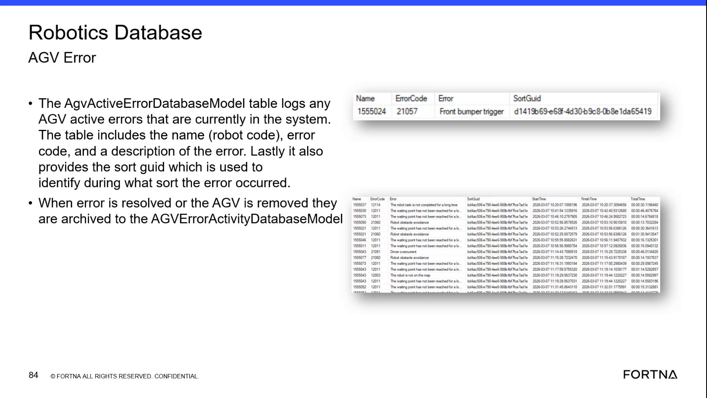

# Check Active Dwell Time at Sort Locations Using Location Active Dwell / Location Dwell Activity Tables

## Runbook Header

| Field | Value |
| --- | --- |
| Procedure ID | `proc_check_active_dwell_time_sort_locations_v1` |
| Title | Check Active Dwell Time at Sort Locations Using Location Active Dwell / Location Dwell Activity Tables |
| Procedure Type | `diagnostic` |
| Primary Role | `L2_support` |
| Supporting Roles | None |
| Support Safe | Yes |
| Capability Tags | `robot_dwell_or_shutdown_staging` |
| Access Surface | `wcs_sql` |
| Audience Roles | `L2_support` |
| Failure Pattern Tags | None |
| Validation Status | `needs_sme_review` |
| Merge Status | `source_finalized` |

## Summary

Use WCS / Helix DB (SSMS) to verify how long an AGV has been sitting at a sort location that is marked for dwell tracking by checking active dwell records in “Location Active Dwell” and, if the AGV has already left, confirming the dwell activity was archived to “Location Dwell activity”.

## When To Use

When you need evidence of dwell timing at a sort location that is configured for dwell tracking (e.g., to confirm how long an AGV has been sitting at that location).

## Access Or Tools Needed

* WCS / Helix DB (SSMS)

## Related Operational Context

* ctx_training_video_location_dwell_tables_v1
* ctx_training_video_dwell_time_definition_v1

## Visual References

*Frame showing “Location Active Dwell Model” and that active dwell is archived to “LocationDwellActivity” once the AGV leaves; includes example columns/rows (e.g., AgvName, Station, SortGuid, SatTime/FinishTime/TotalTime).*

*Frame that explicitly states “Location Active Dwell model table displays the active dwells at sort locations marked for dwell tracking” and that dwell activity is archived after leaving.*

## Procedure Steps

### Step 1 — Open WCS / Helix DB (SSMS) and connect to the OptiSweep database containing dwell models

**Responsible role:** L2_support

**Instruction:**
Open WCS / Helix DB (SSMS) and connect to the OptiSweep database that contains the Robotics / location dwell models.

**Expected result:**
SSMS is connected to the OptiSweep database that contains the Robotics/location dwell models so you can browse/query the dwell-related model tables.

---

### Step 2 — Locate the “Location Active Dwell” model/table

**Responsible role:** L2_support

**Instruction:**
In SSMS, locate the model/table named “Location Active Dwell” (Location Active Dwell model table).

**Expected result:**
You find the “Location Active Dwell” model/table in the OptiSweep database.

---

### Step 3 — Find dwell-tracked sort location rows and read the dwell time value

**Responsible role:** L2_support

**Instruction:**
In “Location Active Dwell”, find the row(s) for the relevant sort location(s) that are marked for dwell tracking and identify the dwell time value (how long the AGV has been sitting at that location).

**Expected result:**
For the selected dwell-tracked sort location(s), “Location Active Dwell” shows row(s) containing dwell timing information (dwell time / total dwell duration) for the current active dwell.

**Stop or Escalate If:**

* If no active dwell record exists in “Location Active Dwell” for a location that is expected to be dwell-tracked, escalate for deeper investigation (e.g., whether the location is correctly marked for dwell tracking or whether dwell tracking is not being recorded).

---

### Step 4 — Confirm whether the dwell record is still active

**Responsible role:** L2_support

**Instruction:**
Confirm whether the dwell record is still active (present in “Location Active Dwell”).

**Expected result:**
The dwell record for the location/AGV is either present in “Location Active Dwell” (active) or absent (indicating the AGV has left and the dwell should have been archived).

---

### Step 5 — If AGV already left, verify archived dwell activity in “Location Dwell activity”

**Responsible role:** L2_support

**Instruction:**
If the AGV has already left the location, check the archived “Location Dwell activity” records for the same location to confirm the dwell activity was archived after leaving.

**Expected result:**
When the dwell is no longer active, the corresponding dwell activity is present in “Location Dwell activity” for the same location.

**Stop or Escalate If:**

* If dwell records appear inconsistent between active and archived tables, escalate for support to reconcile the timing/archival behavior.

---

## Success Criteria

* For a dwell-tracked sort location currently experiencing dwell, “Location Active Dwell” contains an active record with a dwell time value indicating how long the AGV has been sitting at that location.
* After the AGV leaves, the corresponding record is no longer active in “Location Active Dwell” and is instead present in “Location Dwell activity”.

## Failure Conditions

* No active dwell record exists in “Location Active Dwell” for a location expected to be dwell-tracked.
* Dwell records are inconsistent between “Location Active Dwell” and “Location Dwell activity” (e.g., missing from both or not matching expected archival behavior).

## Escalation Guidance

* If no active dwell record exists for a location expected to be dwell-tracked, escalate for deeper investigation (e.g., whether the location is correctly marked for dwell tracking or whether dwell tracking is not being recorded).
* If dwell records appear inconsistent between active and archived tables, escalate for support to reconcile the timing/archival behavior.

## Missing Details / Known Gaps

* The source does not provide exact SSMS navigation steps (e.g., which database name to expand first) or exact column names for dwell time beyond the concept of dwell time/total dwell duration; this runbook therefore stays at the model/table level using the verified model/table names “Location Active Dwell” and “Location Dwell activity”.

## Source Lineage

- Candidate IDs: candidate_training_video_dwell_time_active_dwell_check
- Source ID: `training_video_day2`
- Source Type: `training_video`
