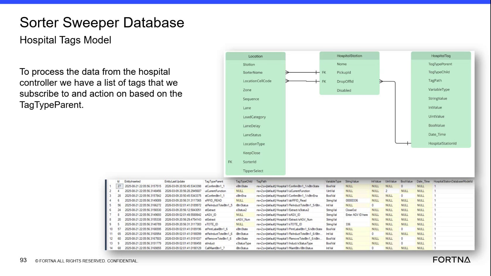

# Verify Hospital Pickup and Drop-Off Location ID Mapping

## Runbook Header

| Field | Value |
| --- | --- |
| Procedure ID | `proc_verify_hospital_pickup_and_drop_off_location_id_mapping_v1` |
| Title | Verify Hospital Pickup and Drop-Off Location ID Mapping |
| Procedure Type | `diagnostic` |
| Primary Role | `L2_support` |
| Supporting Roles | `L3_support` |
| Support Safe | Yes |
| Capability Tags | `hospital_diversion` |
| Access Surface | `wcs_sql` |
| Audience Roles | `L2_support`, `L3_support` |
| Failure Pattern Tags | `mapping_abnormal` |
| Validation Status | `needs_sme_review` |
| Merge Status | `source_finalized` |

## Summary

Use the WCS / Helix DB (SSMS) read-only view of the Sorter Sweeper Database to verify that hospital station pickup and drop-off identifiers resolve to the intended Location records.

## When To Use

Use this WCS / Helix DB (SSMS) diagnostic when validating hospital station configuration or investigating whether hospital pickup and drop-off identifiers resolve to Location records.

## Do Not Use For

* Do not use this WCS / Helix DB (SSMS) procedure to change hospital station IDs, pickup IDs, drop-off IDs, or database relationships.
* Do not use this procedure as a general database-model orientation or training walkthrough without a live mapping check.

## Safety And Operational Notes

* Use the WCS / Helix DB (SSMS) view in read-only mode.
* Do not alter IDs or database relationships during this diagnostic.

## Access Or Tools Needed

* WCS / Helix DB (SSMS)
* Sorter Sweeper Database
* Location table/model
* HospitalStation table/model
* HospitalStationId
* PickupId
* DropOffId
* Location ID

## Related Operational Context

* ctx_training_video_hospital_location_ids_v1
* ctx_training_video_hospital_tags_model_v1

## Visual References

*WCS / Helix DB (SSMS) Hospital Tags model view showing HospitalStation, PickupId, DropOffId, HospitalStationId, Location-related fields, and tag model fields.*

## Procedure Steps

### Step 1 — Open the Sorter Sweeper location models

**Responsible role:** L2_support

**Instruction:**
In the WCS / Helix DB (SSMS) read-only view, open the Sorter Sweeper Database and locate the Location and HospitalStation records or models. Identify the available HospitalStationId, PickupId, DropOffId, and Location ID fields.

**Expected result:**
The WCS / Helix DB (SSMS) view exposes the hospital station and location records needed for comparison.

**Stop or Escalate If:**

* Stop and escalate to L3_support if the required WCS / Helix DB (SSMS) records or identifier fields are not available.

---

### Step 2 — Identify the hospital station pickup and drop-off IDs

**Responsible role:** L2_support

**Instruction:**
In the WCS / Helix DB (SSMS) HospitalStation record, identify the hospital station's HospitalStationId, PickupId, and DropOffId. Treat the pickup and drop-off identifiers as the location identifiers described for the hospital station.

**Expected result:**
The WCS / Helix DB (SSMS) HospitalStation record provides the pickup and drop-off identifiers associated with the selected hospital station.

**Stop or Escalate If:**

* Stop and escalate to L3_support if the selected hospital station has no identifiable PickupId or DropOffId.

---

### Step 3 — Compare identifiers with Location records

**Responsible role:** L2_support

**Instruction:**
In the WCS / Helix DB (SSMS) Location records, compare the HospitalStation PickupId and DropOffId from the selected HospitalStation record with the corresponding Location IDs. Check each identifier separately and determine whether it resolves to one identifiable Location row.

**Expected result:**
Each hospital station PickupId and DropOffId resolves to an identifiable Location record, with the associated location identifier visible in the WCS / Helix DB (SSMS).

**Stop or Escalate If:**

* Stop and escalate to L2_support or L3_support if a PickupId or DropOffId has no matching Location row.
* Stop and escalate if an identifier maps to an unexpected or ambiguous Location relationship.

---

### Step 4 — Record the matched location records

**Responsible role:** L2_support

**Instruction:**
From the WCS / Helix DB (SSMS) inspection, record the HospitalStationId, PickupId, DropOffId, the matched Location IDs, and the associated HospitalStation or Location records. Record any missing, unexpected, or ambiguous relationship without modifying the database.

**Expected result:**
The diagnostic record contains the observed hospital station identifiers and their matched Location records, or clearly identifies an unresolved mapping.

**Stop or Escalate If:**

* Escalate the recorded result to L3_support when a pickup or drop-off ID does not resolve or resolves unexpectedly.
* Do not modify IDs or database relationships.

---

## Success Criteria

* The HospitalStationId, PickupId, and DropOffId are identifiable in the WCS / Helix DB (SSMS).
* The PickupId resolves to an identifiable Location record.
* The DropOffId resolves to an identifiable Location record.
* The observed relationships are unambiguous and are recorded without changing database data.

## Failure Conditions

* A PickupId has no matching Location record.
* A DropOffId has no matching Location record.
* An identifier maps to an unexpected Location record.
* An identifier produces an ambiguous or unresolved relationship.
* The required HospitalStation or Location fields cannot be identified in the WCS / Helix DB (SSMS).

## Escalation Guidance

* Escalate to L2_support or L3_support when a pickup or drop-off ID has no matching Location record, maps to an unexpected location, or produces an unresolved or ambiguous relationship.
* Do not alter IDs or database relationships during the diagnostic.

## Missing Details / Known Gaps

* The packet does not provide a complete read-only SQL query.
* The packet does not provide the exact live database name, schema name, or complete production column names for the Location and HospitalStation models.
* The database model view indicates that some primary-key or location-related fields were not shown; an SME must confirm the exact live field names before operational use.
* The current implementation was described as one-to-one for pickup and drop-off location mapping, but the packet does not define the validation rule for future one-to-many configurations.
* The packet does not define the required recording system or template for storing matched identifiers.

## Source Lineage

- Candidate IDs: candidate_training_video_hospital_location_id_mapping
- Source ID: `training_video_day2`
- Source Type: `training_video`
