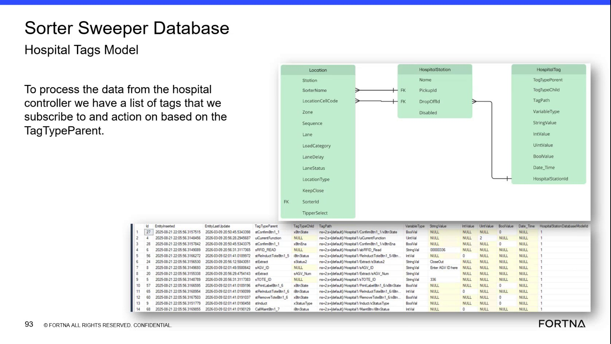

# Check Hospital Tag Variable Types and Stored Values in the WCS Database

## Runbook Header

| Field | Value |
| --- | --- |
| Procedure ID | `proc_check_hospital_tag_variable_types_and_stored_values_v1` |
| Title | Check Hospital Tag Variable Types and Stored Values in the WCS Database |
| Procedure Type | `diagnostic` |
| Primary Role | `L2_support` |
| Supporting Roles | `L3_support` |
| Support Safe | Yes |
| Capability Tags | `wcs_system_faults` |
| Access Surface | `wcs_sql` |
| Audience Roles | `L2_support`, `L3_support` |
| Failure Pattern Tags | `system_fault` |
| Validation Status | `needs_sme_review` |
| Merge Status | `source_finalized` |

## Summary

Use the WCS / Helix DB (SSMS) read-only view of the Sorter Sweeper Database to inspect HospitalTag records. Verify TagTypeParent, TagTypeChild, TagPath, VariableType, the applicable typed value field, and Disabled state for a hospital or PLC tag.

## When To Use

Use this WCS / Helix DB (SSMS) diagnostic when validating how a hospital-controller or PLC tag is represented in the Sorter Sweeper HospitalTag model, especially when the observed tag value, type, or communication path is in question.

## Do Not Use For

* Do not use this read-only check to change database configuration or tag definitions.
* Do not use this procedure as a substitute for confirming an active hospital or PLC communication path when the record is Disabled.

## Safety And Operational Notes

* Use the WCS / Helix DB (SSMS) view for read-only inspection.
* Do not change database configuration as part of this check.

## Access Or Tools Needed

* WCS / Helix DB (SSMS)
* Sorter Sweeper Database
* HospitalTag / Hospital Tags Model

## Related Operational Context

* ctx_training_video_hospital_tags_model_v1
* ctx_training_video_tag_variable_types_v1

## Visual References

*Hospital Tags Model view showing TagTypeParent, TagTypeChild, TagPath, VariableType, StringValue, IntValue, UintValue, BoolValue, Date_Time, and example tag records.*

## Procedure Steps

### Step 1 — Open the HospitalTag model in WCS / Helix DB (SSMS)

**Responsible role:** L2_support

**Instruction:**
In the WCS / Helix DB (SSMS) read-only view, open the Sorter Sweeper Database and locate the HospitalTag / Hospital Tags Model records. Inspect the fields TagTypeParent, TagTypeChild, TagPath, VariableType, StringValue, IntValue, UintValue, BoolValue, Date_Time, and Disabled.

**Expected result:**
A HospitalTag record or set of records is visible with the named tag-definition and typed-value fields.

**Stop or Escalate If:**

* Escalate to L3_support if the HospitalTag record or required fields are missing.

---

### Step 2 — Identify the tag type and WCS / Helix DB (SSMS) TagPath

**Responsible role:** L2_support

**Instruction:**
In the WCS / Helix DB (SSMS) HospitalTag record, inspect TagTypeParent and TagTypeChild. Confirm that TagPath identifies the associated hospital controller or PLC tag. TagTypeParent indicates whether the tag is an input or output.

**Expected result:**
The record shows identifiable TagTypeParent and TagTypeChild values and a TagPath associated with the expected hospital controller or PLC tag.

**Stop or Escalate If:**

* Escalate to L2/L3 support if TagPath does not identify the expected hospital or PLC tag.

---

### Step 3 — Determine the typed value field in WCS / Helix DB (SSMS)

**Responsible role:** L2_support

**Instruction:**
Inspect VariableType in the WCS / Helix DB (SSMS) HospitalTag record. Use the indicated type to determine whether the applicable value is stored in StringValue, IntValue, UintValue, BoolValue, or Date_Time.

**Expected result:**
VariableType identifies the value representation and points to the corresponding typed value field.

**Stop or Escalate If:**

* Escalate to L2/L3 support if VariableType does not identify or align with an applicable value field.

---

### Step 4 — Compare the stored value with VariableType in WCS / Helix DB (SSMS)

**Responsible role:** L2_support

**Instruction:**
Inspect the value field associated with VariableType in the WCS / Helix DB (SSMS) record. Compare the observed value with VariableType. Treat unrelated value fields that are NULL as unused fields for that record when the selected typed value field contains the tag value.

**Expected result:**
The applicable typed value field contains the observed tag value, while unrelated value fields may be NULL.

**Stop or Escalate If:**

* Escalate to L2/L3 support if VariableType and the populated value field do not align.

---

### Step 5 — Inspect Disabled state and record the WCS / Helix DB (SSMS) observation

**Responsible role:** L2_support

**Instruction:**
Inspect Disabled in the WCS / Helix DB (SSMS) HospitalTag record. Record the observed Disabled state together with TagPath, VariableType, and the value in the applicable typed field.

**Expected result:**
Disabled is observable, and the diagnostic record contains the tag path, variable type, applicable stored value, and disabled state.

**Stop or Escalate If:**

* Escalate to L2/L3 support if the tag is Disabled when an active hospital or PLC communication path is required.
* Do not change database configuration as part of this check.

---

## Success Criteria

* A HospitalTag record is located in the Sorter Sweeper Database through the WCS / Helix DB (SSMS) read-only view.
* TagTypeParent, TagTypeChild, and TagPath are observable, with TagPath identifying the expected hospital or PLC tag.
* VariableType identifies the applicable typed value field.
* The applicable value field contains the observed tag value, with unrelated value fields allowed to be NULL.
* Disabled state is observable and recorded.

## Failure Conditions

* The HospitalTag record or required fields are missing.
* TagPath does not identify the expected hospital or PLC tag.
* VariableType does not align with the populated value field.
* No applicable typed value field contains the observed tag value.
* The tag is Disabled when an active hospital or PLC communication path is required.

## Escalation Guidance

* Escalate to L2/L3 support when the tag record is missing, TagPath is not identifiable, or VariableType does not align with the populated value field.
* Escalate when Disabled is set for a tag required by an active hospital or PLC communication path.
* Do not modify database configuration during this diagnostic.

## Missing Details / Known Gaps

* The packet does not provide an exact SSMS database navigation path, query, filter, or record-selection method.
* The packet does not provide a complete lookup table mapping every VariableType value to its typed value column.
* The packet does not define the exact Disabled value semantics or an acceptance threshold for a tag required by an active communication path.
* The packet does not provide a live-system confirmation method outside the WCS / Helix DB (SSMS) record.

## Source Lineage

- Candidate IDs: candidate_training_video_hospital_tag_value_type_check
- Source ID: `training_video_day2`
- Source Type: `training_video`
