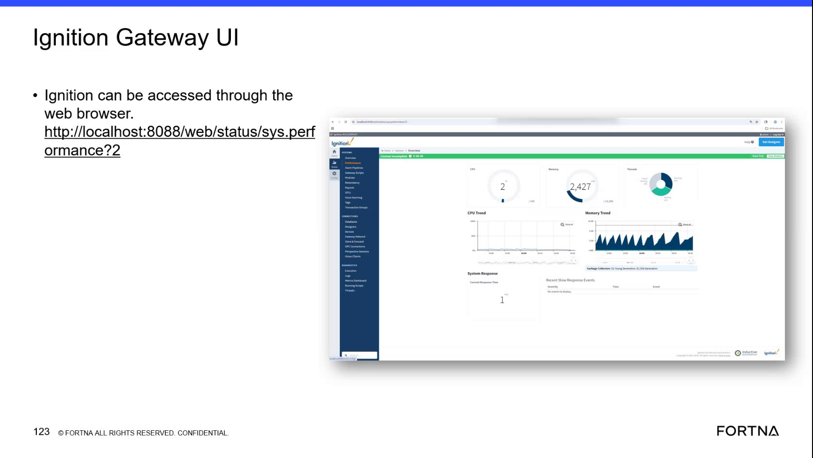
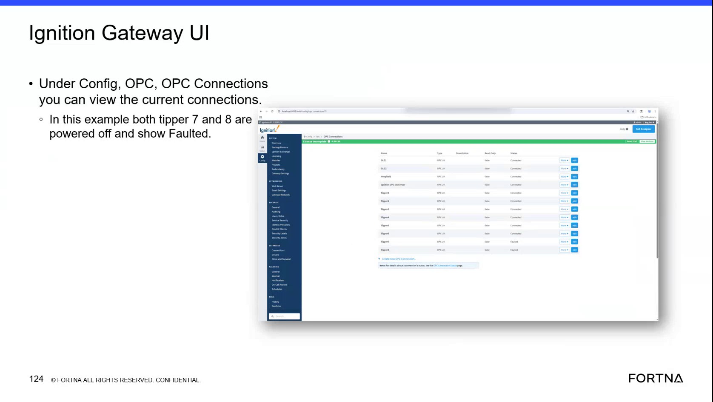

# Check Ignition Gateway OPC Connections status for tipper OPC endpoints

## Runbook Header

| Field | Value |
| --- | --- |
| Procedure ID | `proc_check_ignition_gateway_opc_connections_tipper_endpoints_v1` |
| Title | Check Ignition Gateway OPC Connections status for tipper OPC endpoints |
| Procedure Type | `diagnostic` |
| Primary Role | `L1_support` |
| Supporting Roles | `L2_support` |
| Support Safe | Yes |
| Capability Tags | `opc_connection_or_tipper_heartbeat` |
| Access Surface | `ignition_gateway` |
| Audience Roles | `L1_support` |
| Failure Pattern Tags | `gateway_unhealthy` |
| Validation Status | `needs_sme_review` |
| Merge Status | `source_finalized` |

## Summary

Use the Ignition Gateway UI to check the current OPC Connections status for specific tipper endpoints. Confirm whether the expected tipper entries show “Faulted” (example: tipper 7 and 8 powered off show “Faulted”).

## When To Use

When you need to verify whether Ignition Gateway shows expected tipper OPC connections as healthy vs “Faulted” for specific tippers (example tippers: 7 and 8).

## Access Or Tools Needed

* Ignition gateway (Ignition Gateway UI)

## Related Operational Context

* ctx_training_video_ignition_gateway_opc_connections_v1
* ctx_training_video_opc_connection_faulted_status_v1

## Visual References

*Ignition Gateway UI access context and example statement that tipper 7–8 are powered off and show faulted.*

*Ignition Gateway UI page showing Config > OPC > OPC Connections with example that tipper 7 and 8 show “Faulted”.*

## Procedure Steps

### Step 1 — Open Ignition Gateway and navigate to Config > OPC > OPC Connections

**Responsible role:** L1_support

**Instruction:**
In the Ignition Gateway UI, navigate to Config > OPC > OPC Connections.

**Expected result:**
The Ignition Gateway OPC Connections page is open and shows a connections list where tipper entries can be located.

---

### Step 2 — Locate the relevant tipper entries (example: tipper 7 and tipper 8) in the OPC Connections list

**Responsible role:** L1_support

**Instruction:**
In the OPC Connections list, locate the entries for the relevant tippers (example shown: tipper 7 and tipper 8).

**Expected result:**
You can see the connections list rows for the selected tipper entries (e.g., tipper 7 and tipper 8).

---

### Step 3 — Verify the connection status value for each selected tipper entry

**Responsible role:** L1_support

**Instruction:**
For each located tipper entry, observe the connection status value shown in the list (example status shown: “Faulted” for tipper 7 and tipper 8).

**Expected result:**
The selected tipper entries show the connection status value as displayed in the OPC Connections list (example: “Faulted”).

**Stop or Escalate If:**

* Escalate to L2_support if the OPC connection status does not match the observed physical state (e.g., a powered-off tipper is not showing “Faulted”, or a powered-on tipper is showing “Faulted”).

---

### Step 4 — Compare Ignition Gateway OPC status to the expected powered-off vs “Faulted” example

**Responsible role:** L1_support

**Instruction:**
Compare what you observe in the OPC Connections list to the example expectation: if the tipper is powered off, its OPC connection status is shown as “Faulted”.

**Expected result:**
You determine whether the observed status aligns with the expected powered-off → “Faulted” relationship from the example.

**Stop or Escalate If:**

* If mismatch is found, escalate to L2_support.

---

## Success Criteria

* For the checked tipper entries, the Ignition Gateway OPC Connections list shows the expected connection status value relationship from the example (powered-off tippers show “Faulted”).

## Failure Conditions

* A powered-off tipper entry does not show “Faulted” in Ignition Gateway OPC Connections.
* A powered-on tipper entry shows “Faulted” in Ignition Gateway OPC Connections.

## Escalation Guidance

* Escalate to L2_support if the OPC connection status does not match the observed physical state (powered-off not “Faulted”, or powered-on showing “Faulted”).

## Missing Details / Known Gaps

* The packet does not provide the exact UI field/column name for the connection status value (it is only shown as “Faulted” in the example).
* The packet does not provide the exact expected status for powered-on tippers (only the powered-off → “Faulted” example is evidenced).
* The packet does not provide any Ignition Gateway recovery/admin actions; escalation guidance is limited to notifying L2_support on mismatch.

## Source Lineage

- Candidate IDs: candidate_training_video_ignition_gateway_opc_connections_check
- Source ID: `training_video_day2`
- Source Type: `training_video`
