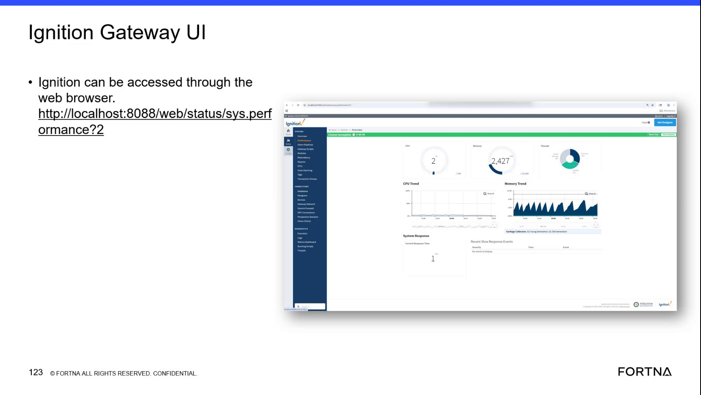
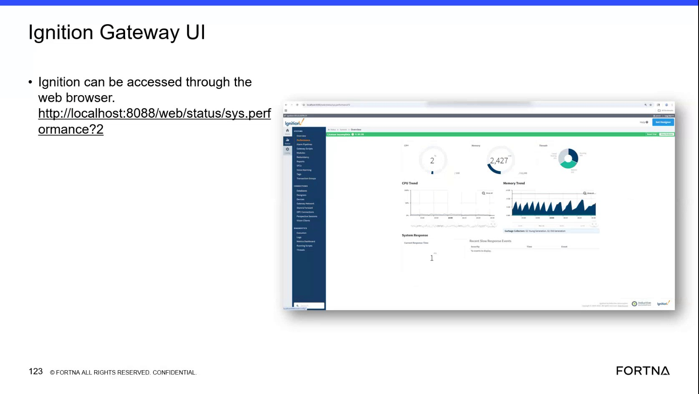

# Check Ignition Gateway Performance Metrics

## Runbook Header

| Field | Value |
| --- | --- |
| Procedure ID | `proc_check_ignition_gateway_performance_metrics_v1` |
| Title | Check Ignition Gateway Performance Metrics |
| Procedure Type | `diagnostic` |
| Primary Role | `L2_support` |
| Supporting Roles | `L3_support` |
| Support Safe | Yes |
| Capability Tags | `gateway_health`, `opc_connection_or_tipper_heartbeat` |
| Access Surface | `ignition_gateway` |
| Audience Roles | `L2_support`, `L3_support` |
| Failure Pattern Tags | `gateway_unhealthy`, `opc_connection_faulted`, `service_crash_or_restart` |
| Validation Status | `needs_sme_review` |
| Merge Status | `source_finalized` |

## Summary

An L2 support user can open the live Ignition gateway performance page in a web browser and review CPU, memory, connection, response-time, slow-response, garbage-collector, and tuning-script indicators for evidence of gateway health or degradation.

## When To Use

Use this Ignition gateway diagnostic procedure when gateway health, performance degradation, an unplanned restart, or related OPC and application symptoms require live evidence from the Ignition Gateway performance page.

## Do Not Use For

* Do not use this procedure as a substitute for a physical E-stop, LOTO, or physical AGV recovery.
* Do not infer numeric healthy thresholds for CPU, memory, response time, garbage collectors, or other indicators from this procedure.
* Do not restart services or change gateway configuration as part of this inspection-only procedure.

## Safety And Operational Notes

* This is a diagnostic inspection procedure; do not change gateway settings or restart services based only on this runbook.
* Preserve displayed response events, severity values, and visible trend behavior as escalation evidence.

## Access Or Tools Needed

* Ignition gateway
* Web browser
* Ignition Gateway performance page at http://localhost:8088/web/status/sys.performance?2

## Related Operational Context

* ctx_training_video_ignition_gateway_performance_metrics_v1
* ctx_training_video_ignition_gateway_diagnostics_v1

## Visual References

*Ignition gateway performance page showing browser access, the performance URL, and gateway diagnostic sections.*

*Ignition gateway performance page showing CPU and memory trend behavior, including the described memory spike and drop-to-zero pattern.*

*Ignition gateway performance page showing CPU Trend, Memory Trend, Database, OPC Connection, Perspective Session, Vision Clients, System Response, Current Response Time, Recent Slow Response Events, Garbage Collectors, Tuning Scripts, and Severity.*

## Procedure Steps

### Step 1 — Open the Ignition gateway performance page

**Responsible role:** L2_support

**Instruction:**
In a web browser on the support host, open the Ignition gateway performance page at http://localhost:8088/web/status/sys.performance?2.

**Expected result:**
The Ignition gateway performance page opens and displays gateway performance and diagnostic sections.

**Stop or Escalate If:**

* Escalate to L3 support if the Ignition gateway performance page cannot be opened.

---

### Step 2 — Inspect CPU and memory trends

**Responsible role:** L2_support

**Instruction:**
On the live Ignition gateway performance page, review the CPU Trend and Memory Trend displays for visible spikes, sustained elevated activity, or a memory pattern in which usage spikes and then drops to zero.

**Expected result:**
The CPU Trend and Memory Trend displays provide visible current or recent trend evidence for gateway performance.

**Stop or Escalate If:**

* Escalate when a visible CPU or memory spike or sustained elevated activity cannot be explained from the available live evidence.
* Escalate when the memory trend shows a crash-related spike followed by a drop to zero and the event cannot be correlated with available live evidence.

---

### Step 3 — Review gateway connection and client sections

**Responsible role:** L2_support

**Instruction:**
On the Ignition gateway performance page, inspect the Database, OPC Connection, Perspective Session, and Vision Clients sections and preserve any displayed live information or fault state.

**Expected result:**
The four gateway sections display their current connection or client information, including any displayed OPC connection state.

**Stop or Escalate If:**

* Escalate when an OPC connection or another gateway connection/client section shows an unexplained faulted or missing condition.

---

### Step 4 — Review response and slow-response indicators

**Responsible role:** L2_support

**Instruction:**
Review System Response, Current Response Time, and Recent Slow Response Events on the Ignition gateway performance page, including any displayed Severity value.

**Expected result:**
The page displays the current response information and shows whether recent slow-response events are listed, including their displayed severity when present.

**Stop or Escalate If:**

* Escalate when a current response-time problem is displayed.
* Escalate when a Recent Slow Response Event or Severity indication cannot be explained from the available live evidence.

---

### Step 5 — Inspect garbage collectors and tuning scripts

**Responsible role:** L2_support

**Instruction:**
Review the Garbage Collectors, including Young Generation and Old Generation where displayed, and the Tuning Scripts indicators. Preserve the displayed values or statuses without treating unclear values as fixed health thresholds.

**Expected result:**
The Garbage Collectors and Tuning Scripts indicators are visible and their displayed values or statuses are available as diagnostic evidence.

**Stop or Escalate If:**

* Escalate when a displayed garbage-collector or tuning-script condition is associated with gateway degradation.
* Do not assign a numeric healthy threshold to an unclear garbage-collector value.

---

## Success Criteria

* The live Ignition gateway performance page opens in a web browser.
* CPU Trend, Memory Trend, Database, OPC Connection, Perspective Session, Vision Clients, System Response, Current Response Time, Recent Slow Response Events, Garbage Collectors, and Tuning Scripts are reviewed.
* Displayed response events, severity values, connection states, and visible trend behavior are available as evidence for support or escalation.
* No unexplained visible performance spike, response-time problem, faulted connection, or recent slow-response indication is found.

## Failure Conditions

* The Ignition gateway performance page cannot be opened.
* CPU or memory shows an unexplained spike or sustained elevated activity.
* Memory shows a crash-related spike followed by a drop to zero.
* A Database, OPC Connection, Perspective Session, or Vision Clients section shows an unexplained faulted or missing condition.
* Current Response Time shows a problem or Recent Slow Response Events displays an unexplained event or Severity indication.
* Gateway diagnostic indicators are incomplete, unclear, or associated with observed gateway degradation.

## Escalation Guidance

* Escalate to L3 support if the Ignition gateway performance page cannot be opened.
* Escalate unexplained CPU or memory spikes, sustained elevated activity, or a memory spike followed by a drop to zero.
* Escalate unexplained faulted or missing Database, OPC Connection, Perspective Session, or Vision Clients information.
* Escalate a current response-time problem or unexplained Recent Slow Response Event/Severity indication.
* Include the displayed trend behavior, connection state, response values, event text, and Severity value in the escalation evidence when available.
* Escalate rather than infer numeric health thresholds when the packet provides no threshold or definitive status meaning.

## Missing Details / Known Gaps

* No numeric healthy thresholds are provided for CPU, memory, response time, garbage collectors, or tuning scripts.
* Definitive meanings for all displayed statuses and Severity values are not provided.
* The packet does not define authentication steps or gateway credentials.
* This runbook inspects gateway indicators only; it does not define service restart, gateway recovery, or configuration-change actions.
* The packet does not provide a site code or site label.

## Source Lineage

- Candidate IDs: candidate_training_video_ignition_gateway_performance_check
- Source ID: `training_video_day2`
- Source Type: `training_video`
