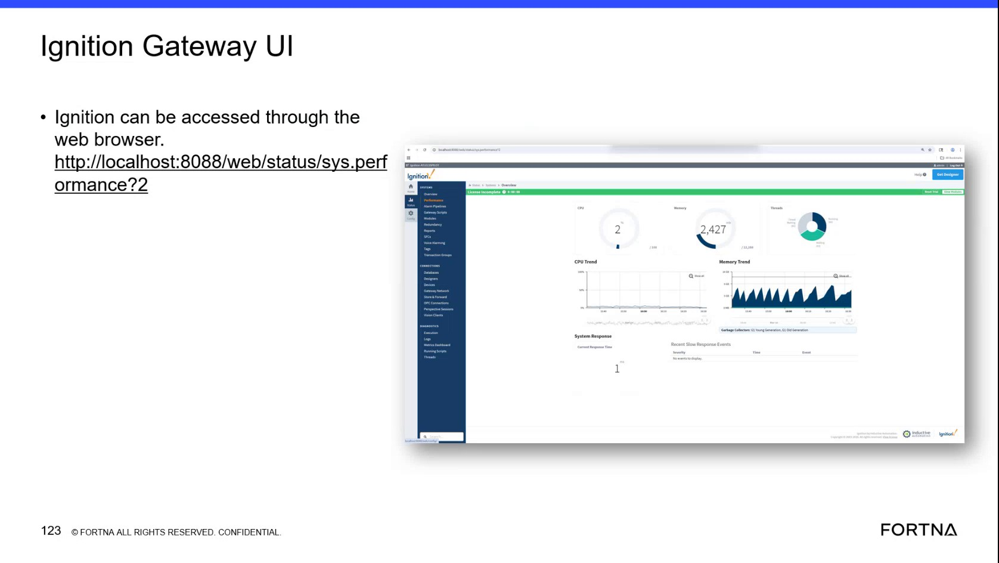

# Diagnose Ignition Gateway Performance Using the Performance Page

## Runbook Header

| Field | Value |
| --- | --- |
| Procedure ID | `proc_diagnose_ignition_gateway_performance_using_the_performance_page_v1` |
| Title | Diagnose Ignition Gateway Performance Using the Performance Page |
| Procedure Type | `diagnostic` |
| Primary Role | `L2_support` |
| Supporting Roles | None |
| Support Safe | Yes |
| Capability Tags | `gateway_health` |
| Access Surface | `ignition_gateway` |
| Audience Roles | `L2_support` |
| Failure Pattern Tags | `gateway_unhealthy` |
| Validation Status | `needs_sme_review` |
| Merge Status | `source_finalized` |

## Summary

Use the Ignition gateway performance page in a web browser to review Memory Trend, CPU Trend, System Response, Current Response Time, and Recent Slow Response Events while investigating an OptiSweep system issue. The memory chart can provide evidence of a spike followed by a drop to 0, but the Gateway chart alone does not establish the underlying application fault.

## When To Use

Use the Ignition gateway performance page when investigating an OptiSweep system issue and Gateway-level memory, response, or slow-response behavior needs to be checked.

## Do Not Use For

* Do not use this procedure as a Perspective diagnostic; the source distinguishes the Ignition gateway from Perspective.
* Do not treat the Gateway performance chart alone as proof of the underlying application fault or as the sole explanation for a reported system symptom.
* Do not use this procedure as a service restart procedure; the supplied evidence does not provide a complete named service restart workflow.

## Safety And Operational Notes

* This is an observation-only diagnostic procedure based on the supplied evidence; no production stop or physical intervention is specified.
* A memory spike followed by a drop to 0 is an indicator associated with a crash, not proof of the underlying application cause.

## Access Or Tools Needed

* Ignition gateway
* Web browser
* Ignition gateway performance page

## Related Operational Context

* ctx_training_video_ignition_gateway_performance_page_v1
* ctx_training_video_ignition_memory_trend_reference_v1

## Visual References

*Ignition gateway performance page showing the browser path, Memory Trend, CPU Trend, System Response, Current Response Time, and Recent Slow Response Events.*

## Procedure Steps

### Step 1 — Open the Ignition gateway performance page

**Responsible role:** L2_support

**Instruction:**
In a web browser, open the Ignition gateway and navigate to `/web/status/sys.performance?2`. Confirm that the page is the Ignition gateway performance page, not Perspective.

**Expected result:**
The Ignition gateway performance page opens and displays Gateway performance sections, including Memory Trend, CPU Trend, System Response, Current Response Time, and Recent Slow Response Events.

**Stop or Escalate If:**

* Escalate to deeper Ignition or system troubleshooting if the performance page cannot be opened.

---

### Step 2 — Review the Memory Trend

**Responsible role:** L2_support

**Instruction:**
On the Ignition gateway performance page, inspect the Memory Trend chart. Determine whether the displayed memory usage shows a spike followed by a drop to 0.

**Expected result:**
The current Memory Trend behavior is observable, including whether a spike followed by a drop to 0 is present.

**Stop or Escalate If:**

* Escalate when a memory spike followed by a drop to 0 is observed, especially if the related system symptom persists.

---

### Step 3 — Check response and slow-event indicators

**Responsible role:** L2_support

**Instruction:**
On the Ignition gateway performance page, inspect CPU Trend, System Response, Current Response Time, and Recent Slow Response Events. Read the displayed values and determine whether Recent Slow Response Events contains entries or displays `No events to display`.

**Expected result:**
The displayed CPU Trend, System Response, Current Response Time, and Recent Slow Response Events state are observable.

**Stop or Escalate If:**

* Escalate to deeper Ignition or system troubleshooting if the displayed response evidence does not explain the reported system behavior.

---

### Step 4 — Record and interpret the observed Gateway evidence

**Responsible role:** L2_support

**Instruction:**
Record the currently displayed Memory Trend pattern, CPU Trend, System Response, Current Response Time, and Recent Slow Response Events state. Correlate these observations with the reported OptiSweep system behavior, and do not conclude that the Ignition gateway is the sole cause from the chart alone.

**Expected result:**
The live Gateway observations and their relationship to the reported symptom are captured, with any uncertainty or unexplained symptom identified for further troubleshooting.

**Stop or Escalate If:**

* Escalate to deeper Ignition or system troubleshooting when the observed memory or response evidence does not explain the reported system behavior.
* Do not close the investigation solely because the Gateway chart does not show the crash-associated pattern.

---

## Success Criteria

* The Ignition gateway performance page opens in a web browser.
* Memory Trend, CPU Trend, System Response, Current Response Time, and Recent Slow Response Events are reviewed.
* The memory pattern and response/event observations are captured.
* Any spike followed by a drop to 0 is identified as crash-associated evidence rather than definitive proof of root cause.
* The Gateway chart is not treated as the sole explanation for the reported system behavior.

## Failure Conditions

* The Ignition gateway performance page cannot be opened.
* The performance page does not display the expected Gateway performance sections.
* Memory Trend shows a spike followed by a drop to 0.
* Recent Slow Response Events contains entries or response indicators show behavior requiring further investigation.
* The observed Gateway evidence does not explain the reported system behavior.

## Escalation Guidance

* Escalate to deeper Ignition or system troubleshooting if the performance page cannot be opened.
* Escalate when a memory spike followed by a drop to 0 is observed, especially if the related system symptom persists.
* Escalate when the observed memory or response evidence does not explain the reported system behavior.
* Do not conclude that the Ignition gateway is the sole cause from the performance chart alone.

## Missing Details / Known Gaps

* No numeric healthy-memory threshold is supplied.
* No complete service restart procedure, service control path, or restart validation is supplied for this diagnostic.
* No specific recording system or incident-notes location is supplied.
* The supplied evidence does not identify a definitive underlying application fault from Gateway performance indicators alone.

## Source Lineage

- Candidate IDs: candidate_training_video_ignition_gateway_performance_diagnostic
- Source ID: `training_video_day2`
- Source Type: `training_video`
