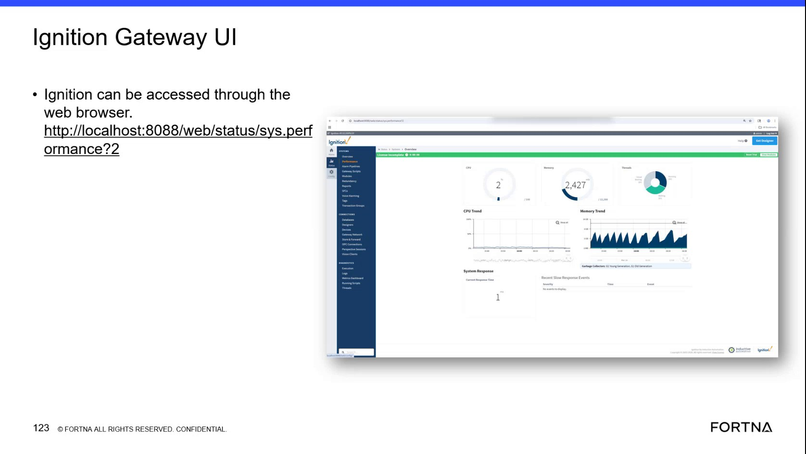

# Check Ignition Gateway system performance status via localhost sys.perf page

## Runbook Header

| Field | Value |
| --- | --- |
| Procedure ID | `proc_check_ignition_gateway_sys_perf_localhost_v1` |
| Title | Check Ignition Gateway system performance status via localhost sys.perf page |
| Procedure Type | `diagnostic` |
| Primary Role | `L2_support` |
| Supporting Roles | None |
| Support Safe | Yes |
| Capability Tags | `gateway_health` |
| Access Surface | `ignition_gateway` |
| Audience Roles | `L2_support` |
| Failure Pattern Tags | `gateway_unhealthy` |
| Validation Status | `needs_sme_review` |
| Merge Status | `source_finalized` |

## Summary

Use the Ignition Gateway web UI on the host to open the system performance status page at http://localhost:8088/web/status/sys.perf. Confirm the page loads and that system performance/health indicators are visible (not a connection/refused/unreachable error).

## When To Use

When Ignition Gateway reachability or performance is suspected on the Ignition Gateway host, and you need a quick local check that the /web/status/sys.perf page is reachable and shows performance/health indicators.

## Access Or Tools Needed

* Web browser access to the Ignition Gateway host
* Ignition Gateway web UI (localhost:8088)

## Related Operational Context

* ctx_training_video_local_gateway_access_example_v1
* ctx_training_video_sys_perf_status_path_v1

## Visual References

*Frame showing Ignition Gateway UI accessed via browser at http://localhost:8088/web/status/sys.perf (sys.perf path visible).*

## Procedure Steps

### Step 1 — Open the Ignition Gateway sys.perf status page on localhost

**Responsible role:** L2_support

**Instruction:**
On the Ignition Gateway host, open a web browser and navigate to http://localhost:8088/web/status/sys.perf.

**Expected result:**
The browser successfully loads the Ignition Gateway system performance status page at /web/status/sys.perf (page content visible; not a connection/refused/unreachable error).

**Stop or Escalate If:**

* If http://localhost:8088/web/status/sys.perf does not load (connection refused/unreachable), treat Ignition Gateway as not healthy/reachable and escalate for deeper gateway diagnostics.

---

### Step 2 — Verify sys.perf performance/health indicators are visible

**Responsible role:** L2_support

**Instruction:**
On the loaded /web/status/sys.perf page, observe the system performance status indicators/readouts shown on the page.

**Expected result:**
System performance/health information is displayed on the sys.perf page (not blank and not replaced by an error/unavailable state).

**Stop or Escalate If:**

* If the page loads but performance indicators show degraded/unacceptable status, escalate for deeper Ignition Gateway performance investigation.

---

## Success Criteria

* http://localhost:8088/web/status/sys.perf loads successfully in a browser
* The sys.perf page displays system performance/health indicators (no connection/refused/unreachable error)

## Failure Conditions

* sys.perf page does not load due to unreachable/error state (e.g., connection refused/unreachable)
* sys.perf page loads but performance indicators show degraded/unacceptable status

## Escalation Guidance

* If the sys.perf page is unreachable/error: treat Ignition Gateway as not healthy/reachable and escalate for deeper gateway diagnostics.
* If the sys.perf page loads but indicators show degraded/unacceptable status: escalate for deeper Ignition Gateway performance investigation.

## Missing Details / Known Gaps

* The packet does not provide the exact sys.perf indicator field names/values or what specific readouts constitute 'acceptable' vs 'degraded/unacceptable' beyond the general presence of performance/health indicators.

## Source Lineage

- Candidate IDs: candidate_training_video_ignition_gateway_sys_perf_check
- Source ID: `training_video_day2`
- Source Type: `training_video`
