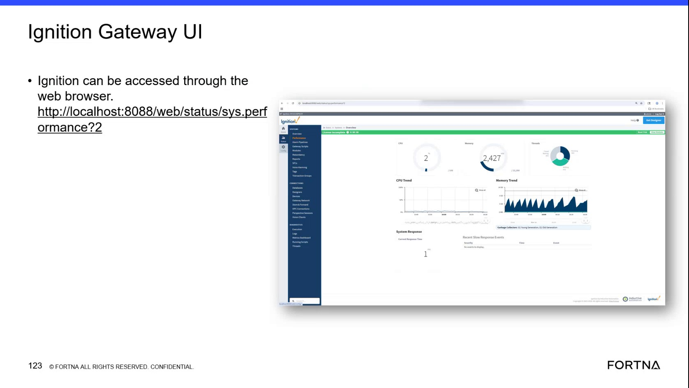

# Check Ignition Gateway System Performance

## Runbook Header

| Field | Value |
| --- | --- |
| Procedure ID | `proc_check_ignition_gateway_system_performance_v1` |
| Title | Check Ignition Gateway System Performance |
| Procedure Type | `diagnostic` |
| Primary Role | `L2_support` |
| Supporting Roles | `L3_support` |
| Support Safe | Yes |
| Capability Tags | `gateway_health` |
| Access Surface | `ignition_gateway` |
| Audience Roles | `L2_support`, `L3_support` |
| Failure Pattern Tags | `gateway_unhealthy` |
| Validation Status | `needs_sme_review` |
| Merge Status | `source_finalized` |

## Summary

Use the live Ignition gateway System Performance page in a web browser to inspect CPU and memory trends, database and OPC connectivity, Perspective sessions, system response, current response time, garbage collectors, queued scripts, and recent slow response events during troubleshooting.

## When To Use

Use the live Ignition gateway System Performance page when troubleshooting suspected gateway performance, connectivity, runtime, or response problems and a current view of gateway resource and subsystem indicators is needed.

## Do Not Use For

* Do not use this procedure to infer a numeric healthy threshold; the source provides no numeric thresholds.
* Do not use this procedure as a replacement for site or floor confirmation when the symptom requires physical verification.
* Do not restart an Ignition or OptiSweep service as part of this procedure; service restart evidence is outside the supplied System Performance procedure.

## Safety And Operational Notes

* This is a read-only diagnostic inspection of the displayed Ignition gateway monitoring information.
* Do not infer numeric healthy limits from the displayed trends or values.

## Access Or Tools Needed

* Ignition gateway
* Web browser
* Ignition Gateway System Performance page
* URL: http://localhost:8088/web/status/sys.performance?2

## Related Operational Context

* ctx_training_video_ignition_system_performance_screen_v1
* ctx_training_video_ignition_gateway_monitoring_categories_v1

## Visual References

*Ignition Gateway System Performance page showing CPU Trend, Memory Trend, Database, OPC Connection, Perspective Sessions, System Response, Garbage Collectors, Queuing Scripts, Current Response Time, and Recent Slow Response Events.*

*Ignition gateway performance page with the memory trend example and gateway monitoring panels.*

## Procedure Steps

### Step 1 — Open the Ignition gateway System Performance page

**Responsible role:** L2_support

**Instruction:**
In a web browser, open the Ignition gateway System Performance page at http://localhost:8088/web/status/sys.performance?2.

**Expected result:**
The Ignition gateway System Performance page opens and displays the named monitoring sections.

**Stop or Escalate If:**

* Escalate to deeper Ignition or platform support if the Ignition gateway System Performance page cannot be opened.
* Escalate if the page opens but does not return live monitoring information.

---

### Step 2 — Review CPU Trend and Memory Trend in the Ignition gateway

**Responsible role:** L2_support

**Instruction:**
On the Ignition gateway System Performance page, inspect the CPU Trend and Memory Trend panels. Note the displayed trend shape, visible spikes, and any sustained increase. A memory spike followed by a drop to zero is an observable pattern to report.

**Expected result:**
The current CPU and memory trend behavior is visible and can be reported, including any spike, sustained increase, or drop to zero.

**Stop or Escalate If:**

* Escalate if CPU or memory behavior is sustained or abnormal.
* Escalate if the displayed memory behavior is consistent with a reported gateway crash or performance symptom.

---

### Step 3 — Inspect connectivity and sessions in the Ignition gateway

**Responsible role:** L2_support

**Instruction:**
On the Ignition gateway System Performance page, review the Database, OPC Connection, and Perspective Sessions sections. Record the displayed live state or connection and session information for each section.

**Expected result:**
The Database, OPC Connection, and Perspective Sessions sections display current information that can be reported.

**Stop or Escalate If:**

* Escalate if the displayed database, OPC connection, or Perspective session state is unexpected, unavailable, or faulted.

---

### Step 4 — Review response and runtime activity in the Ignition gateway

**Responsible role:** L2_support

**Instruction:**
On the Ignition gateway System Performance page, review System Response, Current Response Time, Recent Slow Response Events, Garbage Collectors, and Queuing Scripts. Record the displayed values or activity, including whether Recent Slow Response Events shows no entries or displays events.

**Expected result:**
The live gateway response and runtime sections can be reported, including current response time, garbage-collector and queued-script information, and the presence or absence of recent slow response events.

**Stop or Escalate If:**

* Escalate if the page shows displayed response-time problems.
* Escalate if Recent Slow Response Events displays events.
* Escalate if Garbage Collectors or Queuing Scripts show unexpected runtime activity.

---

### Step 5 — Report the live Ignition gateway findings

**Responsible role:** L2_support

**Instruction:**
Report the displayed CPU and memory trends; Database, OPC Connection, and Perspective Sessions states; System Response and Current Response Time; Garbage Collectors and Queuing Scripts information; and whether Recent Slow Response Events is empty or contains events. Identify any visible abnormal condition without assigning an unsupported numeric threshold.

**Expected result:**
Support produces a live Ignition gateway finding that distinguishes normal displayed information from visible resource, connectivity, session, response, or runtime abnormalities.

**Stop or Escalate If:**

* Escalate to deeper Ignition or platform support when the System Performance page is unavailable or does not provide live information.
* Escalate when resource, connectivity, session, response, or runtime indicators show an abnormal condition.

---

## Success Criteria

* The Ignition gateway System Performance page opens and returns live monitoring information.
* CPU Trend and Memory Trend behavior is reported using the displayed trend shape and values.
* Database, OPC Connection, and Perspective Sessions states are reported.
* System Response, Current Response Time, Garbage Collectors, and Queuing Scripts information is reported.
* Recent Slow Response Events is reported as empty or containing events.
* Any visible abnormal condition is escalated without inventing a numeric threshold.

## Failure Conditions

* The Ignition gateway System Performance page cannot be opened or does not return live monitoring information.
* CPU or memory shows a visible spike, sustained increase, or other abnormal trend.
* Database, OPC Connection, or Perspective Sessions shows an unexpected, unavailable, or faulted state.
* System Response or Current Response Time shows a displayed response problem.
* Recent Slow Response Events displays events.
* Garbage Collectors or Queuing Scripts show unexpected runtime activity.

## Escalation Guidance

* Escalate to deeper Ignition or platform support if the System Performance page cannot be opened or does not return live monitoring information.
* Escalate if sustained or abnormal CPU or memory behavior is displayed.
* Escalate if database, OPC connection, Perspective session, response-time, garbage-collector, or queued-script information is unexpected.
* Escalate if Recent Slow Response Events displays events.
* Do not infer numeric healthy thresholds from this procedure.

## Missing Details / Known Gaps

* No numeric CPU, memory, response-time, garbage-collector, or queued-script healthy thresholds are supplied.
* The source does not define the exact healthy or failure meaning of every displayed Database, OPC Connection, Perspective Sessions, Garbage Collectors, or Queuing Scripts value.
* The source does not provide authentication steps or browser access configuration beyond the supplied Ignition gateway URL.
* The source supports escalation for abnormal findings but does not define the downstream escalation owner, ticket fields, or recovery workflow.

## Source Lineage

- Candidate IDs: candidate_training_video_ignition_gateway_system_performance_diagnostic
- Source ID: `training_video_day2`
- Source Type: `training_video`
