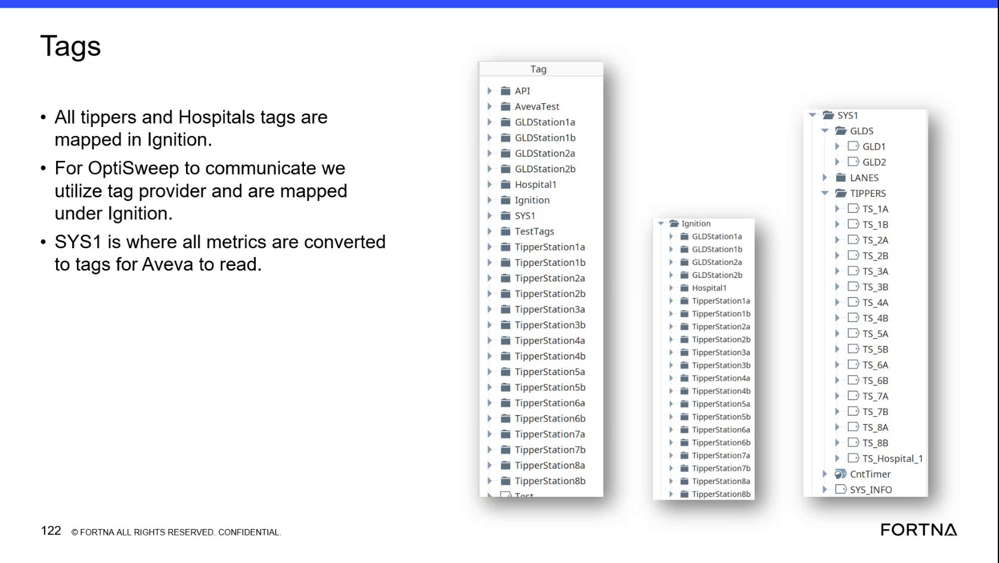

# Check Real-Time Tipper and Hospital Tags in the Ignition Tag Application

## Runbook Header

| Field | Value |
| --- | --- |
| Procedure ID | `proc_check_realtime_tipper_and_hospital_tags_in_ignition_tag_application_v1` |
| Title | Check Real-Time Tipper and Hospital Tags in the Ignition Tag Application |
| Procedure Type | `diagnostic` |
| Primary Role | `L1_support` |
| Supporting Roles | `L2_support` |
| Support Safe | Yes |
| Capability Tags | `tipper_station_fault`, `opc_connection_or_tipper_heartbeat` |
| Access Surface | `ignition_gateway` |
| Audience Roles | `L1_support`, `L2_support` |
| Failure Pattern Tags | `gateway_unhealthy`, `opc_connection_faulted` |
| Validation Status | `needs_sme_review` |
| Merge Status | `source_finalized` |

## Summary

Use the Ignition gateway tag application, rather than a Perspective project, to inspect real-time OptiSweep tags. Verify that mapped tipper, hospital, and SYS1 tags are present, readable, and updating as live tag values.

## When To Use

Use this Ignition gateway diagnostic when verifying whether mapped tipper, hospital, and SYS1 tags are available as real-time values for OptiSweep communication and downstream AVEVA reading.

## Do Not Use For

* Do not use a Perspective project for this check; use the Ignition gateway tag application.
* Do not use this procedure to write tags, change tag-provider mappings, or modify Ignition configuration.

## Safety And Operational Notes

* This is a read-only diagnostic; do not perform tag writes or configuration changes during the check.

## Access Or Tools Needed

* Ignition gateway
* Ignition tag application
* Real-time tag view
* Access to the mapped tag providers and tags for AvevaTest, TIPPERS, Hospital1, and SYS1

## Related Operational Context

* ctx_training_video_ignition_tag_provider_mapping_v1
* ctx_training_video_sys1_metric_conversion_v1
* ctx_training_video_ignition_tag_app_realtime_tags_v1

## Visual References

*Ignition tag mapping view showing AvevaTest, GLDStation1a, GLDStation1b, GLDStation2a, GLDStation2b, Hospital1, TIPPERS, SYS1, TipperStation tags, and TS_1A through TS_8B.*

## Procedure Steps

### Step 1 — Open the Ignition gateway tag application

**Responsible role:** L1_support

**Instruction:**
In the Ignition gateway, open the tag application and its real-time tag view. Do not use a Perspective project for this check.

**Expected result:**
The Ignition gateway tag application opens with a tag tree or tag list and live value fields available for inspection.

**Stop or Escalate If:**

* Stop the diagnostic and escalate to L2 support if the Ignition tag application cannot show the real-time tag view.

---

### Step 2 — Locate the mapped tag providers and groups

**Responsible role:** L1_support

**Instruction:**
In the Ignition gateway tag application, locate the mapped providers or groups named AvevaTest, GLDStation1a, GLDStation1b, GLDStation2a, GLDStation2b, Hospital1, TIPPERS, and SYS1.

**Expected result:**
The named mapped providers or groups are present in the Ignition tag tree or tag list.

**Stop or Escalate If:**

* Stop the diagnostic and escalate to L2 support if required tag providers or groups are absent.

---

### Step 3 — Inspect representative tipper tags

**Responsible role:** L1_support

**Instruction:**
In the Ignition gateway tag application, inspect representative tags including TipperStation1a, TipperStation1b, TipperStation2a, TipperStation2b, and the TS_1A through TS_8B tags.

**Expected result:**
The representative TipperStation and TS tags are present and display readable real-time values.

**Stop or Escalate If:**

* Stop the diagnostic and escalate to L2 support if the representative tipper tags are absent or unavailable.

---

### Step 4 — Inspect Hospital1 and SYS1 tags

**Responsible role:** L1_support

**Instruction:**
In the Ignition gateway tag application, inspect the Hospital1 and SYS1 areas for readable tags. Treat SYS1 as the mapped area where metrics are converted into tags for AVEVA to read.

**Expected result:**
Hospital1 and SYS1-related tags are present and readable in the Ignition real-time tag view.

**Stop or Escalate If:**

* Stop the diagnostic and escalate to L2 support if Hospital1 or SYS1-related tags cannot be displayed.

---

### Step 5 — Confirm live tag readability and updating

**Responsible role:** L1_support

**Instruction:**
In the Ignition gateway tag application, verify that the required tipper, Hospital1, and SYS1 tags remain readable and show updating or otherwise current real-time values. Do not change tag values or configuration.

**Expected result:**
The required mapped tags are readable and updating or otherwise available as current real-time tag values.

**Stop or Escalate If:**

* Stop the diagnostic and escalate to L2 support if mapped values do not update or the Ignition tag application cannot show them.
* Do not attempt corrective tag writes or configuration changes as part of this procedure.

---

## Success Criteria

* The Ignition gateway tag application opens to the real-time tag view.
* AvevaTest, GLDStation1a, GLDStation1b, GLDStation2a, GLDStation2b, Hospital1, TIPPERS, and SYS1 mappings are visible.
* Representative TipperStation and TS_1A through TS_8B tags are present and readable.
* Hospital1 and SYS1-related tags are present and readable.
* Required values update or otherwise remain available as current real-time tag values.

## Failure Conditions

* The Ignition tag application or real-time tag view cannot be opened.
* Required tag providers or groups are absent.
* Representative tipper, Hospital1, or SYS1 tags are absent or unavailable.
* Displayed values are unreadable or do not update as real-time values.

## Escalation Guidance

* Escalate to L2 support when the Ignition tag application cannot display the mapped tags or when values do not update.
* Provide the affected provider or group name and tag name, if identifiable.
* No corrective steps, API endpoint, command, threshold, or tag-provider reconfiguration is defined by this source.

## Missing Details / Known Gaps

* The source does not provide exact Ignition navigation labels beyond the tag application and real-time tag view.
* No numerical healthy-value thresholds or required update interval is defined.
* No corrective procedure is provided for missing providers, unavailable tags, or non-updating values.
* No API request, response field, or endpoint is defined for this diagnostic.

## Source Lineage

- Candidate IDs: candidate_training_video_ignition_realtime_tipper_tag_check
- Source ID: `training_video_day2`
- Source Type: `training_video`
