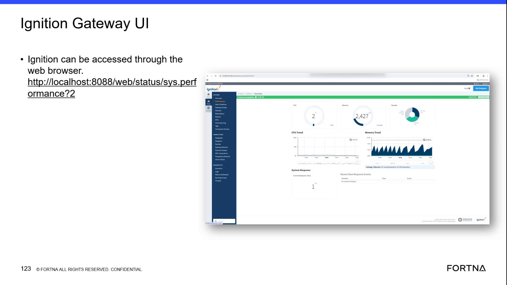
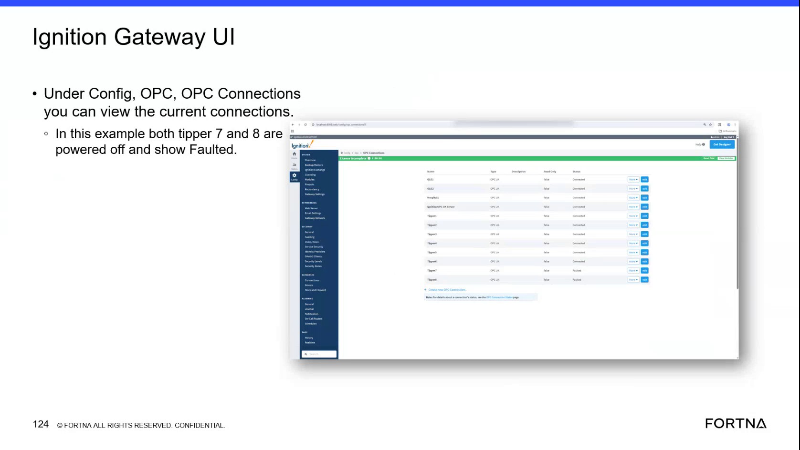

# Check Tipper Active Communications in Ignition Gateway

## Runbook Header

| Field | Value |
| --- | --- |
| Procedure ID | `proc_check_tipper_active_communications_in_ignition_gateway_v1` |
| Title | Check Tipper Active Communications in Ignition Gateway |
| Procedure Type | `diagnostic` |
| Primary Role | `L2_support` |
| Supporting Roles | None |
| Support Safe | Yes |
| Capability Tags | `opc_connection_or_tipper_heartbeat`, `gateway_health` |
| Access Surface | `ignition_gateway` |
| Audience Roles | `L2_support` |
| Failure Pattern Tags | `opc_connection_faulted`, `gateway_unhealthy` |
| Validation Status | `needs_sme_review` |
| Merge Status | `source_finalized` |

## Summary

Use the Ignition gateway web UI to inspect Configuration > Active Communications and verify the displayed power and fault state for Tipper 7 and Tipper 8.

## When To Use

Use this Ignition gateway diagnostic when investigating whether the live communications for Tipper 7 or Tipper 8 are powered on and communicating, or when the gateway communications state needs to be verified.

## Do Not Use For

* Do not use this runbook as a corrective-action or communication-restart procedure; the source does not provide a restart or repair procedure.
* Do not use this runbook to establish healthy-state thresholds; the source only provides the displayed power and fault states.

## Safety And Operational Notes

* This is a support diagnostic inspection in the Ignition gateway UI. No production stop or LOTO instruction is provided by the source.

## Access Or Tools Needed

* Ignition gateway
* Web browser
* Ignition Gateway UI
* Configuration > Active Communications
* Ignition system performance URL: http://localhost:8088/web/status/sys.perf

## Related Operational Context

* ctx_training_video_ignition_gateway_ui_v1
* ctx_training_video_tipper_7_8_communications_status_v1

## Visual References

*Ignition gateway web UI and system performance page; the associated source section identifies Configuration > Active Communications and shows Tipper 7-8 powered off and faulted.*

*Ignition gateway Config view showing the tipper OPC communication entries and displayed Connected/Faulted states.*

## Procedure Steps

### Step 1 — Open the Ignition gateway performance page

**Responsible role:** L2_support

**Instruction:**
In a web browser, open the Ignition gateway at http://localhost:8088/web/status/sys.perf.

**Expected result:**
The Ignition gateway system performance page opens and displays the gateway UI, including its performance and configuration areas.

**Stop or Escalate If:**

* Escalate if the Ignition gateway UI cannot be opened.

---

### Step 2 — Open Active Communications in the Ignition gateway

**Responsible role:** L2_support

**Instruction:**
In the Ignition gateway UI, open Configuration and then select Active Communications.

**Expected result:**
The Active Communications view opens and displays communication entries that can be inspected for the tippers.

**Stop or Escalate If:**

* Escalate if the Active Communications view cannot be opened.

---

### Step 3 — Inspect Tipper 7 and Tipper 8 communication states

**Responsible role:** L2_support

**Instruction:**
In Ignition gateway Active Communications, locate the entries for Tipper 7 and Tipper 8 and observe each entry's displayed power and fault state.

**Expected result:**
A displayed state is available for both Tipper 7 and Tipper 8. The example state is powered off and faulted for both entries.

**Stop or Escalate If:**

* Escalate when Tipper 7 or Tipper 8 is displayed as powered off and faulted.

---

### Step 4 — Record the displayed tipper states

**Responsible role:** L2_support

**Instruction:**
Record the displayed power and fault state for Tipper 7 and Tipper 8 from the Ignition gateway Active Communications view.

**Expected result:**
The recorded observation identifies the state of each tipper communication, including whether it is powered off and displayed as faulted.

**Stop or Escalate If:**

* Escalate when Tipper 7 or Tipper 8 is recorded as powered off and faulted.
* Escalate if the state of either tipper cannot be determined.

---

## Success Criteria

* The Ignition gateway system performance page opens in a web browser.
* Configuration > Active Communications opens in the Ignition gateway UI.
* The communication entries for Tipper 7 and Tipper 8 are located.
* The displayed power and fault state for each tipper is recorded.

## Failure Conditions

* The Ignition gateway UI cannot be opened.
* The Active Communications view cannot be opened.
* A Tipper 7 or Tipper 8 communication entry is displayed as powered off and faulted.
* The state of either tipper communication is unavailable or cannot be determined.

## Escalation Guidance

* Escalate for further support investigation when Tipper 7 or Tipper 8 Active Communications is displayed as powered off and faulted.
* Escalate if the Ignition gateway UI or Active Communications view cannot be opened.
* No corrective action or restart procedure is defined in the source.

## Missing Details / Known Gaps

* The source does not define healthy-state thresholds beyond the absence of the displayed powered-off and faulted condition.
* The source does not provide a corrective action, communication restart procedure, or service-recovery procedure.
* The packet does not specify the authentication requirements or permissions needed to access the Ignition gateway.
* One source artifact labels the view as Config > OPC > OPC Connections, while the candidate and primary evidence label it Configuration > Active Communications; the exact live menu label should be confirmed by an SME.
* The packet does not specify where or how the observed states must be recorded.

## Source Lineage

- Candidate IDs: candidate_training_video_ignition_tipper_active_communications_check
- Source ID: `training_video_day2`
- Source Type: `training_video`
