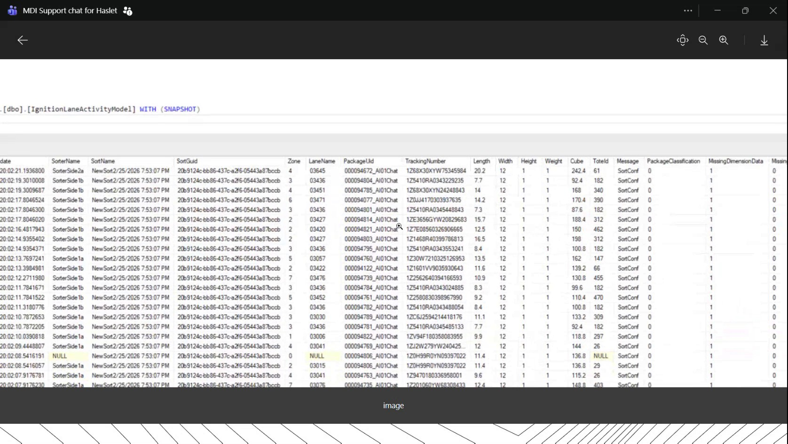
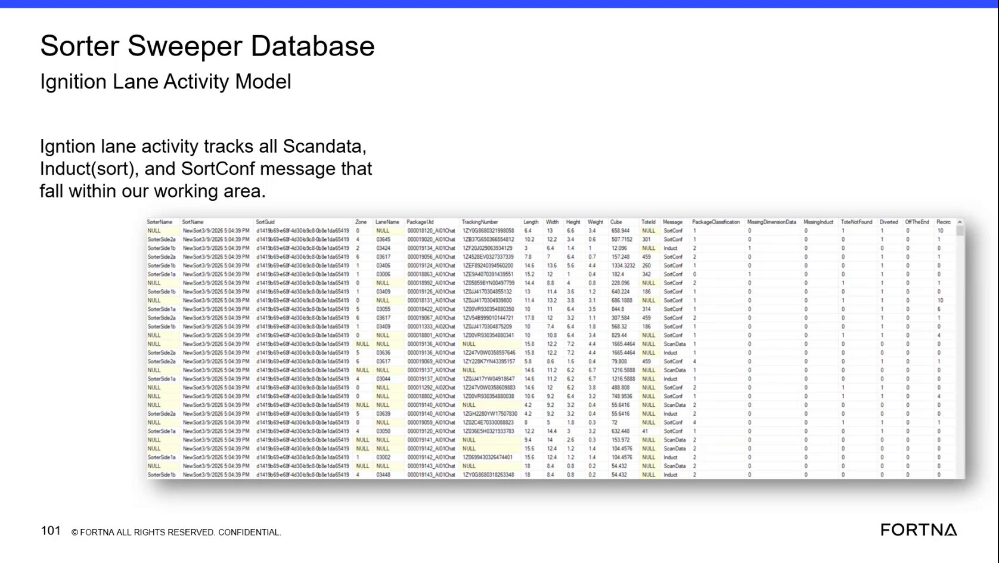
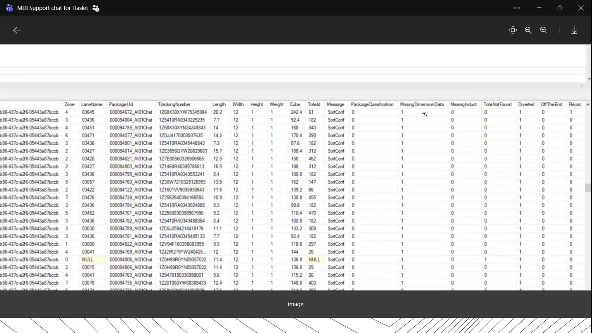
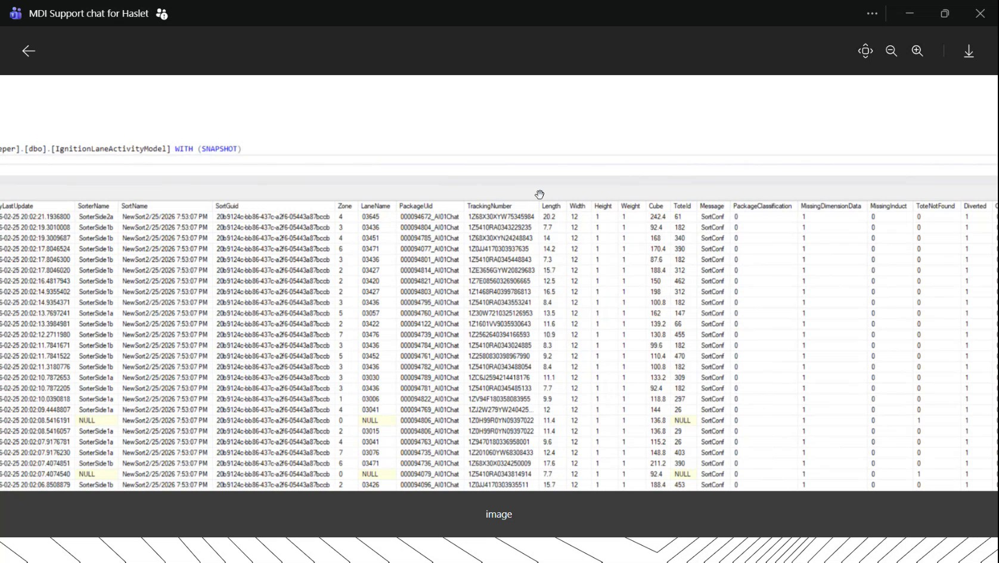

# Inspect Ignition Lane Activity Records in the WCS / Helix DB

## Runbook Header

| Field | Value |
| --- | --- |
| Procedure ID | `proc_inspect_ignition_lane_activity_records_v1` |
| Title | Inspect Ignition Lane Activity Records in the WCS / Helix DB |
| Procedure Type | `diagnostic` |
| Primary Role | `L2_support` |
| Supporting Roles | `L3_support` |
| Support Safe | Yes |
| Capability Tags | `sorter_item_or_scan_state` |
| Access Surface | `wcs_sql` |
| Audience Roles | `L2_support`, `L3_support` |
| Failure Pattern Tags | `miss_scan_or_dimension_fallback` |
| Validation Status | `needs_sme_review` |
| Merge Status | `source_finalized` |

## Summary

Use the WCS / Helix DB (SSMS) read-only view of [dbo].[IgnitionLaneActivityMode] with the SNAPSHOT qualifier to inspect lane activity, package identifiers, measurements, classification, message values, and missing-dimension fields for lane or package troubleshooting.

## When To Use

Use the WCS / Helix DB (SSMS) for read-only troubleshooting when a lane or package requires inspection of Ignition lane activity, sorter and lane identity, package measurements, message status, classification, or missing-dimension data.

## Do Not Use For

* Do not use this procedure to modify database records, issue corrective commands, reboot dimensioners, or perform physical equipment actions.
* Do not use the displayed NewSort, SortConf, null, dash-valued, or numeric fields as a definitive fault interpretation without an established operational meaning or L3 review.

## Safety And Operational Notes

* This procedure is limited to read-only database inspection.
* Do not infer or perform corrective action from the displayed fields unless the operational meaning has been established.

## Access Or Tools Needed

* WCS / Helix DB (SSMS)
* [dbo].[IgnitionLaneActivityMode]
* Read-only database query or view access

## Related Operational Context

* ctx_training_video_ignition_lane_activity_table_v1
* ctx_training_video_package_measurement_fields_v1
* ctx_training_video_lane_activity_status_labels_v1

## Visual References

*WCS / Helix DB (SSMS) result grid showing [dbo].[IgnitionLaneActivityMode] WITH (SNAPSHOT), lane and package fields, measurements, Message, PackageClassification, and MissingDimension Data.*

*Database result grid showing sorter, lane, package identification, measurement, classification, and missing-dimension fields.*

*Filtered lane activity result grid showing SortConf records and repeated measurement values associated with missing dimension data.*

*WCS / Helix DB (SSMS) result grid showing lane activity records and measurement fields in a dimension-data troubleshooting context.*

## Procedure Steps

### Step 1 — Open the Ignition lane activity view

**Responsible role:** L2_support

**Instruction:**
In WCS / Helix DB (SSMS), open the read-only query or view for [dbo].[IgnitionLaneActivityMode] with the SNAPSHOT qualifier. Do not edit the object or its records.

**Expected result:**
The WCS / Helix DB (SSMS) result grid opens and identifies the [dbo].[IgnitionLaneActivityMode] object with the SNAPSHOT qualifier.

**Stop or Escalate If:**

* Escalate to L3 support if the named database object cannot be opened or the expected result fields are unavailable.
* Stop if the available access is not read-only.

---

### Step 2 — Inspect sorter and lane identity fields

**Responsible role:** L2_support

**Instruction:**
In the WCS / Helix DB (SSMS) result grid, inspect the date or timestamp and the SorterName, SortName, SortGuid, Zone, and LaneName fields. Use the available incident time, sorter, zone, or lane information to identify the relevant records.

**Expected result:**
The result grid provides timestamped records with displayed sorter, sort, GUID, zone, and lane-name values that can be compared with the affected lane or sorter context.

**Stop or Escalate If:**

* Escalate to L2/L3 support if the records cannot be associated with the affected lane or package.

---

### Step 3 — Correlate package identifiers and measurements

**Responsible role:** L2_support

**Instruction:**
For the affected lane or package in the WCS / Helix DB (SSMS) result grid, locate PackageUid and TrackingNumber. Compare the displayed Length, Width, Height, Weight, and Cube values for the associated record.

**Expected result:**
The package record can be identified by PackageUid and/or TrackingNumber, and its displayed measurement fields can be compared, including populated, blank, null, or dash-valued entries.

**Stop or Escalate If:**

* Escalate to L2/L3 support if the affected package cannot be identified or the records cannot be associated with it.

---

### Step 4 — Review message, classification, and missing-dimension fields

**Responsible role:** L2_support

**Instruction:**
In the WCS / Helix DB (SSMS) result grid, inspect Message, PackageClassification, and MissingDimension Data. Note displayed values such as NewSort, SortConf, numeric flags, nulls, blanks, or dash-valued fields. Treat these as observations; do not assign an operational fault meaning unless it is established by L2/L3 support.

**Expected result:**
The record shows the displayed message or status-like value, package classification, and missing-dimension data value for the affected record.

**Stop or Escalate If:**

* Escalate for interpretation when NewSort, SortConf, missing-dimension, null, blank, or dash-valued fields do not have an established operational meaning.
* Escalate to L3 support if the displayed pattern indicates missing dimension data but the responsible upstream condition is not established.

---

## Success Criteria

* The WCS / Helix DB (SSMS) read-only view for [dbo].[IgnitionLaneActivityMode] with the SNAPSHOT qualifier opens.
* The relevant records can be associated with the affected sorter, zone, lane, or package.
* PackageUid and/or TrackingNumber can be correlated with the displayed Length, Width, Height, Weight, and Cube values.
* Message, PackageClassification, and MissingDimension Data values are available for operational review.

## Failure Conditions

* The database object cannot be opened or the expected result fields are unavailable.
* Records cannot be associated with the affected lane or package.
* Package identifiers or measurement fields are missing or cannot be correlated.
* NewSort, SortConf, null, blank, dash-valued, numeric, or missing-dimension values require interpretation that is not established by the available evidence.

## Escalation Guidance

* Escalate to L2/L3 support if the named object cannot be opened, expected fields are unavailable, or records cannot be associated with the affected lane or package.
* Escalate for field interpretation when displayed NewSort, SortConf, missing-dimension, null, blank, or dash-valued fields do not have an established operational meaning.
* Do not prescribe dimensioner reboot or other corrective action from this inspection alone.

## Missing Details / Known Gaps

* The source does not provide the database name.
* The source does not provide SQL text or a filtering syntax; no query has been invented.
* The source does not define complete healthy-versus-fault interpretations for NewSort, SortConf, PackageClassification, MissingDimension Data, numeric flags, nulls, blanks, or dash-valued fields.
* The source does not define measurement units or field-specific thresholds.
* The source shows missing-dimension observations associated with dimension data availability but does not establish the complete upstream corrective procedure.
* The candidate and displayed evidence use both [dbo].[IgnitionLaneActivityMode] and IgnitionLaneActivityModel terminology; the exact live object name requires SME confirmation.

## Source Lineage

- Candidate IDs: candidate_training_video_inspect_ignition_lane_activity_records
- Source ID: `training_video_day2`
- Source Type: `training_video`
