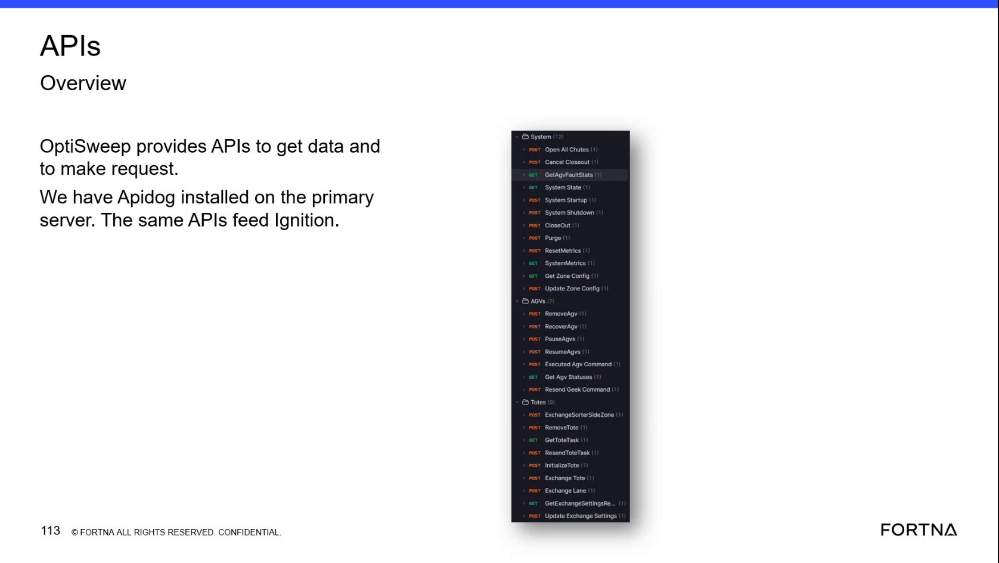
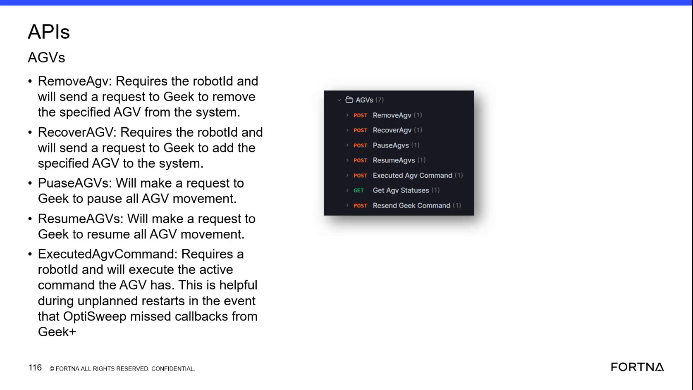
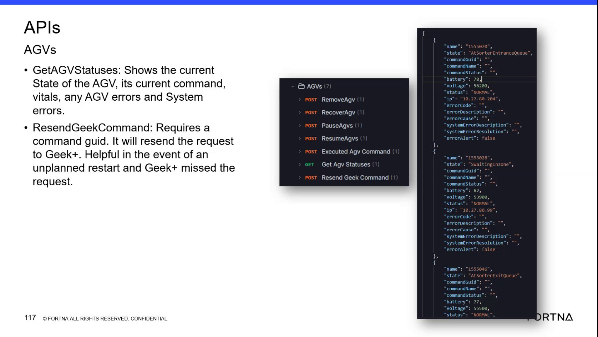

# Remove a Specified AGV Through the OptiSweep WCS API

## Runbook Header

| Field | Value |
| --- | --- |
| Procedure ID | `proc_remove_specified_agv_through_optisweep_wcs_api_v1` |
| Title | Remove a Specified AGV Through the OptiSweep WCS API |
| Procedure Type | `recovery` |
| Primary Role | `L2_support` |
| Supporting Roles | None |
| Support Safe | Yes |
| Capability Tags | `agv_active_errors` |
| Access Surface | `wcs_api`, `apidog` |
| Audience Roles | `L2_support`, `L3_support` |
| Failure Pattern Tags | `api_unresponsive` |
| Validation Status | `needs_sme_review` |
| Merge Status | `source_finalized` |

## Summary

Use the OptiSweep / WCS API RemoveAgv operation in Apidog or an equivalent API client to request removal of one specified AGV from the system through Geek. The request requires the AGV's robot ID and must be verified using the AGV status response.

## When To Use

Use when an identified AGV must be removed from the OptiSweep system through the live OptiSweep / WCS API and the robot ID is confirmed.

## Do Not Use For

* Do not use without a confirmed robot ID.
* Do not use to add or recover an AGV; RecoverAgv is the separate operation described for adding the specified AGV to the system.
* Do not use as a substitute for PauseAgvs or ResumeAgvs, which control movement for all AGVs.

## Safety And Operational Notes

* Confirm the robot ID before submitting the removal request.
* Removal changes the AGV's representation in the OptiSweep system; verify the live result after submission.

## Access Or Tools Needed

* OptiSweep / WCS API
* Apidog or equivalent WCS API client
* POST RemoveAgv operation
* Confirmed robot ID
* GET Get Agv Statuses operation or another available AGV status response

## Related Operational Context

* ctx_training_video_remove_recover_agv_v1

## Visual References

*Apidog / WCS API overview showing the AGVS operation group and POST RemoveAgv and GET Get Agv Statuses operations.*

*AGVS API view showing POST RemoveAgv and the requirement for a robot ID to request removal from the system.*

*AGV status response showing fields including name, state, commandGuid, commandName, commandStatus, battery, voltage, status, errorCode, errorDescription, errorCause, system error fields, and errorAlert.*

## Procedure Steps

### Step 1 — Open the AGVS RemoveAgv operation in Apidog

**Responsible role:** L2_support

**Instruction:**
In Apidog or an equivalent OptiSweep / WCS API client, open the AGVS operation group and locate the POST RemoveAgv operation.

**Expected result:**
The AGVS operation list displays POST RemoveAgv and the request can be opened for input.

**Stop or Escalate If:**

* Stop and escalate if the OptiSweep / WCS API client cannot be accessed.
* Stop and escalate if POST RemoveAgv is not available.

---

### Step 2 — Enter the confirmed robot ID

**Responsible role:** L2_support

**Instruction:**
Enter the confirmed robot ID in the input required by POST RemoveAgv. Do not continue if the robot ID has not been confirmed.

**Expected result:**
The RemoveAgv request contains the intended AGV robot ID.

**Stop or Escalate If:**

* Stop if the robot ID is not confirmed.
* Stop and escalate if the API client rejects the robot ID input and the required format is not available in this source.

---

### Step 3 — Submit the POST RemoveAgv request

**Responsible role:** L2_support

**Instruction:**
Submit the POST RemoveAgv request after confirming that the request targets the intended robot ID.

**Expected result:**
The OptiSweep / WCS API submits a request to Geek to remove the specified AGV from the system.

**Stop or Escalate If:**

* Stop and escalate if the POST RemoveAgv request cannot be submitted.
* Do not retry against a different robot ID without confirming the intended target.

---

### Step 4 — Verify the AGV status after removal

**Responsible role:** L2_support

**Instruction:**
Use GET Get Agv Statuses or the available live AGV status response in the OptiSweep / WCS API to locate the specified robot ID. Check the returned AGV identity and state/status fields, including name, state, status, errorCode, errorDescription, and errorAlert where present.

**Expected result:**
The specified robot is no longer represented as an active AGV in the returned system state, or its returned state/status indicates removal.

**Stop or Escalate If:**

* Stop and escalate if the specified AGV remains present after the request.
* Escalate if the status response is unavailable or does not identify the specified robot clearly.

---

## Success Criteria

* The POST RemoveAgv operation is submitted with the confirmed robot ID.
* The OptiSweep / WCS API sends the removal request to Geek.
* The specified robot is no longer represented as an active AGV in the live AGV status response, or its state/status indicates removal.

## Failure Conditions

* The API client or POST RemoveAgv operation is unavailable.
* The robot ID is missing or unconfirmed.
* The POST RemoveAgv request cannot be submitted.
* The specified AGV remains present as an active AGV after submission.
* The AGV status response is unavailable or does not provide enough information to verify the result.

## Escalation Guidance

* Escalate to L3_support if the API request cannot be submitted.
* Escalate to L3_support if the specified AGV remains present after the RemoveAgv request.
* Escalate when the robot ID or live AGV status cannot be confirmed.

## Missing Details / Known Gaps

* The source does not provide an HTTP response code or detailed RemoveAgv response fields.
* The source does not specify the exact request-body field syntax beyond requiring the robot ID.
* The source does not define how long to wait before verifying the AGV status.
* The source does not provide a definitive live response example showing the removed AGV; verification must use the available AGV status response.

## Source Lineage

- Candidate IDs: candidate_training_video_remove_agv_via_wcs_api
- Source ID: `training_video_day2`
- Source Type: `training_video`
