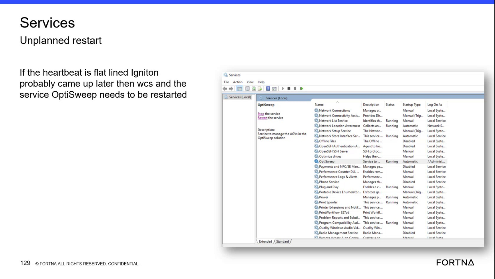
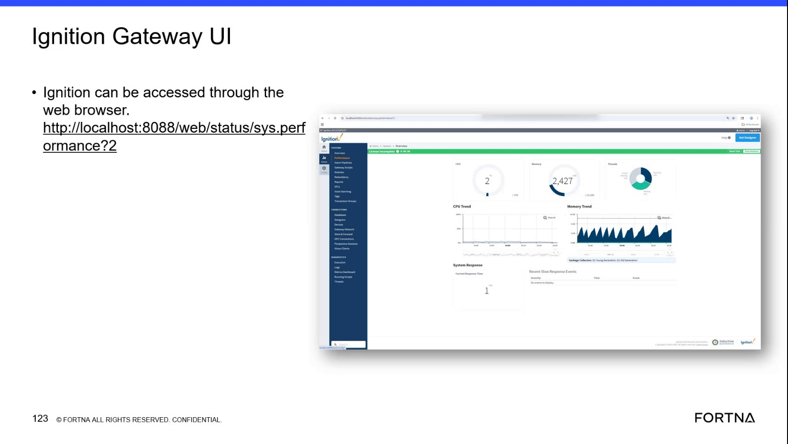

# Restart the OptiSweep Windows Service in Windows Services After Flatlined Tipper Heartbeats in the Ignition Gateway

## Runbook Header

| Field | Value |
| --- | --- |
| Procedure ID | `proc_restart_optisweep_service_flatlined_tipper_heartbeats_v1` |
| Title | Restart the OptiSweep Windows Service in Windows Services After Flatlined Tipper Heartbeats in the Ignition Gateway |
| Procedure Type | `recovery` |
| Primary Role | `L1_support` |
| Supporting Roles | `L2_support` |
| Support Safe | Yes |
| Capability Tags | `opc_connection_or_tipper_heartbeat`, `wcs_service_health` |
| Access Surface | `ignition_gateway`, `event_viewer` |
| Audience Roles | `L1_support`, `L2_support` |
| Failure Pattern Tags | `opc_connection_faulted`, `gateway_unhealthy`, `service_crash_or_restart` |
| Validation Status | `needs_sme_review` |
| Merge Status | `source_finalized` |

## Summary

Use the Ignition gateway to verify that a tipper heartbeat is flat-lined, then use Windows Services to locate and restart the OptiSweep service. Confirm that the service returns to Running and that the Ignition gateway heartbeat is no longer flat-lined.

## When To Use

Use this Ignition gateway and Windows Services procedure when a live tipper heartbeat is flat-lined or missing, including after an unplanned restart where Ignition may have started later than WCS and the OptiSweep service did not reestablish OPC-related heartbeat communication.

## Do Not Use For

* Do not use this procedure as a general database, API, or broader system restart procedure.
* Do not use it when a flat-lined or missing tipper heartbeat has not been verified in the Ignition gateway.

## Safety And Operational Notes

* Restart the OptiSweep service only after confirming the flat-lined tipper heartbeat in the Ignition gateway.
* The source associates this condition with Ignition, OPC, and service startup timing after an unplanned restart; do not infer additional corrective actions from that association.

## Access Or Tools Needed

* Ignition gateway
* Windows Services MMC
* OptiSweep Windows service

## Related Operational Context

* ctx_training_video_tipper_heartbeat_metric_v1
* ctx_training_video_optisweep_service_reference_v1
* ctx_training_video_heartbeat_ignition_opc_relationship_v1

## Visual References

*Windows Services view showing the OptiSweep entry, its status, and the Restart the service control in the context of a flat-lined tipper heartbeat.*

*Windows Services view supporting the OptiSweep restart after checking a tipper heartbeat in the Ignition gateway.*

*Ignition gateway view showing tipper-related communications and faulted communication status.*

## Procedure Steps

### Step 1 — Check the tipper heartbeat in the Ignition gateway

**Responsible role:** L1_support

**Instruction:**
In the Ignition gateway, inspect the live heartbeat indication for the affected tipper and determine whether heartbeat communication is being received or is flat-lined.

**Expected result:**
The affected tipper's live heartbeat indication is identified as either active or flat-lined, providing the basis for the service-restart decision.

**Stop or Escalate If:**

* If the heartbeat is not flat-lined, do not perform this service-restart procedure.
* If the affected tipper or heartbeat indication cannot be identified in the Ignition gateway, escalate for L2 support.

---

### Step 2 — Locate OptiSweep in Windows Services

**Responsible role:** L1_support

**Instruction:**
Open Windows Services MMC, locate the service named "OptiSweep," and review its Status.

**Expected result:**
The Windows Services console displays the OptiSweep service entry and its current Status.

**Stop or Escalate If:**

* If the OptiSweep service cannot be located, escalate to L2 support.
* If Windows Services cannot be opened or the service status cannot be read, escalate to L2 support.

---

### Step 3 — Restart the OptiSweep service in Windows Services

**Responsible role:** L1_support

**Instruction:**
In Windows Services, use the OptiSweep service's "Restart the service" control.

**Expected result:**
Windows Services accepts the restart request for the OptiSweep service.

**Stop or Escalate If:**

* Escalate if the OptiSweep service cannot be restarted.
* Escalate if the restart request reports an error.

---

### Step 4 — Confirm service state and tipper heartbeat recovery

**Responsible role:** L1_support

**Instruction:**
In Windows Services, verify that the OptiSweep service returns to a Running state. Then return to the Ignition gateway and recheck the affected tipper's live heartbeat indication.

**Expected result:**
The OptiSweep service shows Running and the affected tipper heartbeat is no longer flat-lined.

**Stop or Escalate If:**

* Escalate if the OptiSweep service does not return to Running.
* Escalate if the tipper heartbeat remains flat-lined after the service restart.

---

## Success Criteria

* The OptiSweep entry in Windows Services shows Running after the restart.
* The affected tipper's live heartbeat indication in the Ignition gateway is no longer flat-lined.
* Heartbeat communication is observable again for the affected tipper.

## Failure Conditions

* The OptiSweep service cannot be restarted.
* The OptiSweep service does not return to Running.
* The affected tipper heartbeat remains flat-lined after the restart.
* The affected heartbeat indication cannot be identified in the Ignition gateway.

## Escalation Guidance

* Escalate to L2 support if the OptiSweep service cannot be located or restarted.
* Escalate if the OptiSweep service does not return to Running.
* Escalate if the tipper heartbeat remains flat-lined after the service restart.
* The source associates the condition with Ignition, OPC, and startup ordering after an unplanned restart; no additional corrective action is established by this procedure.

## Missing Details / Known Gaps

* The source does not identify the exact Ignition gateway page, heartbeat field, tag name, or tipper-selection control.
* The source does not define how long to wait after the restart before judging the heartbeat recovery.
* The source does not specify the service host name or a precise Windows Services navigation path.
* The source does not define production-impact, change-control, or authorization requirements for restarting OptiSweep.
* The source does not provide additional corrective actions when the heartbeat remains flat-lined after the restart.

## Source Lineage

- Candidate IDs: candidate_training_video_restart_optisweep_service_after_flatlined_tipper_heartbeats
- Source ID: `training_video_day2`
- Source Type: `training_video`
