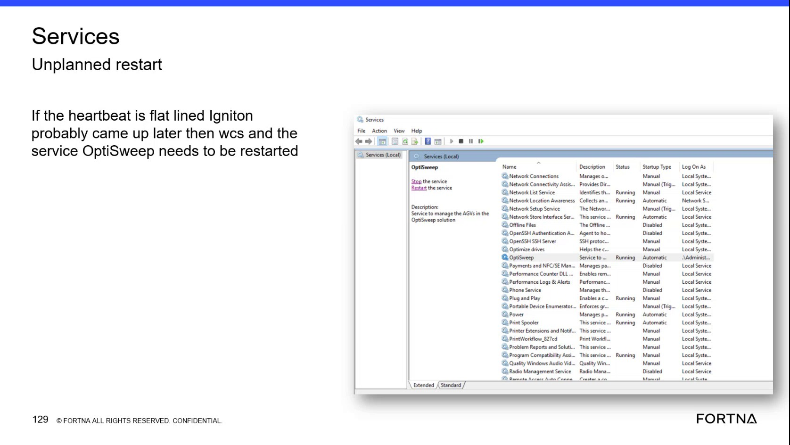

# Restart the OptiSweep Windows Service in Windows Services

## Runbook Header

| Field | Value |
| --- | --- |
| Procedure ID | `proc_restart_optisweep_windows_service_v1` |
| Title | Restart the OptiSweep Windows Service in Windows Services |
| Procedure Type | `recovery` |
| Primary Role | `L1_support` |
| Supporting Roles | None |
| Support Safe | Yes |
| Capability Tags | `wcs_service_health`, `windows_service_or_event_log` |
| Access Surface | `event_viewer` |
| Audience Roles | `L1_support` |
| Failure Pattern Tags | `service_crash_or_restart` |
| Validation Status | `needs_sme_review` |
| Merge Status | `source_finalized` |

## Summary

Use the Windows Event Viewer / services surface, specifically Windows Services MMC, to locate the OptiSweep service, restart it, and verify that its Status is Running and Startup Type remains Automatic.

## When To Use

Use Windows Services when a tipper heartbeat is flatlined and the source-associated condition is delayed OptiSweep startup relative to Ignition and WCS.

## Do Not Use For

* Do not use this procedure as a substitute for a detailed Ignition health check; the supplied source does not provide that check.
* Do not use this procedure to diagnose or repair a physical tipper, AGV, or OPC connection fault beyond restarting the OptiSweep Windows service.

## Safety And Operational Notes

* Confirm the OptiSweep service state after the restart before treating the recovery as successful.
* Escalate rather than repeatedly restarting if the service does not return to Running or the heartbeat remains flatlined.

## Access Or Tools Needed

* Windows Event Viewer / services
* Windows Services MMC
* OptiSweep Windows service

## Related Operational Context

* ctx_training_video_heartbeat_flatline_v1
* ctx_training_video_optisweep_windows_service_v1
* ctx_training_video_startup_timing_v1

## Visual References

*Windows Services MMC showing the OptiSweep service, the Status and Startup Type fields, and the Restart the service control.*

## Procedure Steps

### Step 1 — Open Windows Services and locate OptiSweep

**Responsible role:** L1_support

**Instruction:**
In the Windows Event Viewer / services surface, open Windows Services MMC and locate the service named OptiSweep.

**Expected result:**
The OptiSweep service entry is visible with its service controls and Status and Startup Type fields.

**Stop or Escalate If:**

* Escalate if the OptiSweep service entry cannot be located.

---

### Step 2 — Inspect the OptiSweep service state

**Responsible role:** L1_support

**Instruction:**
In Windows Services MMC, select the OptiSweep entry and inspect the displayed Status and Startup Type values.

**Expected result:**
The OptiSweep entry displays Status as Running and Startup Type as Automatic when the service is in the expected state.

**Stop or Escalate If:**

* Escalate if the OptiSweep entry is not present or its displayed fields cannot be inspected.

---

### Step 3 — Restart the OptiSweep service

**Responsible role:** L1_support

**Instruction:**
In Windows Services MMC, use the service control labeled Restart the service for the OptiSweep entry.

**Expected result:**
The Windows Services console initiates the restart of the OptiSweep service.

**Stop or Escalate If:**

* Stop and escalate if the OptiSweep service does not return to Running after the restart.

---

### Step 4 — Verify the post-restart service state

**Responsible role:** L1_support

**Instruction:**
Refresh or recheck the OptiSweep entry in Windows Services MMC after the restart and inspect its Status and Startup Type.

**Expected result:**
The refreshed OptiSweep entry displays Status as Running and Startup Type as Automatic.

**Stop or Escalate If:**

* Stop and escalate if the OptiSweep service does not return to Running.
* Escalate if the heartbeat remains flatlined after the OptiSweep service restart.

---

## Success Criteria

* The OptiSweep service is visible in Windows Services MMC after the restart.
* The OptiSweep Status is Running.
* The OptiSweep Startup Type remains Automatic.
* The associated heartbeat is no longer flatlined, when that heartbeat symptom was the trigger.

## Failure Conditions

* OptiSweep does not return to Running after the restart.
* OptiSweep Startup Type is not Automatic after the restart.
* The associated heartbeat remains flatlined after the service restart.

## Escalation Guidance

* Stop and escalate if the OptiSweep service does not return to Running after the restart.
* Escalate if the heartbeat remains flatlined after the OptiSweep service restart.
* The supplied source does not define a further diagnostic sequence for Ignition, OPC, or Windows service logs.

## Missing Details / Known Gaps

* The source does not provide a detailed live Ignition gateway health check or a defined heartbeat verification procedure.
* The source does not specify the host-selection method, permissions, service account, restart wait time, or Windows service log checks.
* No source-supported command-line or API command is provided.

## Source Lineage

- Candidate IDs: candidate_training_video_restart_optisweep_windows_service
- Source ID: `training_video_day2`
- Source Type: `training_video`
