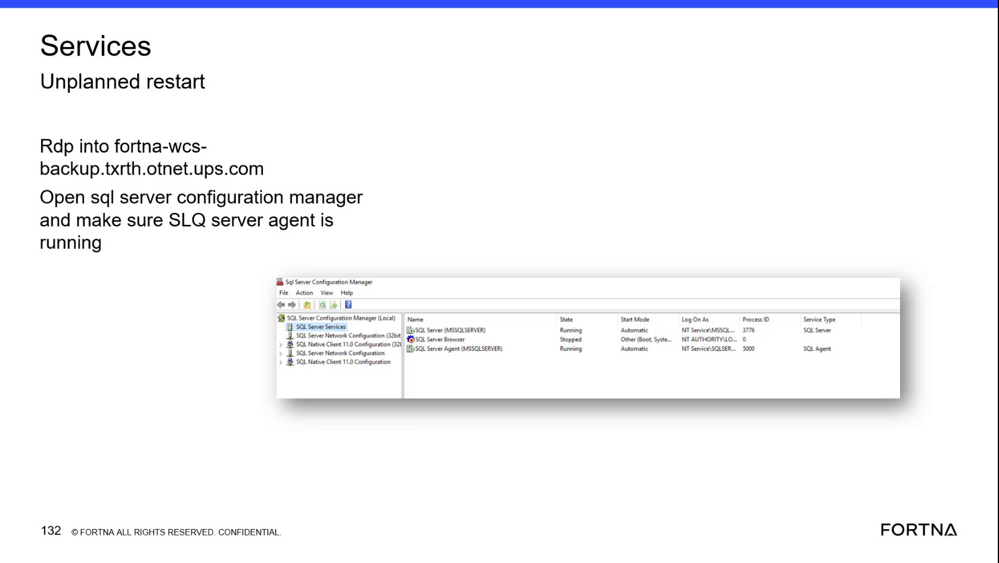

# Check RMS fleet status UI to confirm RMS is up and running

## Runbook Header

| Field | Value |
| --- | --- |
| Procedure ID | `proc_check_rms_fleet_status_ui_confirm_rms_up_v1` |
| Title | Check RMS fleet status UI to confirm RMS is up and running |
| Procedure Type | `diagnostic` |
| Primary Role | `L1_support` |
| Supporting Roles | None |
| Support Safe | Yes |
| Capability Tags | `fleet_system_status` |
| Access Surface | `rms_ui` |
| Audience Roles | `L1_support` |
| Failure Pattern Tags | None |
| Validation Status | `needs_sme_review` |
| Merge Status | `source_finalized` |

## Summary

Use the RMS / fleet status UI as a quick health check to confirm RMS is reachable and displaying current fleet/status information so the OptiSweep system can be considered up and running.

## When To Use

Use after system events or when you need a fast confirmation that RMS is reachable and presenting fleet/status content.

## Access Or Tools Needed

* RMS / fleet status UI (rms_ui)

## Related Operational Context

* ctx_training_video_rms_up_and_running_check_v1

## Visual References

*Training segment frame that explicitly instructs to check RMS to confirm everything is up and running (includes nearby note about SQL Server Configuration Manager / SQL Server Agent running).*

## Procedure Steps

### Step 1 — Open the RMS / fleet status UI

**Responsible role:** L1_support

**Instruction:**
Open the RMS / fleet status UI (rms_ui).

**Expected result:**
The RMS / fleet status UI is reachable and begins loading (i.e., you can view the page rather than seeing a blank/unreachable state).

**Stop or Escalate If:**

* RMS is blank/unreachable

---

### Step 2 — Confirm RMS page loads and shows current fleet/status content

**Responsible role:** L1_support

**Instruction:**
On the RMS / fleet status UI (rms_ui), confirm the page loads successfully and shows current fleet/status content (i.e., not blank/unreachable).

**Expected result:**
RMS / fleet status UI displays current fleet/status information.

**Stop or Escalate If:**

* RMS does not show fleet/status content (blank/unreachable)

---

### Step 3 — Interpret RMS health/error indicator (if present)

**Responsible role:** L1_support

**Instruction:**
If the RMS / fleet status UI shows an errors/health indicator, note whether it indicates normal operation versus an outage/unreachable condition.

**Expected result:**
You can classify the RMS health/error indicator as normal operation or outage/unhealthy/unreachable.

**Stop or Escalate If:**

* RMS indicates outage/unhealthy/unreachable via its health/error indicator

---

## Success Criteria

* RMS / fleet status UI is reachable and displays current fleet/status information (not blank/unreachable).

## Failure Conditions

* RMS / fleet status UI is blank/unreachable.
* RMS / fleet status UI health/error indicator (if present) indicates outage/unhealthy/unreachable.

## Escalation Guidance

* If RMS is blank/unreachable or indicates an outage/unhealthy state, escalate for WCS/OptiSweep service health checks (including SQL Server Agent/service health) rather than assuming the system is up.

## Missing Details / Known Gaps

* The packet does not provide the specific RMS UI field names/labels or the exact wording/visual states for the health/error indicator; outcomes are therefore limited to observable reachability and whether fleet/status content is displayed.

## Source Lineage

- Candidate IDs: candidate_training_video_rms_check_up_and_running
- Source ID: `training_video_day2`
- Source Type: `training_video`
