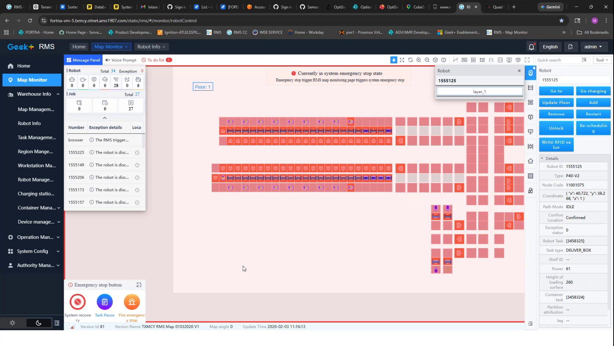

# Check RMS Map Monitor for System Emergency-Stop Status

## Runbook Header

| Field | Value |
| --- | --- |
| Procedure ID | `proc_check_rms_map_monitor_system_emergency_stop_status_v1` |
| Title | Check RMS Map Monitor for System Emergency-Stop Status |
| Procedure Type | `diagnostic` |
| Primary Role | `operator` |
| Supporting Roles | None |
| Support Safe | Yes |
| Capability Tags | `e_stop_or_safety_stop`, `fleet_system_status` |
| Access Surface | `rms_ui` |
| Audience Roles | `operator` |
| Failure Pattern Tags | `site_stoppage` |
| Validation Status | `needs_sme_review` |
| Merge Status | `source_finalized` |

## Summary

Use the RMS / fleet status UI Map Monitor to inspect the live system emergency-stop message, fleet Total and Exception counts, and the Robot Info fields associated with a selected robot.

## When To Use

Use this diagnostic on the RMS / fleet status UI when verifying whether the live fleet is reporting a system emergency-stop state and when identifying the robot status information associated with that display.

## Do Not Use For

* Do not use this procedure to clear, reset, or otherwise change an emergency-stop state.
* Do not use this procedure as a physical emergency-stop response or as a recovery procedure.

## Safety And Operational Notes

* This procedure is read-only and does not clear or reset an emergency stop.
* If the RMS Map Monitor displays a system emergency-stop state, treat the condition as requiring escalation rather than attempting a reset through this procedure.

## Access Or Tools Needed

* RMS / fleet status UI
* RMS Map Monitor page
* RMS Robot Info panel
* RMS Message Panel

## Related Operational Context

* ctx_training_video_rms_map_monitor_emergency_stop_v1

## Visual References

*RMS Map Monitor frame showing the robot map, fleet Total and Exception counts, Message Panel, emergency-stop message, and Robot Info fields.*

## Procedure Steps

### Step 1 — Open the RMS Map Monitor

**Responsible role:** operator

**Instruction:**
Open the RMS / fleet status UI and navigate to the Map Monitor page. Confirm that the robot map, Message Panel, and robot status area are displayed.

**Expected result:**
The RMS Map Monitor page is available and displays the robot map with the fleet monitoring and robot information areas.

**Stop or Escalate If:**

* The RMS Map Monitor is unavailable.
* The displayed robot or fleet information cannot be confirmed.

---

### Step 2 — Inspect fleet Total and Exception counts

**Responsible role:** operator

**Instruction:**
On the RMS Map Monitor, inspect the fleet summary and note the displayed Total and Exception counts. The captured RMS screen shows Total 34 and Exception 0; use the values currently displayed in the live RMS session rather than assuming those captured values remain current.

**Expected result:**
The current RMS fleet Total and Exception values are visible and can be used to characterize the displayed fleet state.

**Stop or Escalate If:**

* The Exception count indicates a robot exception.
* The Total or Exception values cannot be confirmed.

---

### Step 3 — Check the system emergency-stop message

**Responsible role:** operator

**Instruction:**
Inspect the RMS Map Monitor Message Panel and message area for the exact status text "Currently in system emergency stop state."

**Expected result:**
The operator can determine whether the RMS Message Panel currently displays the system emergency-stop status.

**Stop or Escalate If:**

* The RMS Map Monitor displays "Currently in system emergency stop state."
* The Message Panel or displayed status cannot be confirmed.

---

### Step 4 — Review the selected robot status fields

**Responsible role:** operator

**Instruction:**
When an affected robot entry is present in the RMS Map Monitor, select it and review the Robot Info panel. Inspect Robot ID, Type, Node Code, Path Mode, Location, Exception status, and Robot Task information. The captured screen includes Robot ID 1555125, Type P40-V2, Node Code 11001075, Path Mode IDLE, Location, Exception status, and Robot Task details; use the values currently displayed for the selected robot.

**Expected result:**
The selected robot's identifying, location, exception, path, and task fields are visible and can be associated with the RMS emergency-stop or exception display.

**Stop or Escalate If:**

* The selected robot has an exception or emergency-stop-related status.
* The Robot Info fields or associated task information cannot be confirmed.

---

## Success Criteria

* The RMS Map Monitor loads successfully.
* The current fleet Total and Exception counts are visible.
* The operator determines whether the exact system emergency-stop message is displayed.
* When an affected robot is present, its Robot Info fields and task information are available for escalation.

## Failure Conditions

* The RMS Map Monitor is unavailable or its displayed information cannot be confirmed.
* The fleet Exception count indicates an exception.
* The Message Panel displays "Currently in system emergency stop state."
* A selected robot displays an exception or emergency-stop-related status.

## Escalation Guidance

* Escalate when the RMS Map Monitor displays "Currently in system emergency stop state."
* Escalate when the fleet summary or selected robot shows an exception or emergency-stop-related status.
* Escalate when the RMS Map Monitor is unavailable or the robot and fleet information cannot be confirmed.
* Do not attempt to clear or reset the emergency stop using this diagnostic.

## Missing Details / Known Gaps

* The source does not define the emergency-stop reset or recovery procedure.
* The source does not define a specific escalation owner, contact path, or response-time target.
* The captured Total 34 and Exception 0 values are an observed screen state, not a universal operating threshold or baseline.
* The source does not establish additional RMS controls or actions beyond status inspection.

## Source Lineage

- Candidate IDs: candidate_training_video_rms_map_monitor_emergency_stop_status
- Source ID: `training_video_day2`
- Source Type: `training_video`
