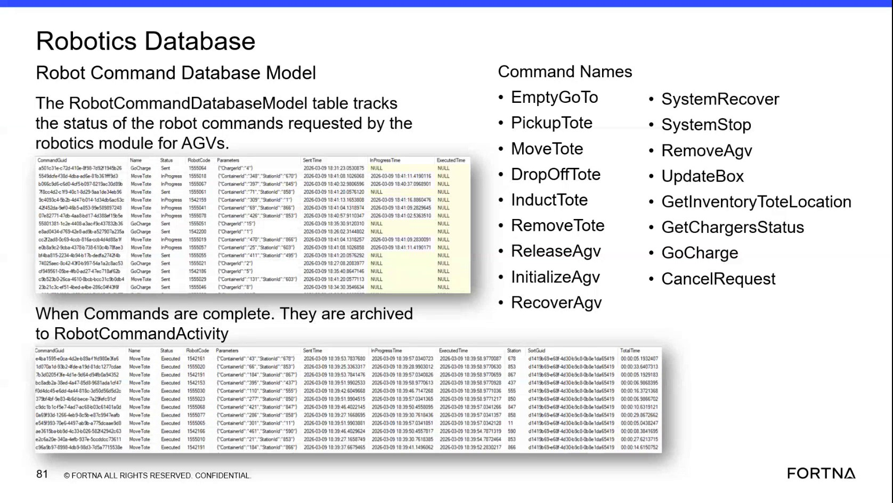

# Diagnose AGV Robot Command State in WCS / Helix DB (SSMS)

## Runbook Header

| Field | Value |
| --- | --- |
| Procedure ID | `proc_diagnose_agv_robot_command_state_in_robotics_database_v1` |
| Title | Diagnose AGV Robot Command State in WCS / Helix DB (SSMS) |
| Procedure Type | `diagnostic` |
| Primary Role | `L2_support` |
| Supporting Roles | `L3_support` |
| Support Safe | Yes |
| Capability Tags | `robot_command_or_task_state` |
| Access Surface | `wcs_sql` |
| Audience Roles | `L2_support`, `L3_support` |
| Failure Pattern Tags | `robot_task_or_command_stuck` |
| Validation Status | `needs_sme_review` |
| Merge Status | `source_finalized` |

## Summary

Use the WCS / Helix DB (SSMS) in read-only mode to trace an AGV command through the Robotics Database RobotCommandDatabaseModel active-command table and Robot Command Activity history. Review command identity, status, robot, container, station, location, parameters, and lifecycle timing fields to determine whether the command was sent, started, completed, errored, or cancelled.

## When To Use

Use this diagnostic on the live WCS / Helix DB (SSMS) when support needs to verify the lifecycle of an AGV command requested by the Robotics module, including whether an active command is Sent or InProgress, whether it has been archived, or whether it has an errored or cancelled status.

## Do Not Use For

* Do not use this procedure to modify database records, resubmit commands, remove or recover an AGV, restart services, or issue other command changes.
* Do not use this procedure as a replacement for physical AGV recovery or safety actions.

## Safety And Operational Notes

* This is a read-only diagnostic. Do not modify database records or issue command changes.
* An errored or cancelled command requires escalation to L2/L3 support rather than corrective database edits.

## Access Or Tools Needed

* WCS / Helix DB (SSMS)
* OptiSweep WCS / Helix Robotics database
* RobotCommandDatabaseModel table
* Robot Command Activity historical records

## Related Operational Context

* ctx_training_video_robot_command_database_v1
* ctx_training_video_robot_command_activity_history_v1
* ctx_training_video_robot_location_capacity_reference_v1

## Visual References

*WCS / Helix DB (SSMS) view of the Robotics Database RobotCommandDatabaseModel table, including command name, status, CommandGuid, RobotCode, parameters, Sent Time, InProgress Time, and Executed Time, with the active-versus-archived command relationship.*

## Procedure Steps

### Step 1 — Open the active command table in WCS / Helix DB (SSMS)

**Responsible role:** L2_support

**Instruction:**
In the WCS / Helix DB (SSMS), open the OptiSweep Robotics database and locate the RobotCommandDatabaseModel table. Review the active command rows and the command/status columns.

**Expected result:**
The live WCS / Helix DB (SSMS) view shows active robot commands requested by the Robotics module, with fields including CommandGuid, CommandName, Status, RobotCode, Parameters, Sent Time, InProgress Time, and Executed Time.

**Stop or Escalate If:**

* Escalate to L3_support if the WCS / Helix DB (SSMS) or Robotics database cannot be accessed.
* Escalate if the relevant command cannot be located in the active table after checking the available command identifiers.

---

### Step 2 — Identify the command in WCS / Helix DB (SSMS)

**Responsible role:** L2_support

**Instruction:**
In the WCS / Helix DB (SSMS) RobotCommandDatabaseModel table, find the relevant row using the command name, RobotCode, CommandGuid, container or station parameters. For a Move Tote command, compare the ContainerId and StationId values in Parameters with the reported movement.

**Expected result:**
One active RobotCommandDatabaseModel row is matched to the reported AGV command using command identity and parameter values.

**Stop or Escalate If:**

* Escalate if the command cannot be uniquely matched using the available command name, RobotCode, CommandGuid, container, station, or parameter values.

---

### Step 3 — Interpret command status and lifecycle timing in WCS / Helix DB (SSMS)

**Responsible role:** L2_support

**Instruction:**
In the matched WCS / Helix DB (SSMS) row, review Status, Sent Time, InProgress Time, and Executed Time. A Sent command may have InProgress Time and Executed Time as NULL. An InProgress command has an InProgress Time while Executed Time remains NULL until the command is finalized.

**Expected result:**
The live row provides an observable lifecycle state through Status and the presence or absence of Sent Time, InProgress Time, and Executed Time.

**Stop or Escalate If:**

* Stop the database diagnostic and escalate to L2/L3 support if Status is errored or cancelled.
* Escalate if the command remains active without the expected InProgress or Executed Time evidence.

---

### Step 4 — Check AGV location fields in WCS / Helix DB (SSMS)

**Responsible role:** L2_support

**Instruction:**
In the WCS / Helix DB (SSMS) Robotics data, review the matched command's related robot location information, including CurrentLocationId and DestinationLocationId when available. Compare the location state with the command's station or destination parameters.

**Expected result:**
The live WCS / Helix DB (SSMS) data shows the AGV's current location and destination location in relation to the command being diagnosed.

**Stop or Escalate If:**

* Escalate if current or destination location data conflicts with the command parameters or indicates a stuck command.

---

### Step 5 — Review finalized command history in WCS / Helix DB (SSMS)

**Responsible role:** L2_support

**Instruction:**
If the command is no longer active in the WCS / Helix DB (SSMS) RobotCommandDatabaseModel table, locate the corresponding record in Robot Command Activity. Review the command name, status, robot name, container, station, parameters, Sent Time, InProgress Time, Executed Time, station circuit, and total time.

**Expected result:**
The live Robot Command Activity record provides the historical status and execution/timing information for the finalized command.

**Stop or Escalate If:**

* Escalate to L2/L3 support if the command cannot be located in either the active RobotCommandDatabaseModel table or Robot Command Activity history.
* Escalate if the historical status is errored or cancelled.

---

## Success Criteria

* The relevant command is identified in the WCS / Helix DB (SSMS) by command name, CommandGuid, RobotCode, container, station, or parameters.
* The command lifecycle is determined from Status, Sent Time, InProgress Time, and Executed Time.
* Current and destination location information is reviewed when location state is relevant.
* A finalized command is correlated to its Robot Command Activity history record, or the reason for escalation is documented from the missing or inconsistent database state.

## Failure Conditions

* The command has an errored or cancelled status.
* The command remains active without expected InProgress or Executed Time evidence.
* The command cannot be located in either RobotCommandDatabaseModel or Robot Command Activity.
* Current or destination location information conflicts with the command parameters or indicates a stuck command.
* The WCS / Helix DB (SSMS) or Robotics database cannot be accessed.

## Escalation Guidance

* Escalate errored or cancelled commands to L2/L3 support.
* Escalate commands that remain active without expected lifecycle timing evidence.
* Escalate when the command is missing from both the active and historical tables.
* Escalate inconsistent current or destination location data, including evidence of a stuck command.
* Do not modify database records or issue command changes while performing this diagnostic.

## Missing Details / Known Gaps

* The packet does not provide exact SSMS database and table navigation steps or a validated SQL query.
* The packet does not provide a separate Robot Command Activity image artifact; the supplied RobotCommandDatabaseModel artifact is used as the available visual reference for the active/archive relationship.
* The packet does not define an exact elapsed-time threshold for determining that an active command is stuck.
* The packet does not provide a complete field-level schema for every Robot Command Activity column or the exact values used for completed status.

## Source Lineage

- Candidate IDs: candidate_training_video_robot_command_database_lifecycle_diagnostic
- Source ID: `training_video_day2`
- Source Type: `training_video`
