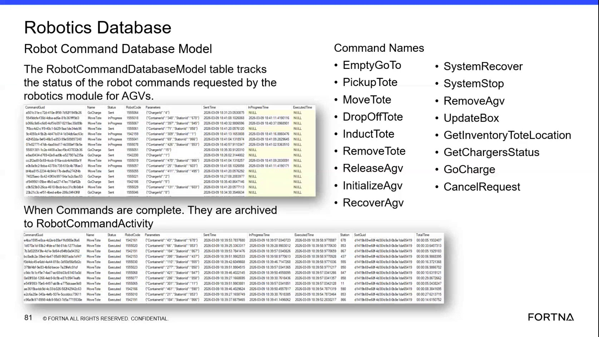

# Check Robot Command Database Model Table for Active Robot Command Status (Sent → In Progress → Archived)

## Runbook Header

| Field | Value |
| --- | --- |
| Procedure ID | `proc_check_robot_command_database_model_table_active_status_v1` |
| Title | Check Robot Command Database Model Table for Active Robot Command Status (Sent → In Progress → Archived) |
| Procedure Type | `diagnostic` |
| Primary Role | `L2_support` |
| Supporting Roles | `L2_support` |
| Support Safe | Yes |
| Capability Tags | `robot_command_or_task_state` |
| Access Surface | `wcs_sql` |
| Audience Roles | `L2_support` |
| Failure Pattern Tags | `mapping_abnormal` |
| Validation Status | `needs_sme_review` |
| Merge Status | `source_finalized` |

## Summary

Use WCS / Helix DB (SSMS) to verify whether a robot command is still active in RobotCommandDatabaseModel, whether it progressed from sent to in-progress, and whether completed commands have been archived to robot command activity (historical record).

## When To Use

When you need to confirm the lifecycle evidence of a specific robot command for an AGV (sent vs in-progress vs completed/archived) using the active transactional table and the archived historical record.

## Do Not Use For

* Do not use this procedure as the primary method to resolve physical safety issues (use on-site physical safety procedures instead).
* Do not use this procedure when you only need to view AGV faults/errors without checking command lifecycle evidence (use the appropriate active error/fault procedure instead).

## Access Or Tools Needed

* WCS / Helix DB (SSMS) read-only access
* RobotCommandDatabaseModel table (Robot Command Database model table)
* Robot command activity archive table/view (historical record of completed/resolved commands)

## Related Operational Context

* ctx_training_video_robot_command_database_table_v1
* ctx_training_video_robot_command_activity_archive_v1
* ctx_training_video_command_status_and_queue_capacity_v1

## Visual References

*RobotCommandDatabaseModel table lifecycle explanation and example fields (sent time, in-progress time, archived to robot command activity; includes command name/status/robot/container/station parameters).*

## Procedure Steps

### Step 1 — Connect to WCS / Helix DB in SSMS (read-only)

**Responsible role:** L2_support

**Instruction:**
Open SSMS and connect to the WCS / Helix DB read-only environment.

**Expected result:**
SSMS is connected to the WCS / Helix DB environment and ready to browse databases/tables.

---

### Step 2 — Open the WCS/OptiSweep database containing RobotCommandDatabaseModel

**Responsible role:** L2_support

**Instruction:**
In the database list, open the OptiSweep/WCS database that contains the RobotCommandDatabaseModel table.

**Expected result:**
The database containing RobotCommandDatabaseModel is opened/expanded in SSMS.

---

### Step 3 — Locate RobotCommandDatabaseModel and identify lifecycle evidence fields

**Responsible role:** L2_support

**Instruction:**
Locate the RobotCommandDatabaseModel table and identify the columns/fields shown in the table UI for command lifecycle evidence, including sent time and in-progress time, plus command identifiers such as command name and robot/container/station parameters.

**Expected result:**
RobotCommandDatabaseModel is open and the lifecycle evidence fields (sent time and in-progress time) and identifiers (command name and robot/container/station parameters) are visible.

---

### Step 4 — Find the specific command instance by CommandName and robot/container/station identifiers

**Responsible role:** L2_support

**Instruction:**
Find the specific command instance by using the command name (e.g., MoveTote, PickupTote, DropOffTote, RemoveAgv, GoCharge) and the relevant robot/container/station identifiers that match the incident context.

**Expected result:**
A matching row (or set of rows) for the targeted CommandName and robot/container/station identifiers is located in RobotCommandDatabaseModel.

---

### Step 5 — Verify lifecycle progression: sent time and in-progress time

**Responsible role:** L2_support

**Instruction:**
Observe the lifecycle timestamps/fields for the targeted row: confirm whether the row shows a sent time and whether it has transitioned to an in-progress state (in-progress time populated).

**Expected result:**
For the targeted command row, sent time is populated; in-progress time is populated if the command has progressed to in-progress.

**Stop or Escalate If:**

* If the command remains in RobotCommandDatabaseModel without an in-progress transition (sent time populated but in-progress time not populated), escalate for deeper command/task state troubleshooting rather than assuming completion.

---

### Step 6 — Check destination/queue-capacity interaction evidence for in-progress commands

**Responsible role:** L2_support

**Instruction:**
If the command is in-progress, confirm queue/capacity interaction evidence by checking that the destination queue/location is reflected as freed/occupied based on in-progress status (e.g., in-progress indicates the AGV is occupying the queue/location capacity).

**Expected result:**
The destination/current location fields associated with the in-progress command reflect active occupancy behavior consistent with queue capacity handling.

---

### Step 7 — Verify completion: command archived out of RobotCommandDatabaseModel into robot command activity

**Responsible role:** L2_support

**Instruction:**
If the command is completed, verify it is no longer present as an active command in RobotCommandDatabaseModel and instead exists in the archived robot command activity (historical record).

**Expected result:**
For the targeted command instance, RobotCommandDatabaseModel no longer contains the active row; the command appears in robot command activity archive with a status such as errored or cancelled.

**Stop or Escalate If:**

* If the command appears completed but is still present in RobotCommandDatabaseModel, escalate to investigate archiving behavior and transactional table consistency.
* If you cannot locate the command by CommandName + robot/container/station identifiers, confirm the correct robot/container/station context and command naming used by the Robotics module.

---

## Success Criteria

* For the targeted command instance, RobotCommandDatabaseModel shows sent time populated.
* If the command has progressed, in-progress time is populated.
* If the command is completed, it is absent from RobotCommandDatabaseModel and present in robot command activity archive with a resolved status (e.g., errored or cancelled).

## Failure Conditions

* Sent time populated but in-progress time not populated (command stuck in sent state).
* Completed command still present in RobotCommandDatabaseModel (archiving/transactional consistency issue).
* Command cannot be located using CommandName + robot/container/station identifiers (context or naming mismatch).

## Escalation Guidance

* If the command remains in RobotCommandDatabaseModel without an in-progress transition (sent populated, in-progress not populated), escalate for deeper command/task state troubleshooting (e.g., Geek translation path and task state).
* If the command appears completed but is still present in RobotCommandDatabaseModel, escalate to investigate archiving behavior and transactional table consistency.
* If you cannot locate the command by CommandName + robot/container/station identifiers, confirm the correct robot/container/station context and command naming used by the Robotics module.

## Missing Details / Known Gaps

* The packet does not provide explicit SSMS navigation steps (exact menu clicks) or the exact archived table/view name for 'robot command activity' within the SSMS database environment; the procedure therefore instructs to verify presence in the archived robot command activity without specifying the exact object name.

## Source Lineage

- Candidate IDs: candidate_training_video_robot_command_database_model_table_status_check
- Source ID: `training_video_day2`
- Source Type: `training_video`
