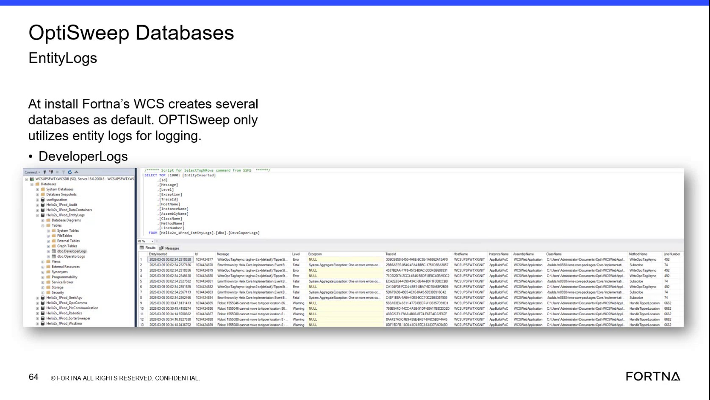
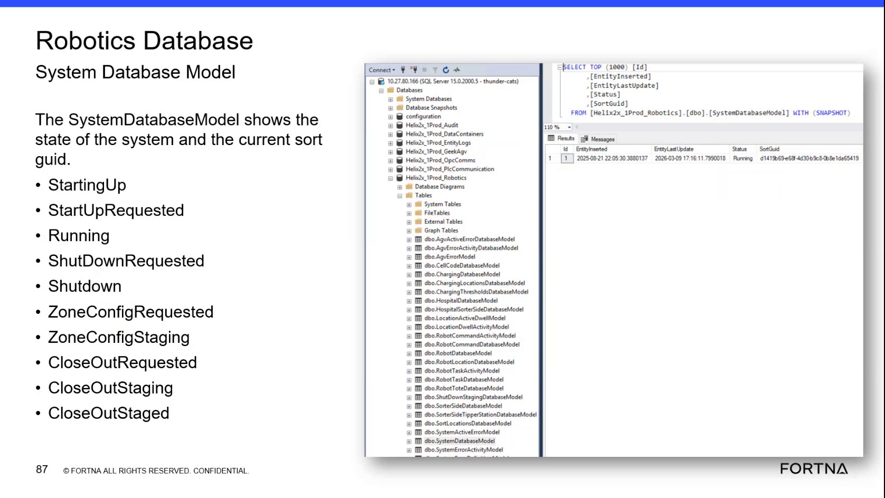
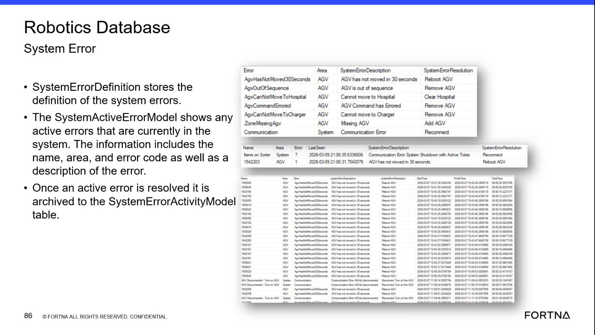

# Check Active Errors in the Robotics SystemActiveError Model

## Runbook Header

| Field | Value |
| --- | --- |
| Procedure ID | `proc_check_active_errors_robotics_systemactiveerrormodel_v1` |
| Title | Check Active Errors in the Robotics SystemActiveError Model |
| Procedure Type | `diagnostic` |
| Primary Role | `L2_support` |
| Supporting Roles | None |
| Support Safe | Yes |
| Capability Tags | `agv_active_errors` |
| Access Surface | `wcs_sql` |
| Audience Roles | `L2_support`, `L3_support` |
| Failure Pattern Tags | `system_fault` |
| Validation Status | `needs_sme_review` |
| Merge Status | `source_finalized` |

## Summary

Use the WCS / Helix DB (SSMS) read-only view of the Robotics Database SystemActiveErrorModel to determine whether system errors are currently active and capture the available identifying fields, including Name, Area, Error or area code, SystemErrorDescription, and Last Seen.

## When To Use

Use this diagnostic when troubleshooting a reported system or AGV-related condition and a read-only confirmation of currently active system errors is needed in the WCS / Helix DB (SSMS).

## Do Not Use For

* Do not use this procedure as a recovery or resolution procedure.
* Do not use the presence of an active row as evidence that the documented resolution has been completed.
* Do not use this procedure to interpret historical errors as currently active; resolved system errors are archived to the SystemErrorActivityModel.

## Safety And Operational Notes

* This is a read-only diagnostic check in the WCS / Helix DB (SSMS).
* Do not modify database rows or treat displayed resolution text as confirmation that corrective action has been performed.

## Access Or Tools Needed

* WCS / Helix DB (SSMS)
* Robotics Database
* SystemActiveErrorModel

## Related Operational Context

* ctx_training_video_system_active_error_model_v1

## Visual References

*WCS / Helix DB (SSMS) database overview showing the Robotics database among the OptiSweep databases.*

*WCS / Helix DB (SSMS) Robotics database table list showing dbo.SystemActiveErrorModel.*

*WCS / Helix DB (SSMS) SystemActiveErrorModel view showing active rows and fields including Name, Area, Error, Last Seen, and SystemErrorDescription.*

## Procedure Steps

### Step 1 — Open the Robotics Database in SSMS

**Responsible role:** L2_support

**Instruction:**
In the WCS / Helix DB (SSMS), select the Robotics Database. Use the database and table list to locate the Robotics database and its dbo.SystemActiveErrorModel table.

**Expected result:**
The Robotics database is available in SSMS and dbo.SystemActiveErrorModel can be located in its table list.

**Stop or Escalate If:**

* The Robotics database is unavailable.
* The SystemActiveErrorModel cannot be located or accessed.

---

### Step 2 — Inspect current SystemActiveErrorModel rows

**Responsible role:** L2_support

**Instruction:**
In the WCS / Helix DB (SSMS), open dbo.SystemActiveErrorModel and inspect the current rows. Review the Name, Area, Error or area code, Last Seen, and SystemErrorDescription fields.

**Expected result:**
The model displays zero or more current active-error rows with observable identifying fields and displayed Last Seen information.

**Stop or Escalate If:**

* The SystemActiveErrorModel cannot be opened.
* The displayed active state cannot be confirmed.
* A relevant row lacks Name, Area, Error or area code, SystemErrorDescription, or Last Seen information.

---

### Step 3 — Capture details for relevant active rows

**Responsible role:** L2_support

**Instruction:**
For each relevant row in the WCS / Helix DB (SSMS), capture the Name, Area, Error or area code, SystemErrorDescription, and Last Seen value. Compare examples such as AGV has not moved in 30 seconds or Communication Error with the reported condition.

**Expected result:**
Each relevant active row has a captured name, area, error or area code, description, and Last Seen value, or the model shows no current active row.

**Stop or Escalate If:**

* The reported fault is not represented in the active-error model.
* No current active row is present when one is expected.
* The displayed fields are incomplete.
* The active state cannot be confirmed.

---

### Step 4 — Stop when the active-error check is inconclusive

**Responsible role:** L2_support

**Instruction:**
Stop the diagnostic and escalate to L3_support when no matching active row is present, a relevant row lacks identifying fields, or the active state cannot be confirmed. Do not treat an active row as evidence that the documented resolution has been completed.

**Expected result:**
The result is classified as either a confirmed observable active-error match, no current active row, or an inconclusive check requiring escalation.

**Stop or Escalate If:**

* No active row is present for an expected fault.
* The reported fault is not represented in the active-error model.
* A row lacks the identifying fields needed for comparison.
* The active state cannot be confirmed.

---

## Success Criteria

* The Robotics database and dbo.SystemActiveErrorModel are located in the WCS / Helix DB (SSMS).
* The current active-error rows are inspected without modifying database data.
* Each relevant row has Name, Area, Error or area code, SystemErrorDescription, and Last Seen captured, or the absence of a current row is explicitly recorded.
* The result is classified as a current active-error match, no current active row, or an inconclusive check requiring escalation.

## Failure Conditions

* The Robotics database or SystemActiveErrorModel cannot be accessed.
* The reported condition is not represented by a current active row.
* A relevant row has incomplete identifying fields.
* The active state cannot be confirmed.
* An active row is incorrectly interpreted as proof that resolution has been completed.

## Escalation Guidance

* Escalate to L3_support when the reported fault is not represented in the active-error model.
* Escalate when a relevant row lacks Name, Area, Error or area code, SystemErrorDescription, or Last Seen information.
* Escalate when the active state cannot be confirmed.
* Do not proceed from this diagnostic to a recovery action based solely on the presence of an active row.

## Missing Details / Known Gaps

* The source identifies the Robotics database and SystemActiveErrorModel but does not provide a complete live SSMS navigation path.
* The source does not provide a complete query or a defined destination or format for recording captured row details.
* The source uses both area code and Error terminology; the exact production column label and mapping should be confirmed by an SME.
* This runbook confirms active-error state only and does not define the corrective action for any displayed SystemErrorResolution.

## Source Lineage

- Candidate IDs: candidate_training_video_robotics_system_active_error_check
- Source ID: `training_video_day2`
- Source Type: `training_video`
