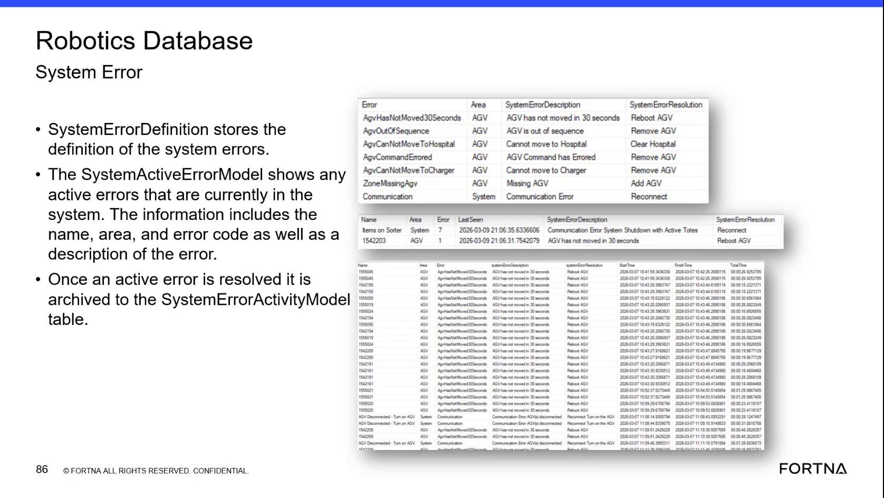

# Verify Resolved Errors in the Robotics SystemErrorActivityModel

## Runbook Header

| Field | Value |
| --- | --- |
| Procedure ID | `proc_verify_resolved_errors_robotics_systemerroractivitymodel_v1` |
| Title | Verify Resolved Errors in the Robotics SystemErrorActivityModel |
| Procedure Type | `diagnostic` |
| Primary Role | `L2_support` |
| Supporting Roles | None |
| Support Safe | Yes |
| Capability Tags | `agv_active_errors` |
| Access Surface | `wcs_sql` |
| Audience Roles | `L2_support`, `L3_support` |
| Failure Pattern Tags | None |
| Validation Status | `needs_sme_review` |
| Merge Status | `source_finalized` |

## Summary

Use read-only SSMS access to the Robotics Database to verify that a resolved active error appears as archived activity in the SystemErrorActivityModel. Inspect the SystemErrorDescription, SystemErrorResolution, Start Time, Finish Time, and duration fields.

## When To Use

Use this read-only WCS / Helix DB (SSMS) diagnostic when an active error is reported as resolved and support must verify that the error was archived in the Robotics Database SystemErrorActivityModel with recorded timing and resolution details.

## Do Not Use For

* Do not use this procedure to infer resolution success solely from the presence of a SystemErrorResolution value.
* Do not use this procedure as a recovery or error-clearing procedure; it only verifies archived error activity.

## Safety And Operational Notes

* This is a read-only diagnostic; no production control or error-clearing action is specified.

## Access Or Tools Needed

* WCS / Helix DB (SSMS)
* SSMS
* Robotics Database
* SystemErrorActivityModel

## Related Operational Context

* ctx_training_video_system_error_activity_model_v1

## Visual References

*Robotics Database System Error view showing SystemErrorActivityModel archived records with SystemErrorDescription, SystemErrorResolution, Start Time, Finish Time, and duration values.*

## Procedure Steps

### Step 1 — Open the Robotics Database in SSMS

**Responsible role:** L2_support

**Instruction:**
In WCS / Helix DB (SSMS), select the Robotics Database and open the database view used to inspect the SystemErrorActivityModel.

**Expected result:**
The Robotics Database is selected and the SystemErrorActivityModel is available for inspection.

**Stop or Escalate If:**

* Stop and escalate if the Robotics Database or SystemErrorActivityModel cannot be accessed.

---

### Step 2 — Locate the archived error record

**Responsible role:** L2_support

**Instruction:**
In the Robotics Database SystemErrorActivityModel on WCS / Helix DB (SSMS), locate the record using the error name or SystemErrorDescription.

**Expected result:**
A SystemErrorActivityModel row corresponding to the reported error is located.

**Stop or Escalate If:**

* Stop and escalate if an error reported as resolved has no corresponding archived SystemErrorActivityModel record.

---

### Step 3 — Inspect the archived error fields

**Responsible role:** L2_support

**Instruction:**
On the matching SystemErrorActivityModel row in WCS / Helix DB (SSMS), inspect SystemErrorDescription, SystemErrorResolution, Start Time, Finish Time, and duration.

**Expected result:**
The matching row displays values for SystemErrorDescription, SystemErrorResolution, Start Time, Finish Time, and duration.

**Stop or Escalate If:**

* Stop and escalate if Finish Time or duration is empty.
* Do not treat a populated SystemErrorResolution alone as proof that the error was resolved.

---

### Step 4 — Confirm completed archived timing

**Responsible role:** L2_support

**Instruction:**
In the SystemErrorActivityModel on WCS / Helix DB (SSMS), verify that the matching resolved error has both a Finish Time and a recorded duration in addition to its Start Time.

**Expected result:**
The resolved error has a populated Finish Time and duration in the SystemErrorActivityModel.

**Stop or Escalate If:**

* Escalate when an error reported as resolved has no archived SystemErrorActivityModel record.
* Escalate when the archived record lacks Finish Time or duration evidence.

---

## Success Criteria

* A corresponding archived row is present in the Robotics Database SystemErrorActivityModel.
* The row contains SystemErrorDescription and SystemErrorResolution.
* The row contains Start Time, Finish Time, and a recorded duration.
* Resolution is not accepted based only on the presence of SystemErrorResolution.

## Failure Conditions

* No corresponding archived SystemErrorActivityModel record is present.
* Finish Time or duration is empty.
* The record contains a SystemErrorResolution value but lacks completed timing evidence.

## Escalation Guidance

* Escalate to L3 support when an error reported as resolved has no archived SystemErrorActivityModel record.
* Escalate to L3 support when the archived record lacks Finish Time or duration evidence.
* Do not infer resolution success solely from a documented SystemErrorResolution value.

## Missing Details / Known Gaps

* The source does not provide SQL syntax, query examples, filtering syntax, or exact SSMS navigation beyond selecting the Robotics Database and inspecting the SystemErrorActivityModel.
* The source does not define a required retention period or unique identifier for matching an error record.

## Source Lineage

- Candidate IDs: candidate_training_video_robotics_system_error_activity_archive_check
- Source ID: `training_video_day2`
- Source Type: `training_video`
